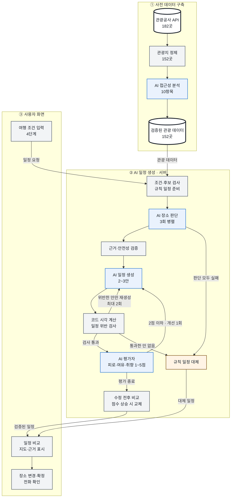

<div align="center">


# 이음길 AI

**휠체어, 어르신, 유모차와 함께 가는 영동 여행 루트 플래너**<br />
문장으로만 된 공공 무장애 정보를 AI가 읽고, 우리 가족 기준으로 판단해 성격이 다른 일정 2~3안으로 짜 줍니다.<br />
정한 일정은 **링크 하나로 함께 가는 사람과 나누고**, A4 한 장으로 뽑아 여행 당일까지 들고 갑니다.

[서비스 바로가기](https://ieumgil-ai.vercel.app) · [**예시 루트 바로 보기**](https://ieumgil-ai.vercel.app/trip/example) · [기획 문서](docs/planning.md) · [AI 설계](docs/ai-plan.md) · [디자인 시안](docs/design/README.md)

[](https://github.com/ieumgil/ieumgil-ai/actions/workflows/ci.yml)
[](https://ieumgil-ai.vercel.app)
[](https://github.com/ieumgil/ieumgil-ai/commits/main)


[](https://ai.google.dev/)
[](https://platform.openai.com/)
[](https://www.data.go.kr/data/15101897/openapi.do)
[](https://apis.map.kakao.com/)
[](https://supabase.com/)
[](https://ieumgil-ai.vercel.app)
<br />


| 관광지 | 필수 조건 위반 | 근거 없이 채운 값 | AI 읽기 일관성 | 자동 테스트 |
| :---: | :---: | :---: | :---: | :---: |
| **152곳**<br /><sub>강릉·속초·동해</sub> | **0건**<br /><sub>시나리오 10 + 유형 조합 14</sub> | **0건**<br /><sub>1,520항목</sub> | **96.4%**<br /><sub>두 번 읽어 비교</sub> | **CI 통과**<br /><sub>단위 229 · 화면 흐름 124</sub> |

</div>

> [!TIP]
> **입력 없이 결과부터 보려면** → [예시 루트](https://ieumgil-ai.vercel.app/trip/example)를 여세요. 실제 AI가 미리 만든 일정(휠체어 · 1박 2일 · 안 3개)이 AI를 부르지 않고 바로 열립니다. 장소 바꾸기 → 일정 확정 → 지도 → 출발 전 전화 확인 → **공유 링크 만들기 · 인쇄**까지 그대로 눌러 볼 수 있습니다.<br />
> 직접 만들려면 [서비스](https://ieumgil-ai.vercel.app)에서 조건 4단계를 고르면 됩니다(AI 일정 만들기는 보통 10~40초).

## 왜 만들었나요

강릉은 2022년 문화체육관광부가 선정한 **국내 첫 무장애 관광도시**입니다.<sup>[1](#참고-자료)</sup> 그런데 관광약자와 함께 여행을 준비하는 사람은 지금도 관광지마다 계단, 장애인 화장실, 주차, 걷는 거리를 따로 찾아보고, 이동 시간을 계산해서 직접 일정으로 엮어야 합니다.

공공 무장애 정보가 있긴 하지만 **"출입구까지 경사로가 설치되어 있음(완만함)" 같은 짧은 문장**으로만 있습니다. 기존 서비스는 이 문장을 그대로 보여주고, 갈 수 있는지 판단은 여행자에게 넘깁니다.

| 지금은 | 이음길에서는 |
| --- | --- |
| 관광지마다 접근성 정보를 따로 검색 | 유형을 고르면 꼭 필요한 조건이 자동으로 켜짐 |
| "경사로 있음" 같은 문장을 직접 해석 | AI가 문장을 읽고 **이 사람 기준으로** 적합 / 주의 / 확인 필요 / 부적합을 판단 |
| 정보가 없으면 가 봐야 앎 | 모르는 항목은 숨기지 않고 확인할 방법을 줌 — 엘리베이터·장애인 화장실·장애인 주차·출입구는 전화로 물어볼 질문과 공식 전화번호, 바닥·경사·쉴 곳은 "가서 보고 확인할 것" |
| 갈 수 있는 곳을 골라 직접 순서를 짬 | AI가 성격이 다른 일정 2~3안을 짜고, 코드가 시각·운영시간을 계산·검사 |
| 어디서 본 정보인지 알기 어려움 | 판단마다 근거가 된 관광공사 원문 항목을 표시 |
| 짠 일정을 캡처·메모로 가족에게 따로 전달 | **공유 링크 하나**로 함께 가는 사람이 로그인 없이 지도·일정·물어볼 것을 보고, 여행 당일에도 휴대폰으로 다시 엶 · **A4 한 장** 일정표로 인쇄 |

## 여행 준비부터 당일까지

루트를 한 번 만들고 끝나는 서비스가 아닙니다. 어디가 있는지 찾아보는 단계부터, 함께 가는 사람과 나누고 여행 당일 휴대폰으로 다시 여는 단계까지 이어집니다.

| 단계 | 하는 일 | 이음길이 돕는 것 |
| --- | --- | --- |
| 1. 찾아보기 | 영동에 어떤 곳이 있는지 | [관광지 둘러보기](#관광지-둘러보기): 지역·분야로 보고, AI 한 줄 소개와 우리 가족 기준 접근성 요약을 보고 담기 |
| 2. 조건 고르기 | 언제·누구와·꼭 필요한 조건·좋아하는 곳 | 4단계 선택형(자유 입력 없음). 유형을 고르면 꼭 필요한 조건이 자동으로 켜짐 |
| 3. 일정 받기 | 갈 수 있는 곳을 골라 순서 짜기 | AI가 장소마다 판단하고 성격이 다른 2~3안을 짬. 시각·운영시간은 코드가 계산·검사, 카카오 실제 이동시간 반영 |
| 4. 고치기 | 마음에 안 드는 곳 바꾸기 | [바꾸기] · [순서 고치기]·빼기 — AI를 다시 부르지 않고 그 자리에서 다시 계산 |
| 5. 확인하기 | 정보가 없는 곳 확인 | 전화로 물어볼 것(직원이 답할 수 있는 것만) + 공식 전화, [괜찮대요]/[어렵대요], 어려우면 바로 바꾸기 |
| 6. **함께 나누기** | 가족·동행에게 일정 보내기 | **공유 링크**: 로그인 없이 읽기 전용으로 지도·일정·물어볼 것. 이동시간은 열 때마다 카카오에서 새로 받음 |
| 7. **들고 가기 · 당일** | 출발 전·여행 중 다시 보기 | **A4 한 장 일정표**(시간표 + 전화 체크 칸) · 당일에는 공유 링크를 휴대폰으로 열어 다음 장소·지도·전화를 바로 |

<table>
<tr>
<th>공유 링크 만들기</th>
<th>받은 사람 화면(읽기 전용)</th>
<th>인쇄·PDF(A4 한 장)</th>
</tr>
<tr>
<td align="center"></td>
<td align="center"></td>
<td align="center"></td>
</tr>
</table>

- **링크에는 고른 일정만 저장합니다**: 장소·순서·머무는 시간·이유·물어볼 것. 이름·연락처·카카오 이동시간·경로는 저장하지 않고, 열 때마다 다시 계산합니다(카카오 결과 저장 금지 정책).
- **알아서 사라집니다**: 여행 마지막 날 + 7일(최대 30일)이 지나면 매일 새벽 자동으로 지워집니다. 기간이 지난 링크를 열면 "공유 기간이 지났어요"라고 안내합니다.
- **받은 사람은 읽기만**: 다른 안 보기·바꾸기·공유 버튼이 없고, 검색 엔진에 올라가지 않습니다(noindex). 저장소는 브라우저 키로 접근할 수 없게 막았습니다(Supabase RLS).
- **종이로도**: 인쇄하면 화면 배치 대신 사진·지도를 뺀 A4 한 장 일정표가 나옵니다(1박 2일 기준 1장). 공유 링크로 연 화면에서 인쇄하면 링크 주소도 함께 적힙니다.

## 계획서 대비 구현 현황

[기획 문서](docs/planning.md)에 적은 계획을 항목마다 지금 상태와 확인할 곳으로 옮겼습니다. 상태는 완료 · 일부 · 예정 세 가지입니다.

**공고 의무 결과물**

| 계획 | 상태 | 확인할 곳 |
| --- | :---: | --- |
| 핵심 기능 1개 이상 작동 | 완료 | 조건 입력 → AI 장소 판단 → AI 일정 2~3안 → 장소 바꾸기 → 확정 일정 + 지도 → 전화 확인 · [배포 사이트](https://ieumgil-ai.vercel.app) |
| 실제 데이터로 시연 | 완료 | 관광공사 무장애 여행정보 API 182곳 → 관광지 152곳 · [데이터](#데이터) |
| 배포 URL + GitHub 공개 | 완료 | Vercel(11/11부터) · 이 저장소 |

**AI가 하는 4가지 일** ([AI 설계](docs/ai-plan.md))

| 계획 | 상태 | 확인할 곳 |
| --- | :---: | --- |
| ① 읽기: 관광공사 문장 → 접근성 10항목·운영시간·동선 (미리) | 완료 | 152곳 완료 · [`data/ai/read/`](data/ai/read/) · [`scripts/ai/read-places.ts`](scripts/ai/read-places.ts) |
| ② 판단: 이 사람에게 적합 / 주의 / 확인 필요 / 부적합 (3회) | 완료 | [`src/lib/ai/judge.ts`](src/lib/ai/judge.ts) · 안전 하한 [`guards.ts`](src/lib/ai/guards.ts) |
| ③ 계획: 성격이 다른 일정 2~3안 + 평가자 | 완료 | [`plan.ts`](src/lib/ai/plan.ts) · [`review.ts`](src/lib/ai/review.ts) · 전체 흐름 [`trip.ts`](src/lib/ai/trip.ts) |
| ④ 풀어주기: 도착 후 동선·출발 전 확인할 것 | 완료(방식 바꿈) | 도착 후 동선은 ① 읽기 결과를 장소 카드 [자세히]에, 출발 전 확인할 것(질문 + 전화)은 [체크리스트](src/components/trip/Checklist.tsx)로 · 요청할 때 다시 다듬는 AI 호출은 뺌(아래 바꾼 결정) |
| AI가 실패해도 시연이 멈추지 않음(규칙 일정) | 완료 | [`fallback.ts`](src/lib/engine/fallback.ts) · 가짜 LLM 테스트 |

**코드가 지키는 원칙** ([CLAUDE.md](CLAUDE.md) 절대 원칙)

| 계획 | 상태 | 확인할 곳 |
| --- | :---: | --- |
| LLM 답은 전부 JSON 스키마로 받고 코드가 검사 | 완료 | [`schemas.ts`](src/lib/ai/schemas.ts) · [`llm.ts`](src/lib/llm.ts) |
| 시각은 코드가 계산, 검사를 통과한 안만 화면에 | 완료 | [`timeline.ts`](src/lib/engine/timeline.ts) · [`check.ts`](src/lib/engine/check.ts) |
| '모름'은 숨기지 않고 질문 + 공식 전화 | 완료 | 빌드 검사 [`validate-places.ts`](scripts/validate-places.ts) |
| 카카오 길찾기 결과 저장 안 함 · 키는 서버에서만 | 완료 | [`api/route-line`](src/app/api/route-line/route.ts) · 테스트 |
| 개인정보 수집 없음 · 지도는 "일반 차량 경로"로만 | 완료 | 자유 입력 칸 없음 · 화면 안내 문구 |

**화면과 기능**

| 계획 | 상태 | 확인할 곳 |
| --- | :---: | --- |
| 시작 화면 + 예시 루트 바로 보기(심사용) | 완료 | [`/trip/example`](https://ieumgil-ai.vercel.app/trip/example) |
| 입력 4단계(언제·어디서 / 누구와 / 꼭 필요한 조건 / 좋아하는 곳) | 완료 | [사용 흐름](#사용-흐름) |
| 관광지 둘러보기(이름을 몰라도 지역·분야로 찾아 어떤 곳인지 보고 담기) | 완료 | [`/places`](src/app/places/PlacesBrowser.tsx) · AI 한 줄 소개 [`summary.json`](data/ai/summary.json) · 대표 관광지 [`featured.json`](data/featured.json) |
| 만드는 중 화면(실제 진행 기록 스트리밍) | 완료 | [`api/plan`](src/app/api/plan/route.ts) |
| 안 비교 → 날짜별 상세 · 여유/빠듯/부족 판정 · 근거 표시 | 완료 | [`src/components/trip/`](src/components/trip/) |
| 장소 바꾸기(AI 호출 없이 코드가 다시 계산·검사) | 완료 | [`edit.ts`](src/lib/trip/edit.ts) · 단위 6개 |
| 순서 바꾸기·빼기(지도를 보고 고치기) | 완료 | 날짜마다 [순서 고치기] → 위·아래로 옮기기 · 빼기 · [처음 일정으로], 코드가 다시 계산·검사 · [`edit.ts`](src/lib/trip/edit.ts) · 단위 5개 |
| 확정 일정 + 카카오 지도·경로선 | 완료 | [`final/`](src/app/trip/%5Bid%5D/final/) · 번호 카드 · 구간 화살표·이동시간 |
| 인쇄·PDF | 완료 | 화면 대신 A4 한 장 일정표(시간표 + 전화 체크 칸) · [`PrintSheet.tsx`](src/components/trip/PrintSheet.tsx) |
| 출발 전 확인할 것(질문 + 전화) 모음 | 완료 | 체크리스트(괜찮대요/어렵대요) |
| 어려운 곳 목록과 대안 | 완료 | 결과 화면 아래 "이번 조건으로 가기 어려운 곳": 꼭 가고 싶은 곳·대표 관광지·좋아하는 분야 중 빠진 곳을 이유(✕)와 함께, 같은 분야의 가까운 갈 만한 곳 하나 · [`hard.ts`](src/lib/trip/hard.ts) |
| 모바일·PC 반응형 | 완료 | 4단계 배치(휴대폰 · 태블릿 · PC · 넓은 PC) |
| 관광지 사진(공공누리, 출처 표시) | 완료 | [`photos.json`](data/photos.json) |
| 카카오 이동시간을 일정 시각에 반영 | 완료 | 일정을 만들 때 실제 이동시간으로 다시 검사·시간 맞춤, 화면은 열 때마다 받아 다시 계산(저장 안 함) · [`/api/legs`](src/app/api/legs/route.ts) · [`real-travel.ts`](src/lib/trip/real-travel.ts) |
| 공유 링크(읽기 전용, 기간 지나면 자동 폐기) | 완료 | 확정 일정의 [공유 링크 만들기] → `/s/{id}`(로그인 없이 읽기 전용, 지도 + 일정 + 물어볼 것). 고른 안만 Supabase에 저장(이동시간·개인정보 없음), 여행 끝 + 7일에 자동 삭제 · [`lib/share/`](src/lib/share/) · [SQL](supabase/migrations/20261114000000_trips.sql) |

**검증**

| 계획 | 상태 | 확인할 곳 |
| --- | :---: | --- |
| 엔진 시나리오 10개 · 필수 조건 위반 0건 | 완료 | [`tests/engine/scenarios.test.ts`](tests/engine/scenarios.test.ts) · [검증](#검증) |
| 가짜 LLM 가드 테스트 · 화면 흐름 테스트(CI) | 완료 | [`tests/ai/`](tests/ai/) · [`tests/e2e/`](tests/e2e/) · GitHub Actions |
| AI 읽기: 근거 없는 값 0건 · 반복 일치율 | 완료 | [`data/eval/`](data/eval/) |
| AI 판단 3회 일치율 · 모델 간 비교 | 완료 | [`data/eval/judge-v1.md`](data/eval/judge-v1.md) · [`scripts/ai/eval-judge.ts`](scripts/ai/eval-judge.ts) |

<details>
<summary><b>계획에서 바꾼 결정과 이유</b></summary>

| 처음 계획 | 바꾼 것 | 이유 |
| --- | --- | --- |
| '모름'은 모두 전화로 물어볼 질문 | 엘리베이터·화장실·장애인 주차·출입구·수유실·걷는 거리만 전화, 바닥·경사·쉴 곳은 "가서 보고 확인할 것" | 직원도 "노면 재질"에는 답하기 어렵고 도착하면 눈으로 보임. 질문이 장소마다 3~5개씩 쌓이면 아무도 전화하지 않음. 모름은 그대로 표시("공식 정보 없음: 노면") |
| 공유: 요약 이미지 저장·카톡 공유 | 읽기 전용 공유 링크 + A4 한 장 인쇄 (11/14) | 지도 이미지는 브라우저 보안으로 캡처가 막힐 수 있고, 이미지에는 이동시간을 굳혀 넣어야 해 카카오 저장 금지와 맞지 않음. 링크는 열 때마다 실제 이동시간·지도를 다시 받음. 종이로 들고 다니는 경우는 인쇄로 |
| 공유 테이블에 고른 안·다른 안·평가 점수까지 | 고른 안만(장소·순서·체류·이유·물어볼 것) (11/14) | 받은 사람에게 필요한 것만, 저장은 최소로. 서버가 정해진 칸 밖은 거절 |
| 어려운 곳의 대안 이유를 LLM이 붙임 | 대안은 코드가 고르고 이유는 ② 판단 이유를 그대로 | 요청할 때 AI 호출을 늘리지 않기로 한 결정(11/14)과 같음. 대안도 이미 판단한 후보에서 고르므로 이유가 이미 있음 |
| 강릉만 | 영동권(강릉·속초·동해) | 관광공사 API로 장소를 충분히 모을 수 있어 범위를 넓힘(신청서의 '영동권 확대'와 같은 방향) |
| 사람이 장소를 조사·판정 | AI가 공공데이터 문장을 읽고, 모르는 항목은 사용자에게 질문 + 전화번호로 안내 (11/10) | 노면·걷는 거리는 공공데이터에 거의 없어 사람이 152곳을 다 확인할 수 없음. 숨기지 않고 확인할 방법을 주는 쪽을 택함. 사람이 확인한 값은 등급 `human`으로 덮어쓸 수 있게 둠 |
| 이동시간 표를 카카오 다중 목적지로 미리 계산 | AI는 직선 추정 표로 짜고, 다 짠 안만 날짜마다 카카오 다중 경유지 1회로 실제 시간을 받아 다시 검사 (11/14) | 후보 20~30곳 전부를 짝지으면 호출이 너무 많음. 짠 안의 실제 동선만 재면 날짜마다 1회. 결과는 저장하지 않고 화면은 열 때 다시 받음(원칙 3) |
| 조건 바꿔 다시 만들기 | 장소별 [바꾸기] (11/10 시연 피드백) | 다시 만들면 AI를 처음부터 다시 불러 느림. 바꾸기는 AI 호출 없이 바로 |
| '가 글씨 크게' 버튼 | 휴대폰·브라우저 글자 크기 설정을 따름 (11/11 실사용 피드백) | 버튼보다 기기 설정을 쓰는 사람이 많음. 모든 글자를 rem 단위로 |
| 숙소 지역 하나 | 2박 3일은 밤마다 (11/12) | 첫날 강릉, 둘째 날 속초처럼 옮기는 여행이 있음 |
| AI 추가 질문 0~3개(입력 뒤 한 단계) | 빼기 (11/14) | 입력 4단계에서 유형·꼭 필요한 조건·걷는 거리·취향을 이미 선택형으로 받아 더 물을 것이 적고, 단계가 늘면 어르신 등 사용자에게 부담. 메인 기능(판단·일정·바꾸기·실제 이동시간)에 집중 |
| ④ 풀어주기를 요청할 때 AI로 한 번 더 | 미리 읽은 동선 + 체크리스트로 대신 (11/14) | 도착 후 동선은 ① 읽기에서 장소마다 이미 정리해 카드에 보여 주고, 출발 전 확인할 것(질문 + 공식 전화)은 체크리스트로 제공한다. 요청할 때 한 번 더 다듬는 AI 호출은 시간만 늘어 하지 않기로 함 |
| 모든 일정에 2~3안 | 2박 3일은 1안 + 장소마다 [바꾸기] (11/14) | 3일치를 2~3안으로 나누면 후보를 나눠 써서 안끼리 겹쳐 빠졌음. 영동권 2박 3일은 드물어 비교보다 1안을 제대로 짜는 쪽을 택함 |
| 역할: 강환일 = 백엔드(신청서) | 개발은 공지혁, 강환일은 관광지 조사·운영 | 실제 작업에 맞춤(주간보고에 기록) |

</details>

남은 일의 순서는 [구현 계획](docs/impl-plan.md)에 있습니다.

## 사용 흐름

**1. 조건 4단계** — 한 화면에 질문 하나. 유형을 고르면 꼭 필요한 조건이 자동으로 켜집니다.

| 시작 | 언제·어디서 | 누구와 | 꼭 필요한 조건 | 좋아하는 곳 |
| :---: | :---: | :---: | :---: | :---: |
|  |  |  |  |  |

**2. AI가 일정을 만들고, 고르고, 확정합니다**

조건: 휠체어 · 택시 · 1박 2일 · 강릉역 도착 · 숙소 강릉 · 바다·해변, 역사·문화 · 꼭 가고 싶은 곳 오죽헌<br />
→ 이 결과는 **AI 호출 5회 · 15초**에 일정 2가지가 나왔습니다(세 번째 안은 다른 안과 장소가 많이 겹쳐 코드가 뺐습니다).

| ① 만드는 중 | ② 일정 비교 | ③ 장소 카드 [자세히] |
| :---: | :---: | :---: |
|  |  |  |
| **④ 장소 바꾸기** | **⑤ 확정 일정 + 지도** | **⑥ 출발 전 전화 확인** |
|  |  |  |
| **⑦ 지도 번호 카드** | **⑧ 순서 고치기** | **⑨ 가기 어려운 곳과 대안** |
|  |  |  |

<details>
<summary>화면마다 자세한 설명</summary>

1. **만드는 중**: 진행률과 단계, AI가 살펴보는 장소, 진행 기록("장소 판단 3/3번째 끝", "B안: 운영시간을 넘는 곳이 있어 고치는 중")을 서버에서 받은 그대로 보여줍니다.
2. **일정 비교**: 성격이 다른 2~3안(여유롭게 / 좋아하는 곳 중심 / 확인할 것 적게)을 같은 줄에 맞춰 비교합니다(2박 3일은 하루하루 꼼꼼하게 1안) — 갈 곳 한 줄 요약("강릉 · 오죽헌 → 선교장 → 허난설헌 생가터 외 1곳"), 장소 수, 이동 시간, **전화로 확인할 곳 수**. 안을 누르면 그 일정으로 바로 내려가고, 고른 안·날짜의 **지도(일반 차량 경로선)**가 함께 바뀝니다.
3. **장소 카드**: 처음에는 핵심만 — **관광지 사진**(누르면 크게 보기: 여러 장 넘겨 보기, 편의시설 사진은 "편의시설 사진: 화장실"처럼 표시, 사진마다 출처), 도착 예상 시각, 판단(예: "✓ 적합 · 전화로 확인할 것 있음"), 공식 정보가 없는 항목("공식 정보 없음: 노면"), 한 줄 이유, 공식 전화. [자세히]를 누르면 AI 판단 이유, 도착하면(장애인 주차 → 출입구 → 화장실), 전화로 물어볼 것, 가서 보고 확인할 것(바닥·경사·쉴 곳), 근거(관광공사 원문 항목)가 펼쳐집니다.
4. **장소 바꾸기**: AI가 이미 판단해 둔 근처 장소(최대 3곳)로 바꿉니다. AI를 다시 부르지 않고 코드가 그 자리에서 시각과 운영시간을 다시 계산·검사하고, 걸리면 이유를 보여주고 바꾸지 않습니다. 원래 장소로 되돌릴 수 있습니다.
5. **확정 일정**: 정한 안 하나만 남기고 카카오 지도에 **번호 + 장소 이름**과 **일반 차량 경로선**을 그립니다. 구간마다 진행 방향 화살표와 이동시간("↘ 12분")을 붙이고, 번호를 누르면 사진·시각·판단이 담긴 작은 카드가 떠서 [일정에서 보기]로 그 장소로 내려갑니다(반대로 일정의 번호를 누르면 지도가 그 장소로 갑니다). 경로는 열 때마다 새로 받고 저장하지 않습니다. 인쇄·PDF로 저장할 수 있고, [공유 링크 만들기]로 함께 가는 사람에게 읽기 전용 링크를 보낼 수 있습니다(여행 끝나고 7일 뒤 자동 삭제).
6. **출발 전 전화 확인**: 날짜별로 장소마다 물어볼 것(엘리베이터·장애인 화장실·장애인 주차·출입구처럼 직원이 바로 답할 수 있는 것만, 같은 주제는 하나로)과 공식 전화를 모았습니다. 통화 뒤 **[괜찮대요] / [어렵대요]**를 누르면 진행률이 쌓이고, '어렵대요'면 그 자리에서 다른 곳으로 바꾸기를 권합니다. 모두 괜찮으면 "출발 준비 끝!"을 보여줍니다.
7. **지도 번호 카드**: 확정 일정 지도의 번호를 누르면 사진·도착 시각·판단이 담긴 작은 카드가 뜨고, [일정에서 보기]로 그 장소로 내려갑니다.
8. **순서 고치기**: 날짜마다 [순서 고치기]를 누르면 위·아래로 옮기거나 뺄 수 있습니다. AI를 부르지 않고 코드가 시각을 다시 계산·검사하며, 운영시간·하루 범위를 넘으면 고치지 않고 이유를 보여 줍니다. [처음 일정으로] 되돌릴 수 있습니다.
9. **가기 어려운 곳과 대안**: 꼭 가고 싶은 곳·대표 관광지·좋아하는 분야 중 이번 조건으로 빠진 곳을 이유(✕ 계단·휴무·AI 판단)와 함께 보여 주고, 같은 분야의 가까운 갈 만한 곳을 알려 줍니다(정보만).

</details>

**3. 함께 나누고, 들고 갑니다** — 확정 일정의 [공유 링크 만들기]와 [인쇄·PDF로 저장]. 화면은 [위](#여행-준비부터-당일까지)에 있습니다.

**4. PC에서도** — 창 너비에 따라 배치가 바로 바뀝니다: 휴대폰(한 칸) · 태블릿(768px~, 넓은 한 칸) · PC(1024px~, 두 칸) · 넓은 PC(1280px~, 안 비교 3칸)


| 시작(왼쪽 소개 + 실제 결과 화면 미리보기) | 확정 일정(왼쪽 지도 + 오른쪽 일정) |
| :---: | :---: |
|  |  |

#### 관광지 둘러보기

**`/places`** — 이름을 몰라도 강릉·속초·동해 탭과 분야로 둘러봅니다. 카드마다 사진, **어떤 곳인지 한 줄**(관광공사 소개를 AI가 정리, 원문에 없는 내용은 검사로 버림), 볼 거리, 고른 유형 기준 접근성 요약(✓ 가능 · ! 일부만 · ✕ 어려움 · ? 공식 정보 없음)이 나오고, [자세히 보기]에서 관광공사 소개 원문·운영시간·전화·접근성 10항목을 본 뒤 [담기]로 꼭 가고 싶은 곳에 넣습니다. 대표 관광지(기획 조사표 38곳)를 먼저 보여 줍니다. 4단계와 시작 화면에서 들어갑니다.


**누구나 쓸 수 있게**: 본문 16px 이상 · 터치 영역 44px 이상(자동 검사) · 글자 크기는 rem이라 휴대폰·브라우저 설정을 그대로 따름 · 상태를 색만이 아니라 기호(✓ ! ✕)와 글자로 함께 표시 · 안 고른 칸이 있으면 그 칸으로 데려가 잠깐 표시

## LLM이 어떻게 판단하고 추천하나요

**LLM이 읽고 · 판단하고 · 계획하고 · 평가하고, 코드는 계산과 검사를 강제합니다.** 공공데이터가 문장으로만 있어 코드로는 가능/불가를 가를 수 없기 때문에, 판단은 LLM이 맡습니다. 대신 LLM의 답은 전부 **정해진 JSON 형식**으로 받고, 코드가 근거·안전 기준·시간을 검사한 뒤에만 화면에 나갑니다.


<details>
<summary>자세한 흐름 보기(분기·다시 짜기·실패 대비)</summary>



<sub>파란 칸 = AI(LLM)가 하는 일 · 회색 칸 = 코드가 하는 계산·검사 · 굵은 테두리 = 데이터 · 주황 칸 = AI가 실패했을 때 대비(규칙 일정)</sub>

</details>

| 단계 | 누가 | 하는 일 | 코드가 지키는 것 |
| --- | --- | --- | --- |
| ① 읽기 (미리) | LLM | 관광공사 문장 → 접근성 10개 항목 값, 운영시간, 도착 후 동선 | 근거 id가 원문 문단에 있어야 함 · 없으면 '모름' + 질문 |
| 후보 거르기 | 코드 | 갈 수 없는 곳 제외, 점수(취향·꼭 가고 싶은 곳·거리)로 20곳 | 필수 조건이 원문상 '불가'면 제외 · 휴무 제외 |
| ② 판단 | LLM × 3 | "이 사람이 관광할 수 있나"를 장소 전체 근거로 판단 | 근거 검사 · 안전 하한 · 3회 일치로 확신도 |
| ③ 계획 | LLM | 성격이 다른 2~3안을 JSON으로 한 번에 | 체류 범위 맞춤 · 시각은 코드가 계산 · **꼭 가고 싶은 곳이 빠지면 위반**으로 다시 요청 · 검사 통과한 안만 노출 |
| 평가자 | LLM | 안마다 피로도·여유·취향 점수와 한 줄 의견 | 2점 이하면 개선 지시를 붙여 1회 다시 · 다시 짠 안도 같은 검사를 거치고 점수가 오를 때만 교체 |
| 대체 | 코드 | AI가 실패하면 규칙만으로 일정 1안 | 시연이 멈추지 않음 |
| 장소 바꾸기 | 코드 | ② 판단을 마친 후보 중 그 안에 없는 근처 장소를 골라 두고, 바꾸면 시각을 다시 계산 | 부적합·그날 휴무·중복 제외 · 운영시간·하루 범위를 넘으면 바꾸지 않음 |
| 순서 바꾸기·빼기 | 코드 | 같은 날 안에서 위·아래로 옮기거나 빼면 시각을 다시 계산 | 운영시간·하루 범위를 넘으면 고치지 않고 이유 표시 · 그날 남은 한 곳은 뺄 수 없음 · 다른 날로 옮기기는 없음 |
| 공유 링크 | 코드 | 고른 안만 서버가 검사해 저장, 열 때 시각을 다시 계산 | 정해진 칸·아는 장소·크기만 받음 · 이동시간·개인정보 저장 0 · 여행 끝 + 7일에 자동 삭제 |

**안전 하한** — LLM은 더 보수적으로만 바꿀 수 있습니다 ([`src/lib/ai/guards.ts`](src/lib/ai/guards.ts))
- 꼭 필요한 조건이 원문상 **불가** → 부적합 · **부분가능** → 최소 주의 · 걷는 거리가 알려져 있고 넘으면 부적합
- 휠체어는 **"들어갈 수 있다"는 원문**(진입)이 없으면 적합이 될 수 없음(확인 필요)
- 그 밖에 정보가 없는 항목은 판단을 막지 않고 **출발 전 확인 질문**으로 붙임
- LLM이 실패해 규칙만으로 판단할 때는 엄격하게: 꼭 필요한 조건 중 하나라도 '모름'이면 확인 필요

**요청 한 번에** LLM 호출 5~8회(판단 3 · 계획 1~3 · 평가 1~2), 보통 10~40초입니다. 모델은 **Gemini Flash-Lite를 먼저** 쓰고, Gemini가 붐비거나(503) 30초 넘게 답이 없으면 같은 요청을 **OpenAI GPT-6 Luna**에도 보내 먼저 온 답을 씁니다([`llm.ts`](src/lib/llm.ts)). 둘 다 안 되면 규칙 일정 1안이 나옵니다. 모델은 환경변수로 바꿀 수 있고, OpenAI에는 대화를 저장하지 않게 보냅니다(`store: false`). 이름·연락처는 받지도 보내지도 않습니다(자유 입력 칸 없음).

<details>
<summary>실제 응답 예: ③ 계획이 낸 A안(검사 통과)과 코드가 계산한 시각</summary>

[예시 루트](https://ieumgil-ai.vercel.app/trip/example)의 A안 첫날(휠체어 · 자가용 + 표지 · 1박 2일 · AI 호출 5회 · 14초)입니다. 이유·판단은 AI가, 시각은 코드가 계산했습니다.

```text
A안 "여유로운 강릉 여행" — 동선이 가깝고 편안하게 이동하며 여유롭게 둘러보는 일정입니다.
10:00 강릉역 출발 → 차량 약 11분
약 10:11~11:36 강릉 오죽헌·시립박물관 [적합 · 확신 높음]
    이유: 경사로와 엘리베이터가 있어 편리하게 관람할 수 있어 골랐어요.
    가서 볼 것: 바닥 — 모래·자갈·흙길이 보이면 포장길이나 데크로만 다니세요.
    근거: 관광공사 무장애 정보(접근로, 출입통로, 엘리베이터, 화장실, 주차)
→ 차량 약 5분
약 11:41~13:06 강릉자수박물관 [적합 · 확신 높음]
13:06~13:26 쉬는 시간 · 13:26~14:26 점심·휴식
→ 차량 약 11분
약 14:37~15:50 강릉시립미술관 교동 [적합 · 확신 높음]
    이유: 출입구에 경사로가 있어 진입하기 수월해요.
    전화로 물어볼 것: 엘리베이터가 있나요?  ☎ 공식 전화
AI 평가: 피로도 4 · 시간 여유 4 · 취향 4 — "이동 동선이 짧고 휠체어 이용에 편리한 박물관 중심이라 무리 없이 둘러보기 좋습니다."
```

</details>


## 유형별 조건

[기획 문서](docs/planning.md)의 조건표를 그대로 코드로 옮겼습니다([`src/lib/engine/conditions.ts`](src/lib/engine/conditions.ts)).

| 항목 | 휠체어 | 유모차 | 보행이 불편한 어르신 |
| --- | :---: | :---: | :---: |
| 계단·단차 없는 진입 | **필수** | 주의 | 주의 |
| 엘리베이터 (층이 있는 곳) | **필수** | **필수** | 선호 |
| 급한 경사 없음 | **필수** | 선호 | 주의 |
| 포장길·데크 노면 | **필수** | 선호 | 주의 |
| 장애인 화장실 | **필수** | — | 선호 |
| 수유실·기저귀 교환대 | — | 선호 | — |
| 장애인 전용 주차구역 | **필수**¹ | — | **필수**¹ |
| 주차장→입구, 관람 동선 거리 | — | — | **필수**² |
| 쉴 곳 (벤치·쉼터) | — | 선호 | 선호 |
| 휠체어·유모차 대여 | 선호 | 선호 | 선호 |

**필수**: 원문상 '불가'면 루트에서 뺍니다 · **선호**: 추천 순위에만 반영 · **주의**: 루트에 남기고 경고를 붙입니다<br />
¹ 자가용이고 장애인 사용 자동차 표지가 있을 때만 · ² 사용자가 고른 거리(100m / 300m / 500m) 이하


## 데이터

1차 출처는 **한국관광공사 무장애 여행정보 API**<sup>[2](#참고-자료)</sup>입니다. 강릉·속초·동해의 관광지·문화시설 182곳을 받아, 화장실·문화원·숙박형 리조트처럼 관광지가 아닌 곳을 빼고 **152곳**을 씁니다. 어떤 정보가 얼마나 있는지는 [공공데이터 조사](docs/data/tour-api-fields.md)에 정리했습니다.

| 지역 | 장소 | 무장애 문장 예 |
| --- | :---: | --- |
| 강릉 | 101곳 | "출입구까지 경사로가 설치되어 있음(완만함)" |
| 속초 | 30곳 | "장애인 주차장 있음(6대)", "엘리베이터 있음" |
| 동해 | 21곳 | "주출입구는 턱이 없어 휠체어 접근 가능함" |

- **AI가 모두 읽었어요**: 152곳 · 1,520항목. 근거 없이 채운 값은 코드가 '모름'으로 바꿉니다. 원문에 없는 항목은 '모름'(57%)으로 두고 질문을 붙였습니다. 노면·걷는 거리는 공공데이터에 거의 없어서 카드에 '출발 전 확인'으로 나옵니다.
- **관광지 한 줄 소개**: 152곳의 관광공사 소개(개요)를 AI가 "어떤 곳인지 한 문장 + 볼 거리"로 정리했습니다([`summary.json`](data/ai/summary.json), [`scripts/ai/summarize-places.ts`](scripts/ai/summarize-places.ts)). 근거는 그 장소 소개 문단만, 볼 거리는 원문에 있는 낱말만 남기고 원문과 동떨어진 문장은 버립니다(처음 152곳 중 21곳을 버리고 다시 받음).
- **모름은 숨기지 않아요**: '모름'에는 물어볼 질문이, 장소에는 공식 전화번호가 반드시 있어야 합니다. 빠지면 [검사 스크립트](scripts/validate-places.ts)가 빌드를 멈춥니다.
- **근거 원문을 함께 공개**: 장소마다 [근거 문서](data/docs/places/)(관광공사 원문 + 문단 id)와 [AI 읽기 결과](data/ai/read/)를 저장소에 둡니다.
- **사진**: 관광공사 API 사진(공공누리) **1,136장**을 장소별로 풍경·건물 / 편의시설(화장실·엘리베이터·주차장·경사로 등) / 기타(안내판·음식·광고)로 나눴습니다. 대표 사진은 풍경 사진만 쓰고, 화장실 같은 편의시설 사진은 대표가 되지 않게 코드가 막습니다([photos.ts](src/lib/places/photos.ts)). 152곳 중 **135곳**에 사진이 있습니다.
  - 제1유형(출처 표시만 하면 자르기 가능, 77곳): 작게 줄여 저장소에 둡니다(`public/photos/`).
  - 제3유형(변경 금지, 58곳): 저장하지 않고 관광공사 원본을 **자르지 않고 통째로** 보여 줍니다.
  - 모든 사진에 "사진: 한국관광공사 · 공공누리 제N유형"을 표시합니다. 분류는 Claude Code가 사진 모음을 보고 1차로 하고 사람이 확인했습니다([photos.json](data/photos.json)).


## 검증

사람이 정답을 다는 평가는 하지 않고, 자동으로 잴 수 있는 지표를 씁니다. AI 지표는 정확도가 아니라 **일관성과 안전 규칙 준수**입니다. 모든 커밋마다 GitHub Actions가 장소 데이터 검사, 테스트, 린트, 빌드, 화면 흐름 테스트를 실행합니다.

| 항목 | 목표 | 현재 |
| --- | --- | --- |
| 자동 테스트 | 모두 통과 | [](https://github.com/ieumgil/ieumgil-ai/actions/workflows/ci.yml) 단위 229개 · 화면 흐름(E2E) 59개 × 모바일·PC + 너비별 배치 6개 |
| 엔진 시나리오 10개 + 유형 조합 14개 | 필수 조건 위반 0건 | **0건** |
| AI 가드 (가짜 LLM 테스트 61개) | 근거 없는 판단 사용 0건 · 안전 하한보다 낙관 0건 · 검사를 통과하지 못한 안 노출 0건 · AI 실패 시 규칙 일정 | **모두 통과** |
| AI 읽기 근거 | 원문에 없는 근거로 채운 값 0건 | **0건** (152곳 · 1,520항목) |
| AI 읽기 일관성 | 같은 152곳을 두 번 읽었을 때 항목 일치율 | **96.4%** (프롬프트 예시 추가 전후 비교 · [`data/eval/`](data/eval/)) |
| 장소 바꾸기 | 부적합·이미 있는 곳으로 바꾸기 0건 · 검사에 걸리면 안 바꿈 · 시각은 코드 값 | **모두 통과** (단위 6개 + E2E) |
| 카카오 경로·이동시간 | 길찾기 결과 저장 0건(탭 보관 일정에도 없음) · 키는 서버에서만 · 영동권 밖 좌표 거부 | **모두 통과** (단위 6개 + E2E) |
| 공유 링크 | 저장 값에 이동시간·시각·개인정보 0건 · 정해진 칸 밖·모르는 장소 거절 · 키 없으면 '준비 중' · 받은 사람 화면은 만든 사람과 같은 장소·순서·시각 | **모두 통과** (단위 11개 + E2E) · 실제 Supabase로 만들기 → 열기 확인 |
| AI 판단 일관성 | 같은 후보를 3회 판단했을 때 셋 다 같은 비율 · 두 모델의 정반대 판단(적합 ↔ 부적합) | **85.7%** (Gemini, 6개 장면 119곳) · OpenAI 78.3% · 정반대 **0건**, 갈린 곳은 대부분 OpenAI가 더 보수적 ([판단 평가](data/eval/judge-v1.md)) |
| AI 판단 안전 규칙 | 원문에 없는 근거로 한 판단은 버림 · 안전 하한으로 보수적 조정 | 버림 0.3% · 하한 조정 4.5% (Gemini) — 코드가 막아 화면에 나가지 않음 |

<details>
<summary>엔진 시나리오 10개 (기획 문서 표 그대로, <a href="tests/engine/scenarios.test.ts">tests/engine/scenarios.test.ts</a>)</summary>

| # | 유형 | 이동수단 | 기간·상황 | 확인하는 것 |
| --- | --- | --- | --- | --- |
| 1 | 휠체어 | 자가용 + 표지 차량 | 당일 | 장애인 주차가 필수 조건으로 반영 |
| 2 | 휠체어 | 택시 | 당일 | 장애인 주차 조건이 꺼짐 |
| 3 | 고령자(300m) | 자가용 | 당일 | 관람 동선이 300m를 넘는 곳은 빠짐 |
| 4 | 유모차 | 택시 | 1박 2일 | 수유실 선호 점수, 날짜 배분, 같은 장소 중복 없음 |
| 5 | 휠체어 + 고령자 | 자가용 + 표지 차량 | 2박 3일 | 조건 합집합, 둘째 날 숙소 출발 |
| 6 | 휠체어 | 택시 | 1박 2일, 숙소 미정 | 숙소 위치를 가정하고 표시 |
| 7 | 고령자 + 유모차 | 자가용 | 반나절(4시간) | 개수 하한, 빠듯·부족 판정 |
| 8 | 휠체어 | 자가용 | 동절기 날짜 | 동절기 운영시간·휴무 반영 |
| 9 | 휠체어 | 택시 | 꼭 가고 싶은 곳이 불가 | 경고 후 제외 |
| 10 | 휠체어 + 유모차 | 택시 | 후보가 적은 지역 | 하루 상한 자동 축소 |

여기에 세 유형의 모든 조합 7가지 × 이동수단 2가지(택시, 자가용 + 표지 차량) = 14가지를 2박 3일로 돌려 필수 조건 위반이 0건인지 함께 검사합니다.

</details>

## 기술 스택

AI가 읽고 판단하고 계획하는 일, 공공데이터, 지도·길찾기, 저장·배포를 각각 맡은 기술과, 이 서비스에서 지킨 약속입니다.

| 기술 | 이 서비스에서 맡은 일 | 지킨 원칙 |
| --- | --- | --- |
| <br />`gemini-3.5-flash-lite` · `@google/genai` | ① 읽기(관광공사 문장 → 접근성 10항목·운영시간·도착 후 동선) · ② 판단(후보마다 3번 판단해 맞춰 봄) · ③ 일정 2~3안 · 점검 · 관광지 한 줄 소개 | 응답은 JSON 스키마로만 받고 코드가 검사(Ajv). 근거 id가 없거나 원문 밖이면 버림. 시각은 쓰지 않음(코드가 계산) |
| <br />Responses API(fetch) | Gemini가 붐비거나(503·429) 30초 넘게 늦으면 같은 요청을 보내 먼저 온 답을 씀 | 엄격 JSON 스키마, `store: false`(요청 내용 보관 안 함). 둘 다 실패하면 규칙 일정 1개로 시연이 멈추지 않음 |
| <br />KorWithService2 · 공공누리 사진 | 강릉·속초·동해 182곳 → 관광지 152곳의 무장애 정보·운영시간·전화·사진의 1차 출처 | 수집 스크립트에서만 호출(키는 서버에만). 빈칸은 '모름'으로 두고 지어내지 않음. 사진은 공공누리 유형대로 출처 표시 |
| <br />JavaScript SDK · 카카오모빌리티 길찾기 | 확정 일정 지도(번호·장소 이름·구간 화살표·이동시간), 실제 차량 이동시간, 경로선 | 길찾기 결과는 저장하지 않고 열 때마다 받음(탭에도 안 남김). "일반 차량 경로"로만 표시. REST 키는 서버에만, JS 키만 도메인 제한으로 브라우저에 |
| <br />Postgres · RLS | 공유 링크(읽기 전용, 확정 일정 + 지도): 고른 안을 저장하고 `/s/{id}`로 열기 | 고른 안의 장소·순서·체류·이유만 저장, 이동시간·경로·개인정보는 저장 안 함(서버가 스키마로 검사). RLS로 브라우저 키 접근 막음, 여행 끝 + 7일에 자동 삭제(pg_cron). 서버 키는 서버에만 |
|  | 배포(서버 함수에서 AI·카카오 호출, 진행 단계 스트리밍) | 키는 환경변수에만 |
|    | 화면과 서버(App Router, `/api/plan` 스트리밍 · `/api/legs` · `/api/route-line`) | TypeScript strict. AI·데이터 규칙은 `src/lib/`에 코드로 |
|  <br />Radix · lucide · Pretendard | 모바일 우선 화면, 디자인 토큰 | 본문 16px 이상 · 터치 44px 이상 · 상태는 색 + 기호(✓ ! ✕) + 글자 · rem 단위(기기 글자 크기 설정을 따름) |
|    | 단위 테스트(엔진 시나리오·가짜 LLM 가드) · 화면 흐름 테스트(모바일·PC) · 푸시마다 자동 검사 | 필수 조건 위반 0건, 근거 없는 판단은 버리는지 테스트로 고정 |

<details>
<summary>폴더 구조</summary>

```
src/app/            시작 · places/(관광지 둘러보기) · plan/(입력 4단계, making/ 만드는 중) · trip/[id]/(안 비교·상세·바꾸기·순서 고치기)
                    · trip/[id]/final/(확정 일정 + 지도 + 인쇄) · s/[id]/(공유 링크, 읽기 전용)
                    · api/plan/(전체 흐름 + 스트리밍) · api/legs/·api/route-line/(카카오 이동시간·경로선, 저장 안 함) · api/trips/(공유 저장)
src/lib/ai/         judge.ts(② 판단) · plan.ts(③ 일정 2~3안) · review.ts(평가자) · trip.ts(전체 흐름) · guards.ts(안전 하한·근거 검사) · schemas.ts
src/lib/engine/     conditions.ts · filter.ts · timeline.ts(시각 계산) · check.ts(일정 검사) · fallback.ts(규칙 일정) · travel.ts
src/lib/trip/       view.ts(결과 화면 값) · alternatives.ts(대체 후보) · edit.ts(바꾸기·순서·빼기 후 다시 계산) · hard.ts(어려운 곳과 대안)
                    · questions.ts(전화로 물을 것 / 가서 볼 것) · real-travel.ts(카카오 실제 이동시간, 메모리만) · store.ts(탭 보관) · example.ts(예시 루트)
src/lib/share/      doc.ts(공유할 값·검사·사라지는 날) · supabase.ts(서버 전용) · view.ts(열 때 화면 값으로)   ·   supabase/migrations/(테이블·RLS·자동 삭제 SQL)
src/lib/llm.ts      AI 호출을 한 곳에(Gemini → 붐비거나 늦으면 OpenAI, JSON 검사·형식 오류 재요청) · src/lib/kakao.ts(길찾기, 서버 전용)
src/components/     ui/(shadcn 기반 부품) · plan/(입력 단계) · trip/(장소 카드·안 고르기·바꾸기 창·체크리스트·공유 버튼·인쇄 일정표) · map/ · photos/
data/               places.json · evidence.json · photos.json(사진 분류) · featured.json(대표 관광지) · ai/summary.json(한 줄 소개)
                    · docs/places/(근거 원문) · ai/read/(AI 읽기 결과) · eval/(평가 자료)
scripts/            tour/(관광공사 API 수집·사진) · ai/(① 읽기·합치기·예시) · readme/(캡처·구조도) · dev/(연결 확인·시험) — 실행 순서는 scripts/README.md
tests/              단위 테스트(src와 같은 폴더 · 엔진·AI 가드, 가짜 LLM) · e2e/(화면 흐름 테스트, Playwright)
docs/               기획 문서, AI 설계, 구현 계획, 디자인 시안, 공공데이터 조사
```

</details>

## 실행 방법

Node.js 22 이상이 필요합니다.

```bash
git clone https://github.com/ieumgil/ieumgil-ai.git
cd ieumgil-ai
npm install
cp .env.example .env.local   # GEMINI_API_KEY(또는 OPENAI_API_KEY) = 일정 만들기 · 카카오 키 = 지도·길찾기 · SUPABASE_* = 공유 링크(선택)
npm run dev                  # http://localhost:3000
```

| 명령 | 하는 일 |
| --- | --- |
| `npm test` | 엔진·AI 가드 테스트(가짜 LLM, 키 필요 없음) |
| `npm run test:e2e` | 화면 흐름 테스트 (처음 한 번 `npx playwright install chromium`) |
| `npm run validate:places` | 장소 데이터 검사 |
| `npx tsx scripts/dev/try-trip.ts wheelchair --cat "바다·해변"` | 실제 AI로 규칙 일정 vs AI 일정 비교 출력 |
| `npm run build` | 데이터 검사 후 배포용 빌드 |
| `npm run readme:capture` · `npm run readme:architecture` | README 화면 캡처(개발 서버 켠 뒤, AI 호출 없음) · 구조도 다시 만들기 |
| `npm run data:build` → `data:read` → `data:merge` | 장소 데이터 다시 만들기(관광공사 API·Gemini 키 필요) — 순서와 나머지 스크립트는 [scripts/README.md](scripts/README.md) |


## 한계와 안내

- 일정의 이동 시간은 **카카오 일반 차량 길찾기 값**입니다. 열 때마다 새로 받고 저장하지 않으며, 받지 못한 구간만 직선거리 추정치로 계산해 '추정'을 붙입니다. AI가 일정을 짤 때 보는 이동시간 표는 직선거리 추정이고, 다 짠 뒤 실제 시간으로 다시 검사합니다. 지도 경로선은 카카오 일반 차량 경로이며 휠체어 안전 경로를 보장하지 않습니다.
- AI 일정 만들기는 보통 10~40초입니다. Gemini만 쓰던 때는 서버가 붐비면(503·응답 지연) 3분 넘게 걸린 적이 있어(11/12), 지금은 붐비거나 늦으면 OpenAI로 넘기고, 전체 90초 한도 안에 반드시 결과를 보여 줍니다(시간이 모자라면 점검 단계를 건너뜀). 40초가 넘으면 화면에 '늦어요' 안내가 나옵니다(11/14). 기다리기 어려우면 [예시 루트](https://ieumgil-ai.vercel.app/trip/example)로 결과를 바로 볼 수 있습니다.
- 장소 바꾸기 후보는 이번에 AI가 판단한 장소(최대 20곳) 안에서만 고릅니다. 그래서 같은 후보가 여러 장소에 나올 수 있습니다.
- 접근성 정보는 한국관광공사 자료를 AI가 정리한 것으로 현장과 다를 수 있습니다. 출발 전 공식 전화로 확인해 주세요.
- 관광지 사진은 관광공사가 등록한 사진이라 지금 모습과 다를 수 있습니다. 제3유형 사진은 원본을 불러와 휴대폰에서 조금 늦게 뜰 수 있습니다.
- 공유 링크는 로그인 없이 열리므로 링크를 아는 사람은 누구나 볼 수 있습니다. 저장된 일정에는 이름·연락처가 없고, 여행이 끝나고 7일 뒤 자동으로 지워집니다.
- 음식점·카페·숙소는 추천하지 않습니다. 숙소는 지역만 받아(2박 3일은 밤마다) 다음 날 출발점으로 씁니다.

## 팀 이음길

| 이름 | 역할 |
| --- | --- |
| 공지혁 | 기획, 화면·서버·데이터·AI 개발, 배포, 문서 |
| 강환일 | 관광지 조사(조사표 32곳), 주간보고 |

2026 My AI 랩(강릉과학산업진흥원) 과제입니다. 개발 과정은 [커밋 기록](https://github.com/ieumgil/ieumgil-ai/commits/main)과 [구현 계획](docs/impl-plan.md)에서 볼 수 있습니다.

## 참고 자료

1. 문화체육관광부 보도자료, [첫 번째 '무장애 관광도시'로 강릉시 선정](https://www.mcst.go.kr/kor/s_notice/press/pressView.jsp?pSeq=19453) (2022.4.8.)
2. 공공데이터포털, [한국관광공사 무장애 여행정보 API](https://www.data.go.kr/data/15101897/openapi.do)
