<div align="center">

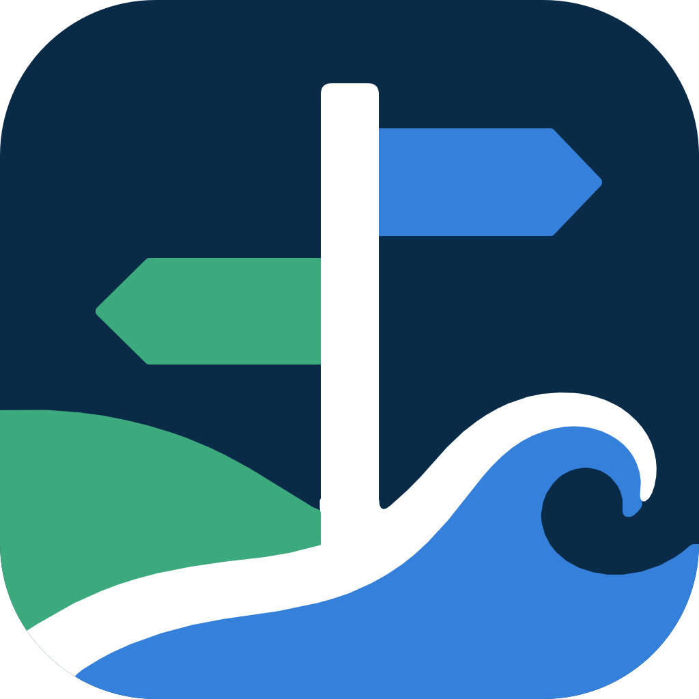

# 이음길 AI

**휠체어, 어르신, 유모차와 함께 가는 강릉·속초·동해 여행 일정**

함께 가는 사람과 꼭 필요한 조건을 고르면, AI가 한국관광공사 무장애 정보 문장을 읽고 장소마다 **이 사람 기준으로** 갈 수 있는지 판단해 성격이 다른 일정 2\~3개를 짭니다. 공식 정보가 없는 항목은 숨기지 않고, 출발 전에 전화로 물어볼 질문과 공식 전화번호를 붙입니다.

### [▶ 예시 일정 바로 보기](https://ieumgil-ai.vercel.app/trip/example) · [직접 만들어 보기](https://ieumgil-ai.vercel.app)

<sub>예시 일정: 휠체어 · 자가용(장애인 표지) · 강릉 1박 2일 · 꼭 가고 싶은 곳 오죽헌. 실제 AI가 미리 만든 일정 3개가 입력 없이 바로 열립니다(AI 호출 5회, 12초).</sub>

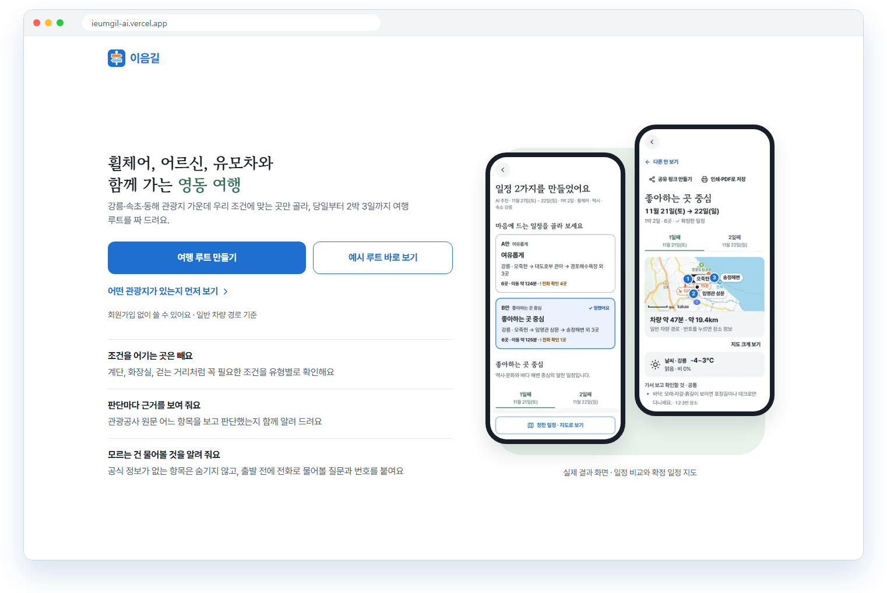

| 관광지 | 근거 없이 채운 값 | 필수 조건 위반 | AI 판단 3회 일치 | 웹 접근성 |
| :---: | :---: | :---: | :---: | :---: |
| **152곳**<br /><sub>강릉·속초·동해 · [원문](data/docs/places/) · [AI 읽기](data/ai/read/)</sub> | **0건**<br /><sub>AI 읽기 1,520항목</sub> | **0건**<br /><sub>규칙 엔진 24가지 조건(시험용 가짜 장소) · AI 가드 테스트 78개</sub> | **85.7%**<br /><sub>Gemini · 6개 장면 119곳 · [평가](data/eval/judge-v1.md)</sub> | **위반 0건**<br /><sub>axe WCAG 2.2 A·AA(글자 대비 제외)</sub> |

[](https://github.com/ieumgil/ieumgil-ai/actions/workflows/ci.yml) 단위 테스트 673개 · 화면 흐름 테스트 500개 · 2026 My AI 랩(강릉과학산업진흥원)

[](https://ai.google.dev/) [](https://platform.openai.com/) [](https://www.data.go.kr/data/15101897/openapi.do) [](https://www.data.go.kr/data/15012892/standard.do) [](https://www.data.go.kr/data/15084084/openapi.do) [](https://apis.map.kakao.com/)

</div>

**목차** · [왜 만들었나요](#왜-만들었나요) · [예시 일정으로 둘러보기](#예시-일정으로-둘러보기) · [오죽헌 한 곳 따라가기](#오죽헌-한-곳-따라가기) · [AI는 어떻게 판단하나요](#ai는-어떻게-판단하나요) · [데이터](#데이터) · [검증](#검증) · [계획서 대비 구현 현황](#계획서-대비-구현-현황) · [지속 가능성](#지속-가능성) · [화면 더 보기](#화면-더-보기) · [기술 스택](#기술-스택) · [실행 방법](#실행-방법) · [이용 안내](#이용-안내) · [팀 이음길](#팀-이음길) · [라이선스](#라이선스) · [참고 자료](#참고-자료)

## 왜 만들었나요

강릉은 2022년 문화체육관광부가 선정한 **국내 첫 무장애 관광도시**입니다.<sup>[1](#참고-자료)</sup> 그런데 관광약자와 함께 여행을 준비하는 사람은 지금도 관광지마다 계단, 장애인 화장실, 주차, 걷는 거리를 따로 찾아보고 이동 시간을 계산해 일정을 직접 엮습니다. 공공 무장애 정보는 **"출입구까지 경사로가 설치되어 있음(완만함)" 같은 짧은 문장**뿐입니다. 기존 서비스는 이 문장을 그대로 보여 줄 뿐, 갈 수 있는지는 여행자가 판단해야 합니다.

| 지금은 | 이음길에서는 |
| --- | --- |
| "경사로 있음" 같은 문장을 직접 해석 | AI가 문장을 읽고 **이 사람 기준으로** 적합 / 주의 / 확인 필요 / 부적합을 판단하고, 고른 이유 한 줄과 출처를 표시(근거가 원문에 없는 판단은 코드가 버림) |
| 갈 수 있는 곳을 골라 직접 순서를 짬 | AI가 성격이 다른 일정 2\~3개를 짜고, 코드가 시각·운영시간을 계산·검사 |
| 정보가 없으면 가 봐야 앎 | 모르는 항목은 숨기지 않고 확인할 방법을 줌: 엘리베이터·장애인 화장실·주차·출입구는 **전화로 물어볼 질문 + 공식 전화**, 바닥·경사·쉴 곳은 **가서 보고 확인할 것** |
| 짠 일정을 캡처·메모로 따로 전달 | **공유 링크 하나**로 함께 가는 사람이 로그인 없이 보고, 여행 당일에도 휴대폰으로 다시 엶 · **A4 한 장** 일정표로 인쇄 |

## 예시 일정으로 둘러보기

[예시 일정](https://ieumgil-ai.vercel.app/trip/example)은 실제 AI가 미리 만든 결과라 입력하거나 기다리지 않고 바로 열립니다. 아래 그림은 모두 이 예시 일정 화면입니다. 조건은 휠체어, 자가용(장애인 표지), 12월 19\~20일 1박 2일, 강릉역 도착, 좋아하는 곳 바다·해변과 역사·문화와 전시·박물관, 꼭 가고 싶은 곳 오죽헌입니다. AI를 5번 불러 12초 만에 성격이 다른 일정 3개가 나왔습니다.

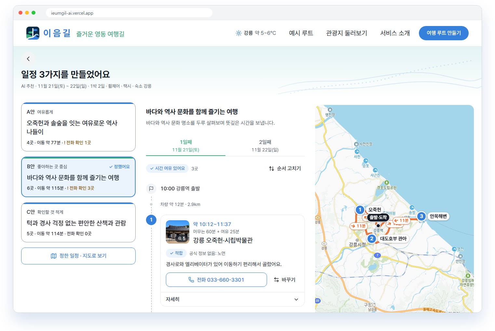

<table>
<tr><th width="33%">① 일정 3개 비교</th><th width="33%">② 장소마다 판단과 근거</th><th width="33%">③ 출발 전 전화로 확인</th></tr>
<tr><td align="center" valign="top">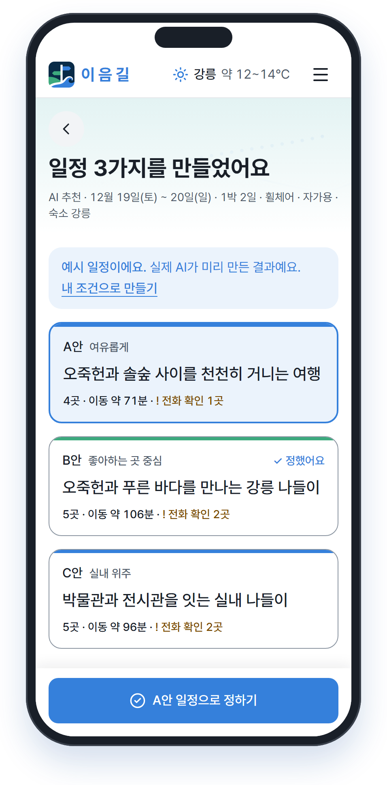</td><td align="center" valign="top">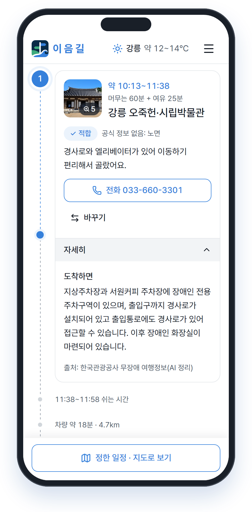</td><td align="center" valign="top">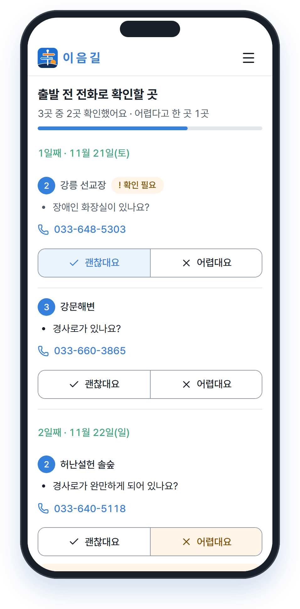</td></tr>
<tr><td valign="top">안마다 제목에 실제 장소가 드러나고, 장소 수 · 이동 시간 · 전화로 확인할 곳 수를 나란히 봅니다.</td><td valign="top">판단(✓ 적합 · ! 주의 · ✕ 부적합 · ? 확인 필요)과 한 줄 이유, 공식 정보가 없는 항목('공식 정보 없음: 노면'), 공식 전화를 먼저 보여 줍니다. [자세히]를 펼치면 도착한 뒤 동선과 출처가 나옵니다.</td><td valign="top">공식 정보가 없는 항목에는 물어볼 질문과 공식 전화번호가 붙습니다. '어렵대요'를 누르면 근처의 다른 곳으로 바꾸기를 권합니다.</td></tr>
</table>

확정한 일정 화면에는 카카오 지도 위에 장소 번호와 일반 차량 경로선, 구간마다 이동 시간이 그려지고, 날짜마다 기상청 예보가 나옵니다. 경로와 날씨는 열 때마다 새로 받고 저장하지 않습니다.

<table>
<tr><th width="34%">휴대폰</th><th>PC</th></tr>
<tr>
<td align="center" valign="top">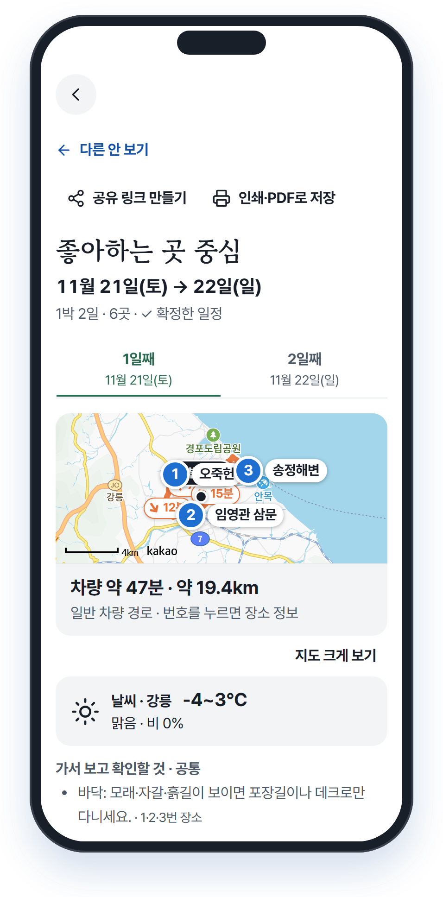</td>
<td align="center" valign="top">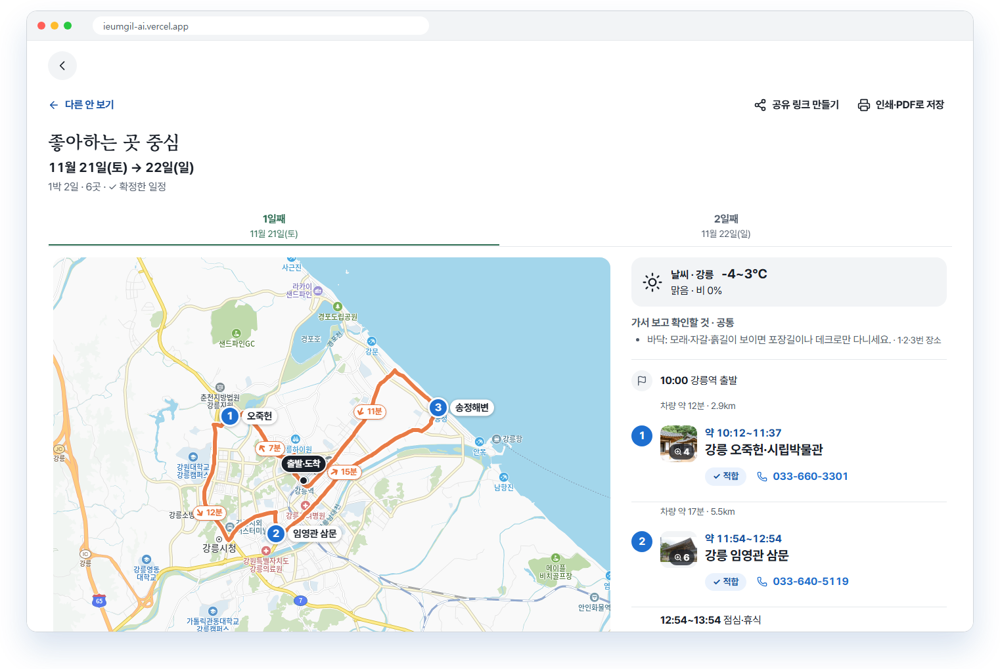</td>
</tr>
</table>

### 함께 나누기 · 들고 가기

<table>
<tr>
<th>공유 링크 만들기</th>
<th>받은 사람 화면(읽기 전용)</th>
<th>인쇄·PDF(A4 한 장)</th>
</tr>
<tr>
<td align="center">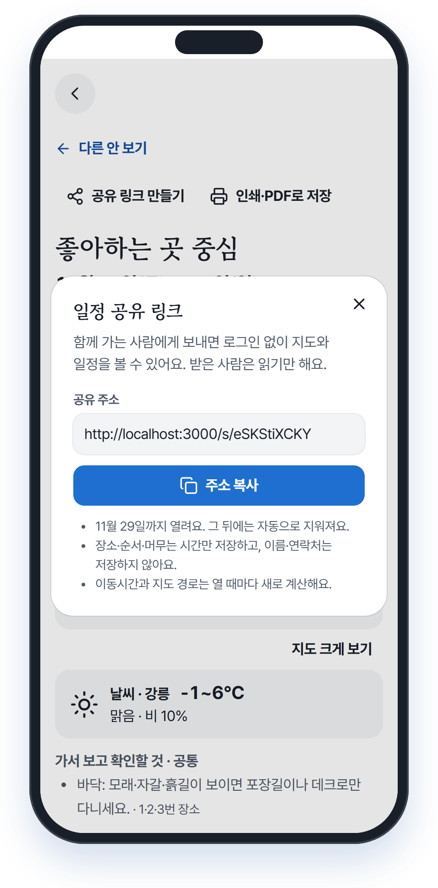</td>
<td align="center">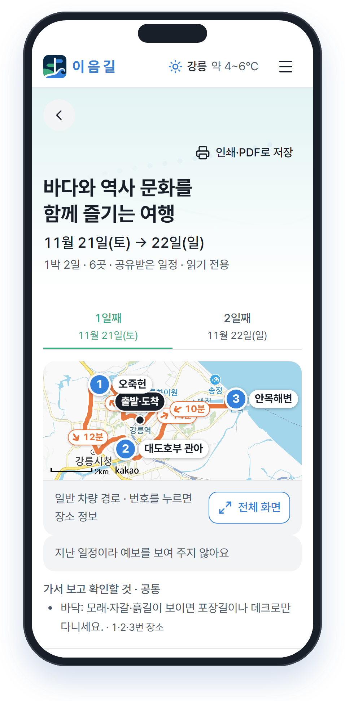</td>
<td align="center">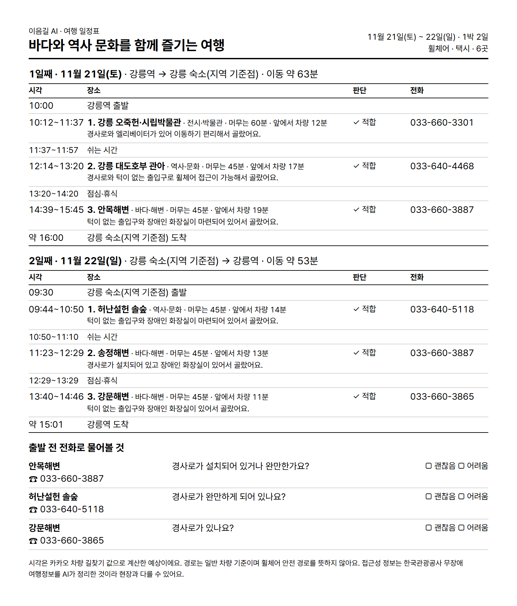</td>
</tr>
</table>

- **저장 범위**: 확정한 안의 장소 · 순서 · 체류 시간 · 선정 이유 · 확인 질문만 저장한다. 이름·연락처는 받지 않으며, 카카오 이동시간·경로와 기상청 예보는 열람 시점에 다시 조회한다.
- **자동 삭제**: 여행 종료일 + 7일(생성일 기준 최대 30일)이 지나면 `pg_cron` 작업이 삭제한다. 만료된 링크는 삭제 안내 화면으로 연결한다.
- **읽기 전용 열람**: 공유 화면에는 편집·재공유 기능이 없고 검색 엔진 수집을 막는다(`noindex`). 테이블은 RLS로 브라우저 키 접근을 차단하고 서버 키로만 읽고 쓴다.
- **인쇄**: 인쇄 시 사진·지도를 제외한 A4 일정표로 출력한다(1박 2일 기준 1장).

시작 화면의 **'누구와 함께 가세요?' 카드 3장**(휠체어·강릉 / 어르신·속초 / 유모차·동해)도 미리 만든 루트를 하나씩 바로 엽니다. 직접 만들려면 [서비스](https://ieumgil-ai.vercel.app)에서 조건 4단계를 고르면 됩니다. AI가 일정을 만드는 데 보통 10\~40초 걸립니다.

## 오죽헌 한 곳 따라가기

예시 일정의 첫 장소 <b>강릉 오죽헌·시립박물관(GN12)</b>이 공공데이터 원문에서 화면까지 어떻게 이어지는지 저장소 파일로 직접 확인할 수 있습니다.

<table>
<tr><th width="16%">단계</th><th width="26%">파일</th><th>오죽헌에서 실제로 나온 값</th></tr>
<tr><td valign="top">① 원문<br /><sub>관광공사</sub></td><td valign="top"><a href="data/docs/places/GN12.md"><code>data/docs/places/GN12.md</code></a></td><td valign="top"><code>route-1</code> "출입구까지 경사로가 설치되어 있음" · <code>exit-1</code> "경사로 있음" · <code>elevator-1</code> "엘리베이터 있음" · <code>restroom-1</code> "장애인 화장실 있음" · <code>parking-1</code> 지상주차장 4대 · 서원커피 주차장 2대. 노면에 대한 문장은 없음</td></tr>
<tr><td valign="top">② 읽기(미리)<br /><sub>AI</sub></td><td valign="top"><a href="data/ai/read/GN12.json"><code>data/ai/read/GN12.json</code></a></td><td valign="top">진입 · 엘리베이터 · 장애인 화장실 · 장애인 주차 '가능'(값마다 근거 문단 id). 노면은 '모름' + 질문 "노면 포장 상태나 재질은 어떻게 되나요?"</td></tr>
<tr><td valign="top">③ 판단<br /><sub>AI × 3</sub></td><td valign="top"><a href="src/lib/trip/example-trip.json"><code>example-trip.json</code></a>의 <code>judgments.GN12</code></td><td valign="top"><b>적합 · 확신 높음</b>(3번 모두 같은 판단). 근거 <code>route-1</code> · <code>exit-1</code> · <code>elevator-1</code> · <code>restroom-1</code> · <code>parking-1</code></td></tr>
<tr><td valign="top">④ 검사<br /><sub>코드</sub></td><td valign="top"><a href="src/lib/ai/guards.ts"><code>guards.ts</code></a></td><td valign="top">근거 id가 원문 문단에 있는지, 필수 조건이 '불가'·'부분가능'인지, 휠체어 진입 문장이 있는지 확인. 오죽헌은 진입 문장(<code>route-1</code>)이 있고 '불가'·'부분가능'이 없어 적합을 유지하고, 노면 '모름'은 출발 전 확인할 것으로 붙음</td></tr>
<tr><td valign="top">⑤ 계획 · 시각<br /><sub>AI · 코드</sub></td><td valign="top">같은 파일의 A안 · <a href="src/lib/engine/timeline.ts"><code>timeline.ts</code></a></td><td valign="top">AI가 쓴 이유: "꼭 가고 싶어 하신 곳으로 경사로가 잘 되어 있어서 편하게 관람할 수 있어요." · 머무는 시간 60분 + 여유 25분 · 도착·출발 시각은 코드가 계산</td></tr>
<tr><td valign="top">⑥ 화면</td><td valign="top">아래 그림 · <a href="https://ieumgil-ai.vercel.app/trip/example">예시 일정</a></td><td valign="top">✓ 적합 칩 · '공식 정보 없음: 노면' · 공식 전화 · [자세히]의 도착 후 동선(주차 → 경사로 → 화장실)과 출처</td></tr>
</table>


- **AI가 쓰지 않는 것**: 시각은 코드가 계산하고, 이동 시간은 카카오, 날씨는 기상청 값을 씁니다(날씨 문구는 코드에 고정). 예시 일정에 저장된 시각은 직선거리로 추정한 값이고, 화면을 열 때 카카오 실제 이동 시간으로 다시 계산합니다.
- **확인할 수 없는 것**: AI가 낸 판단 원본(코드 검사 전)과 코드가 판단을 바꾼 기록은 저장하지 않습니다. 코드가 무엇을 막는지는 [`guards.ts`](src/lib/ai/guards.ts)와 가짜 AI로 돌리는 [가드 테스트](tests/ai/)로 확인할 수 있습니다.
- **해석이 들어간 값**: 경사 '가능'은 "경사로 있음"이라는 문장을 보고 AI가 판단한 값입니다. 급한 경사가 없다고 확인한 것은 아니어서, 바닥·경사는 현장에서 보고 확인할 것으로 안내합니다.

<br clear="right" />

## AI는 어떻게 판단하나요

**AI(LLM)는 읽고 판단하고 계획하고 평가합니다. 계산과 검사는 코드가 맡습니다.** 공공데이터가 문장으로만 있어 코드로는 갈 수 있는지 가를 수 없기 때문에, 판단은 AI에게 맡겼습니다. 대신 AI의 답은 모두 **정해진 JSON 형식**으로 받고, 코드가 근거·안전 기준·시간을 검사한 뒤에만 화면에 내보냅니다.

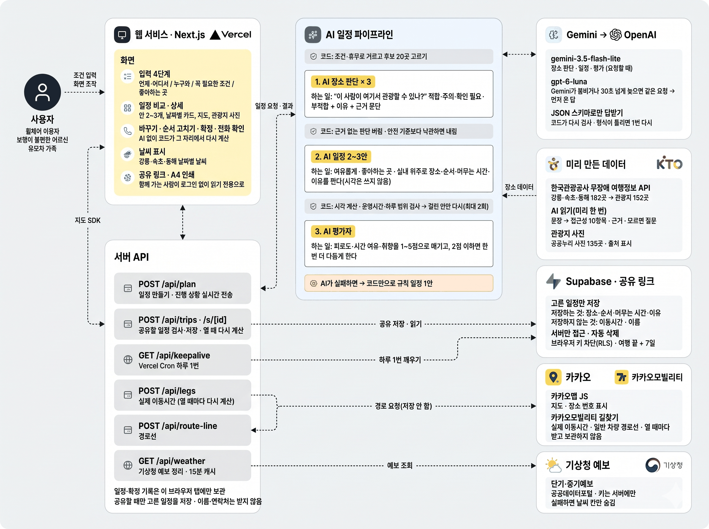

<table>
<tr><th width="18%">단계</th><th width="41%">하는 일</th><th>코드가 지키는 것</th></tr>
<tr><td valign="top">① 읽기(미리)<br /><sub>LLM</sub></td><td valign="top">관광공사 문장 → 접근성 10개 항목 값, 운영시간, 도착 후 동선</td><td valign="top">근거 id가 원문 문단에 있어야 함 · 없으면 '모름' + 질문</td></tr>
<tr><td valign="top">후보 거르기<br /><sub>코드</sub></td><td valign="top">갈 수 없는 곳 제외, 점수(취향·꼭 가고 싶은 곳·거리)로 20곳</td><td valign="top">필수 조건이 원문상 '불가'면 제외 · 휴무 제외</td></tr>
<tr><td valign="top">② 판단<br /><sub>LLM × 3</sub></td><td valign="top">"이 사람이 관광할 수 있나"를 장소 전체 근거로 판단</td><td valign="top">근거 검사 · 안전 하한 · 3회 일치로 확신도</td></tr>
<tr><td valign="top">③ 계획<br /><sub>LLM</sub></td><td valign="top">성격이 다른 2~3안을 JSON으로 한 번에(제목은 실제 장소가 드러나게, 전략 이름 되풀이 금지)</td><td valign="top">시각은 코드가 계산 · 꼭 가고 싶은 곳이 빠지면 다시 요청 · 검사 통과한 안만 노출</td></tr>
<tr><td valign="top">평가자<br /><sub>LLM</sub></td><td valign="top">안마다 피로도·여유·취향 점수와 한 줄 의견</td><td valign="top">2점 이하면 1회 다시 · 점수가 오를 때만 교체</td></tr>
<tr><td valign="top">대체<br /><sub>코드</sub></td><td valign="top">AI가 실패하면 규칙만으로 일정 1안</td><td valign="top">시연이 멈추지 않음</td></tr>
</table>

**안전 하한**: LLM은 더 보수적으로만 바꿀 수 있습니다([`guards.ts`](src/lib/ai/guards.ts)).
- 꼭 필요한 조건이 원문상 **불가** → 부적합 · **부분가능** → 최소 주의 · 걷는 거리가 알려져 있고 넘으면 부적합
- 휠체어는 **"들어갈 수 있다"는 원문**이 없으면 적합이 될 수 없음(확인 필요)
- 그 밖에 정보가 없는 항목은 판단을 막지 않고 확인할 것으로 붙임

**AI가 쓰지 않는 것**: 도착·출발 시각(코드가 계산), 이동시간·거리(카카오), 날씨 문구(코드에 고정된 글).

<details>
<summary>자세한 흐름 보기(다시 짜기·실패 대비) · 설계 전체는 <a href="docs/ai-plan.md">AI 설계 문서</a></summary>

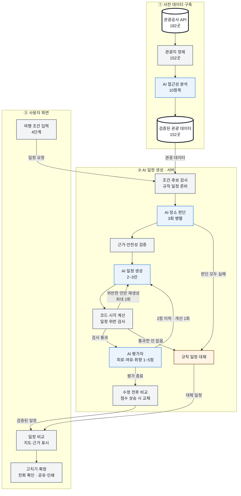

<sub>파란 칸 = AI(LLM)가 하는 일 · 회색 칸 = 코드가 하는 계산·검사 · 굵은 테두리 = 데이터 · 주황 칸 = AI가 실패했을 때 대비</sub>

</details>

### 유형별 조건

[기획 문서](docs/planning.md)의 조건표를 그대로 코드로 옮겼습니다([`conditions.ts`](src/lib/engine/conditions.ts)). 여러 유형을 고르면 항목마다 가장 엄격한 값을 씁니다.

| 항목 | 휠체어 | 유모차 | 보행이 불편한 어르신 |
| --- | :---: | :---: | :---: |
| 계단·단차 없는 진입 | **필수** | 주의 | 주의 |
| 엘리베이터 (층이 있는 곳) | **필수** | **필수** | 선호 |
| 급한 경사 없음 | **필수** | 선호 | 주의 |
| 포장길·데크 노면 | **필수** | 선호 | 주의 |
| 장애인 화장실 | **필수** | — | 선호 |
| 수유실·기저귀 교환대 | — | 선호 | — |
| 장애인 전용 주차구역 | **필수**¹ | — | **필수**¹ |
| 주차장→입구, 관람 동선 거리 | — | — | **필수**² |
| 쉴 곳 (벤치·쉼터) | — | 선호 | 선호 |
| 휠체어·유모차 대여 | 선호 | 선호 | 선호 |

**필수**: 원문상 '불가'면 루트에서 뺍니다 · **선호**: 추천 순위에만 반영 · **주의**: 루트에 남기고 경고를 붙입니다<br />
¹ 자가용이고 장애인 사용 자동차 표지가 있을 때만 · ² 사용자가 고른 거리(100m / 300m / 500m) 이하

## 데이터

**직접 열어 보기**: [장소 데이터 152곳](data/places.json) · [장소별 근거 원문](data/docs/places/) · [AI 읽기 결과](data/ai/read/) · [공공데이터 필드 조사](docs/data/tour-api-fields.md) · [공중화장실 짝짓기 결과](docs/data/public-restrooms.md) · [사진 출처](docs/data/photo-credits.md) · [AI 평가 자료](data/eval/)

| 데이터 | 쓰는 곳 | 출처 표시 |
| --- | --- | --- |
| **한국관광공사 무장애 여행정보 API**<sup>[2](#참고-자료)</sup> | 152곳의 무장애 정보·운영시간·전화·사진(1차 출처). AI가 읽어 접근성 10항목으로 정리 | 등급 `ai` · 근거 원문 문단 |
| **행정안전부 전국공중화장실표준데이터**<sup>[3](#참고-자료)</sup> | 장애인 화장실·기저귀 교환대 보충(31곳) | 등급 `public` · '공공데이터(2024-12 기준)'처럼 기준일과 함께 |
| **기상청 단기·중기예보**<sup>[4](#참고-자료)</sup><sup>[5](#참고-자료)</sup> | 확정·공유 화면 날짜별 날씨, 비·눈 날 바깥 장소 주의 | 날씨 칸 아래 "기상청 단기예보(발표 시각)" |
| 위키미디어 공용 · 공유마당 · pxhere 고화질 사진 | 관광지 40곳 + 시작 화면 6곳의 대표 사진(CC0 · CC BY · CC BY-SA · 공공누리 제1유형, 4:3으로 자르고 줄임) | 사진 크게 보기에 작가 · 원본 · 라이선스 · 바꾼 점, 전체 목록 [`docs/data/photo-credits.md`](docs/data/photo-credits.md) |
| 카카오맵 · 카카오모빌리티 | 지도, 실제 차량 이동시간·거리, 경로선 | '일반 차량 경로' |
| 사람 확인 | 전화·현장으로 확인한 값(있으면 가장 먼저) | 등급 `human` |

- **152곳**: 강릉·속초·동해의 관광지·문화시설 182곳에서 화장실·문화원처럼 관광지가 아닌 곳을 빼고 강릉 101 · 속초 30 · 동해 21곳. 필드 조사는 [공공데이터 조사](docs/data/tour-api-fields.md).
- **AI가 모두 읽었어요**: 152곳 · 1,520항목. 근거 없이 채운 값은 코드가 '모름'으로 바꿉니다. 원문에 없는 항목은 '모름'으로 두고 확인할 방법을 붙였습니다(공공데이터 보충 뒤 1,520항목 중 828개, 54%).
- **빈칸이 큽니다**: 휠체어에 중요한 노면은 152곳 중 136곳, 경사는 71곳이 '모름'입니다. 그래서 대부분 장소에 "가서 볼 것"이나 "전화로 물어볼 것"이 붙고, 숨기지 않고 화면에 그대로 보여 줍니다.
- **근거 원문을 함께 공개**: 장소마다 [근거 문서](data/docs/places/)(관광공사 원문 + 문단 id)와 [AI 읽기 결과](data/ai/read/)를 저장소에 둡니다. '모름'에 질문이, 장소에 공식 전화가 없으면 [검사 스크립트](scripts/validate-places.ts)가 빌드를 멈춥니다.
- **관광지 한 줄 소개**: 관광공사 소개를 AI가 "어떤 곳인지 한 문장 + 볼 거리"로 정리했습니다([`summary.json`](data/ai/summary.json)). 원문과 동떨어진 문장은 검사로 버립니다(처음 152곳 중 21곳을 버리고 다시 받음).
- **사진**: 관광공사 사진(공공누리) 1,136장을 풍경 / 편의시설 / 기타로 나눠 대표 사진은 풍경만 씁니다(135곳에 사진). 제1유형은 작게 줄여 저장하고, 제3유형(변경 금지)은 원본을 통째로 보여 줍니다. 모든 사진에 출처를 표시합니다([`photos.json`](data/photos.json)). 시작 화면 대표 관광지 6곳은 위키미디어 공용·공유마당의 고화질 원본(CC0 · CC BY · 공공누리 제1유형)을 1200×900으로 줄여 씁니다([`featured-photos.json`](data/featured-photos.json)).

<details>
<summary>공중화장실 공공데이터를 짝지은 방법</summary>

- 행정안전부 「전국공중화장실표준데이터」([data.go.kr 15012892](https://www.data.go.kr/data/15012892/standard.do)) · 이용허락범위 제한 없음 · 받은 강원 파일의 데이터 기준일 2024-05\~2025-06 · 강릉·속초·동해 816건.
- 화장실 이름에 관광지 이름이 들어 있고 같은 시인 곳만 짝지어 **36곳**을 찾았습니다(주소만 같은 곳, 주유소 등은 제외).
- 장애인용 대변기가 있거나 기저귀 교환대가 있으면 그 항목을 '가능'으로만 올립니다. 31곳에 값을 채웠습니다(장애인 화장실 30 · 기저귀 교환대 23항목, 그중 '모름'·'불가'였다가 바뀐 것은 장애인 화장실 3 · 기저귀 교환대 18).
- 0칸이거나 목록에 없으면 AI 값을 그대로 둡니다(목록에 없다고 화장실이 없다는 뜻은 아니어서). 수유실 정보는 이 데이터에 없습니다.
- 원본 CSV는 저장소에 두지 않고 짝지은 결과만 [`restrooms.json`](data/public/restrooms.json)과 [짝짓기 결과](docs/data/public-restrooms.md)에 둡니다.
- 전국주차장정보표준데이터([15012896](https://www.data.go.kr/data/15012896/standard.do))는 세 도시 218건 모두 '장애인전용주차구역보유여부'가 빈칸이라 쓰지 않았습니다.

</details>

<details>
<summary>날씨는 기상청 예보로: 쓰는 방법</summary>

- 단기예보 조회서비스([data.go.kr 15084084](https://www.data.go.kr/data/15084084/openapi.do))와 중기예보 조회서비스([15059468](https://www.data.go.kr/data/15059468/openapi.do)) · 이용허락범위 저작자표시.
- 날짜마다 그날 가는 시(강릉·속초·동해)의 하늘·강수확률·기온을 보여 줍니다. 오늘부터 약 10일 뒤까지만 예보가 있고, 그보다 먼 날은 '아직 예보 없음'으로 안내합니다.
- 비·눈 강수확률이 60% 이상이면 바다·해변·자연·산책 장소 카드에만 주의 한 줄을 붙입니다.
- 서버에서만 부르고(키는 서버 환경변수에만) 저장하지 않으며, 서버에 15분 단위로만 잠깐 보관합니다. 호출이 실패하거나 키가 없으면 날씨 칸만 숨깁니다. 날씨 문구는 코드에 고정된 글이라 AI가 쓰지 않습니다.
- 자세한 명세는 [기상청 API 정리](docs/data/kma-forecast.md)에 있습니다.

</details>

## 검증

AI 지표는 정확도가 아니라 **일관성과 안전 규칙 준수**입니다. 커밋마다 GitHub Actions가 장소 데이터 검사, 테스트, 린트, 빌드, 화면 흐름 테스트를 실행합니다.

<table>
<tr><th width="17%">항목</th><th width="48%">무엇으로 쟀나</th><th>결과</th></tr>
<tr><td valign="top">필수 조건 위반</td><td valign="top">규칙 엔진에 기획 문서의 시나리오 10개 + 유형 조합 14가지를 넣어 검사. 장소는 시험용으로 만든 가짜 장소(<a href="tests/engine/fixture.ts"><code>fixture.ts</code></a>)</td><td valign="top"><b>0건</b></td></tr>
<tr><td valign="top">AI 가드</td><td valign="top">가짜 AI로 근거 없는 판단 · 안전 하한보다 낙관한 판단 · 검사 안 된 일정 노출 · AI 실패를 일부러 만들어 검사(78개, <a href="tests/ai/"><code>tests/ai/</code></a>)</td><td valign="top"><b>모두 막음</b> · 실패하면 규칙 일정</td></tr>
<tr><td valign="top">AI 판단</td><td valign="top">6개 장면에서 같은 후보를 3번 판단(<a href="data/eval/judge-v1.md">판단 평가</a>)</td><td valign="top">3번 모두 같음 <b>85.7%</b>(Gemini) · 78.3%(OpenAI) · 두 모델이 정반대로 판단한 곳 <b>0곳</b></td></tr>
<tr><td valign="top">웹 접근성</td><td valign="top">axe-core로 화면 9개 + 열린 창 5개를 휴대폰·PC에서 검사(<a href="tests/e2e/axe.spec.ts"><code>axe.spec.ts</code></a>). 지도·사진·날씨 외부 호출은 막고 검사</td><td valign="top"><b>위반 0건</b>(글자 대비 규칙은 팀 결정으로 제외)</td></tr>
</table>

<details>
<summary>그 밖의 검사(자동 테스트 · AI 읽기 · 고치기 · 카카오 · 날씨 · 공유 링크)</summary>

<table>
<tr><th width="17%">항목</th><th width="48%">무엇으로 쟀나</th><th>결과</th></tr>
<tr><td valign="top">자동 테스트</td><td valign="top">단위 테스트(가짜 AI, 키 없이 실행) · 화면 흐름 테스트(Playwright, 휴대폰 390px · PC 1440px)</td><td valign="top"><a href="https://github.com/ieumgil/ieumgil-ai/actions/workflows/ci.yml"></a> 단위 673개 · 화면 흐름 500개</td></tr>
<tr><td valign="top">AI 읽기</td><td valign="top">원문에 없는 근거로 채운 값</td><td valign="top"><b>0건</b>(1,520항목)</td></tr>
<tr><td valign="top">AI 다시 읽기</td><td valign="top">지시문에 예시를 더해 152곳을 다시 읽고, 처음 결과와 항목 값 비교(<a href="data/eval/"><code>data/eval/</code></a>)</td><td valign="top">일치율 <b>96.4%</b> · 경사 '모름' 17곳이 '가능'으로 바뀜</td></tr>
<tr><td valign="top">고치기</td><td valign="top">장소 바꾸기·순서 고치기·빼기에서 부적합·중복으로 바꾸기 · 검사에 걸린 변경 · 시각을 코드 값으로 쓰는지</td><td valign="top"><b>모두 통과</b></td></tr>
<tr><td valign="top">카카오 · 날씨 · 공유 링크</td><td valign="top">길찾기·예보 저장 0건 · 키는 서버에만 · 공유 링크에 이동시간·개인정보 0건</td><td valign="top"><b>모두 통과</b> · 실제 기상청·Supabase 응답으로도 확인</td></tr>
</table>

</details>

<details>
<summary>엔진 시나리오 10개 (<a href="tests/engine/scenarios.test.ts">tests/engine/scenarios.test.ts</a>)</summary>

| # | 유형 | 이동수단 | 기간·상황 | 확인하는 것 |
| --- | --- | --- | --- | --- |
| 1 | 휠체어 | 자가용 + 표지 차량 | 당일 | 장애인 주차가 필수 조건으로 반영 |
| 2 | 휠체어 | 택시 | 당일 | 장애인 주차 조건이 꺼짐 |
| 3 | 고령자(300m) | 자가용 | 당일 | 관람 동선이 300m를 넘는 곳은 빠짐 |
| 4 | 유모차 | 택시 | 1박 2일 | 수유실 선호 점수, 날짜 배분, 같은 장소 중복 없음 |
| 5 | 휠체어 + 고령자 | 자가용 + 표지 차량 | 2박 3일 | 조건 합집합, 둘째 날 숙소 출발 |
| 6 | 휠체어 | 택시 | 1박 2일, 숙소 미정 | 숙소 위치를 가정하고 표시 |
| 7 | 고령자 + 유모차 | 자가용 | 반나절(4시간) | 개수 하한, 빠듯·부족 판정 |
| 8 | 휠체어 | 자가용 | 동절기 날짜 | 동절기 운영시간·휴무 반영 |
| 9 | 휠체어 | 택시 | 꼭 가고 싶은 곳이 불가 | 경고 후 제외 |
| 10 | 휠체어 + 유모차 | 택시 | 후보가 적은 지역 | 하루 상한 자동 축소 |

여기에 세 유형의 모든 조합 7가지 × 이동수단 2가지 = 14가지를 2박 3일로 돌려 필수 조건 위반이 0건인지 함께 검사합니다.

</details>

## 계획서 대비 구현 현황

[기획 문서](docs/planning.md)의 계획 항목은 모두 구현했고, 일부는 개발하면서 방법을 바꿨습니다. 공고가 요구한 결과물(핵심 기능 작동, 실제 데이터로 시연, 배포 주소와 GitHub 공개)도 모두 갖췄습니다.

<sub>✅ 구현: 계획대로 · 🔄 변경: 방법을 바꿔 구현(이유는 아래 '계획에서 바꾼 결정') · ➕ 추가: 계획에 없던 것 · 테스트와 AI 평가는 [검증](#검증)</sub>

<table>
<tr><th width="11%">상태</th><th width="28%">계획</th><th>구현한 내용</th><th width="17%">확인할 곳</th></tr>
<tr><td colspan="4"><b>AI가 하는 일</b></td></tr>
<tr><td valign="top">🔄 변경</td><td valign="top">① 읽기: 관광공사 문장 → 접근성 값</td><td valign="top">152곳 · 1,520항목을 AI가 미리 읽어 접근성 10항목 · 운영시간 · 도착 후 동선으로 정리(사람 조사 → AI 읽기)</td><td valign="top"><a href="data/ai/read/"><code>data/ai/read/</code></a></td></tr>
<tr><td valign="top">✅ 구현</td><td valign="top">② 판단: 이 사람에게 적합 / 주의 / 확인 필요 / 부적합</td><td valign="top">후보 20곳을 3번 판단해 확신도를 매기고, 코드가 안전 하한을 적용</td><td valign="top"><a href="src/lib/ai/judge.ts"><code>judge.ts</code></a></td></tr>
<tr><td valign="top">🔄 변경</td><td valign="top">③ 계획: 성격이 다른 일정 2~3안 + 평가자</td><td valign="top">당일 · 1박 2일은 2~3안, 2박 3일은 1안을 꼼꼼하게 짜고 고치기로 보완</td><td valign="top"><a href="src/lib/ai/plan.ts"><code>plan.ts</code></a></td></tr>
<tr><td valign="top">🔄 변경</td><td valign="top">④ 풀어주기: 도착 후 동선 · 출발 전 확인할 것</td><td valign="top">요청 때 AI를 다시 부르지 않고, 미리 읽은 동선과 체크리스트로 보여 줌</td><td valign="top"><a href="src/components/trip/Checklist.tsx"><code>Checklist.tsx</code></a></td></tr>
<tr><td valign="top">✅ 구현</td><td valign="top">AI가 실패해도 시연이 멈추지 않음</td><td valign="top">Gemini가 늦으면 OpenAI, 둘 다 실패하면 규칙 일정 1안</td><td valign="top"><a href="src/lib/engine/fallback.ts"><code>fallback.ts</code></a></td></tr>
<tr><td colspan="4"><b>지켜야 할 원칙</b></td></tr>
<tr><td valign="top">✅ 구현</td><td valign="top">AI 답은 JSON 스키마로, 시각은 코드가 계산</td><td valign="top">스키마 · 근거 검사를 통과한 답만 쓰고, 도착·출발 시각은 코드가 계산</td><td valign="top"><a href="src/lib/engine/timeline.ts"><code>timeline.ts</code></a></td></tr>
<tr><td valign="top">🔄 변경</td><td valign="top">'모름'은 숨기지 않고 확인할 방법을 줌</td><td valign="top">전화로 물을 것과 가서 보고 확인할 것으로 나눔. 질문 · 전화번호가 빠지면 빌드가 멈춤</td><td valign="top"><a href="scripts/validate-places.ts"><code>validate-places.ts</code></a></td></tr>
<tr><td valign="top">✅ 구현</td><td valign="top">카카오 결과 저장 안 함 · 키는 서버에만 · 개인정보 없음</td><td valign="top">경로 · 이동시간은 열 때마다 새로 받고, 자유 입력 칸이 없음</td><td valign="top"><a href="src/app/api/legs/route.ts"><code>api/legs</code></a></td></tr>
<tr><td colspan="4"><b>화면과 흐름</b></td></tr>
<tr><td valign="top">🔄 변경</td><td valign="top">대상 지역</td><td valign="top">강릉에서 강릉 · 속초 · 동해 152곳으로 넓힘</td><td valign="top"><a href="data/places.json"><code>places.json</code></a></td></tr>
<tr><td valign="top">✅ 구현</td><td valign="top">입력 4단계 · 만드는 중(진행 기록 스트리밍)</td><td valign="top">질문을 하나씩 묻고, 만드는 동안 단계와 진행 기록을 보여 줌</td><td valign="top"><a href="src/app/plan/"><code>src/app/plan/</code></a></td></tr>
<tr><td valign="top">✅ 구현</td><td valign="top">안 비교 → 날짜별 상세 · 근거 표시</td><td valign="top">안마다 장소 수 · 이동 시간 · 전화 확인 곳 수, 장소마다 판단 · 이유 · 출처</td><td valign="top"><a href="src/components/trip/"><code>src/components/trip/</code></a></td></tr>
<tr><td valign="top">🔄 변경</td><td valign="top">일정 고치기</td><td valign="top">조건을 바꿔 다시 만드는 대신 장소 바꾸기 · 순서 고치기 · 빼기(AI 없이 다시 계산)</td><td valign="top"><a href="src/lib/trip/edit.ts"><code>edit.ts</code></a></td></tr>
<tr><td valign="top">🔄 변경</td><td valign="top">확정 일정 + 지도 · 실제 이동시간</td><td valign="top">AI는 직선 추정으로 짜고, 다 짠 일정만 카카오로 실제 시간을 받아 다시 검사</td><td valign="top"><a href="src/lib/trip/real-travel.ts"><code>real-travel.ts</code></a></td></tr>
<tr><td valign="top">✅ 구현</td><td valign="top">출발 전 확인할 것(질문 + 전화)</td><td valign="top">괜찮대요 / 어렵대요를 누르면 진행률이 쌓이고, 어렵대요면 바꾸기를 권함</td><td valign="top"><a href="src/lib/trip/questions.ts"><code>questions.ts</code></a></td></tr>
<tr><td valign="top">🔄 변경</td><td valign="top">어려운 곳 목록과 대안</td><td valign="top">대안은 코드가 고르고, 이유는 ② 판단 이유를 그대로 씀</td><td valign="top"><a href="src/lib/trip/hard.ts"><code>hard.ts</code></a></td></tr>
<tr><td valign="top">✅ 구현</td><td valign="top">관광지 둘러보기 · 사진 · 반응형</td><td valign="top">지역 · 분야 · 시설로 찾기, 사진마다 출처 표시, 휴대폰 · 태블릿 · PC 화면</td><td valign="top"><a href="src/app/places/PlacesBrowser.tsx"><code>PlacesBrowser.tsx</code></a></td></tr>
<tr><td valign="top">🔄 변경</td><td valign="top">시작 화면 · 예시 루트(심사용)</td><td valign="top">팀이 만든 시안으로 개편, 입력 없이 바로 여는 예시 일정과 사람별 루트 카드 3장</td><td valign="top"><a href="https://ieumgil-ai.vercel.app/trip/example">예시 일정</a></td></tr>
<tr><td colspan="4"><b>함께 쓰기</b></td></tr>
<tr><td valign="top">🔄 변경</td><td valign="top">공유 · 인쇄</td><td valign="top">요약 이미지 대신 읽기 전용 공유 링크(기간이 지나면 자동 삭제) + A4 한 장 인쇄</td><td valign="top"><a href="src/lib/share/"><code>src/lib/share/</code></a></td></tr>
<tr><td colspan="4"><b>계획에 없던 추가</b></td></tr>
<tr><td valign="top">➕ 추가</td><td valign="top">장애인 화장실 · 기저귀 교환대 공공데이터 보충</td><td valign="top">행정안전부 공중화장실 데이터로 31곳 보충</td><td valign="top"><a href="docs/data/public-restrooms.md"><code>public-restrooms.md</code></a></td></tr>
<tr><td valign="top">➕ 추가</td><td valign="top">날짜별 날씨와 비·눈 주의</td><td valign="top">기상청 예보, 비·눈 날 바깥 장소에 주의 한 줄</td><td valign="top"><a href="src/lib/weather/"><code>src/lib/weather/</code></a></td></tr>
<tr><td valign="top">➕ 추가</td><td valign="top">웹 접근성 자동 검사 · 디자인 규칙 감시</td><td valign="top">axe-core로 주요 화면 검사, 글자 크기 · 굵기 규칙을 테스트로 감시</td><td valign="top"><a href="tests/e2e/axe.spec.ts"><code>axe.spec.ts</code></a></td></tr>
</table>

<details>
<summary><b>계획에서 바꾼 결정과 이유</b></summary>

| 처음 계획 | 바꾼 것 | 이유 |
| --- | --- | --- |
| 강릉만 | 영동권(강릉·속초·동해) | 관광공사 API로 장소를 충분히 모을 수 있어 범위를 넓힘. 신청서의 '종료 후 영동권 확대 검토'를 기간 안에 앞당김 |
| 사람이 장소를 조사·판정 | AI가 공공데이터 문장을 읽고, 모르는 항목은 확인할 방법을 안내 | 노면·걷는 거리는 공공데이터에 거의 없어 사람이 152곳을 다 확인할 수 없음. 사람이 확인한 값은 등급 `human`으로 덮어쓸 수 있게 둠 |
| '모름'은 모두 전화로 물어볼 질문 | 직원이 답할 수 있는 것만 전화, 바닥·경사·쉴 곳은 "가서 보고 확인할 것" | "노면 재질"은 직원도 답하기 어렵고 도착하면 보임. 질문이 쌓이면 아무도 전화하지 않음 |
| 이동시간 표를 카카오 다중 목적지로 미리 계산 | AI는 직선 추정으로 짜고, 다 짠 안만 카카오로 실제 시간을 받아 다시 검사 | 후보를 전부 짝지으면 호출이 너무 많음. 짠 안의 실제 동선만 재면 날짜마다 1회 |
| 조건 바꿔 다시 만들기 | 장소 [바꾸기] · [순서 고치기] | 다시 만들면 AI를 처음부터 다시 불러 느림. 고치기는 AI 없이 바로 |
| 모든 일정에 2\~3안 | 2박 3일은 1안 + 고치기 | 3일치를 나눠 짜면 안끼리 겹쳐 빠짐. 1안을 제대로 짜는 쪽을 택함 |
| AI 추가 질문 0\~3개 · ④ 풀어주기를 요청할 때 AI로 한 번 더 | 빼고, 미리 읽은 동선 + 체크리스트로 | 입력 4단계로 충분하고 단계가 늘면 어르신에게 부담. 다시 다듬는 호출은 시간만 늘어남 |
| 공유: 요약 이미지 저장 | 읽기 전용 공유 링크 + A4 인쇄 | 지도 이미지는 캡처가 막힐 수 있고, 이동시간을 이미지에 굳히면 카카오 저장 금지와 맞지 않음 |
| 어려운 곳의 대안 이유를 LLM이 붙임 | 대안은 코드가 고르고 이유는 ② 판단 이유를 그대로 | 요청할 때 AI 호출을 늘리지 않음. 대안도 이미 판단한 후보라 이유가 있음 |
| '가 글씨 크게' 버튼 | 휴대폰·브라우저 글자 크기 설정을 따름 | 버튼보다 기기 설정을 쓰는 사람이 많음. 모든 글자를 rem 단위로 |
| 시작 화면: 소개 글 + 버튼 | 영동 사진 카드 히어로(팀이 만든 시안) · 바로가기 5칸 · 단계 소개(스크롤 고정) · 사람별 루트 카드 · 대표 관광지 | 점검 피드백("텍스트가 많고 AI가 만든 티가 난다")과 지자체 관광 사이트 레퍼런스. 서비스가 무엇을 하는지 첫 화면에서 실제 영동 사진과 루트로 보여 줌 |
| 장소 카드 [자세히]에 AI 판단 이유·가서 볼 것·근거 항목 목록 | 도착하면 · 전화로 물어볼 것 · 출처 한 줄 | 한 카드에 같은 이유가 세 번 나와 읽기 어려움. 출처 등급은 그대로 보임 |
| 역할: 강환일 = 백엔드(신청서) | 개발은 공지혁, 강환일은 자료·API 조사, 사용자 테스트, 보고서·대외 활동 | 실제 작업에 맞춤(주간보고에 기록) |

</details>

## 지속 가능성

신청서에는 "종료 후 속초·동해·삼척 등 영동권으로 확대를 검토"한다고 적었습니다. 이 확대를 **기간 안에 앞당겨 강릉에서 속초·동해까지 넓혔습니다**(강릉 101곳 → 영동권 152곳). 쓰는 공공데이터가 모두 전국 단위라, 같은 방법으로 다른 지역에도 옮길 수 있습니다.

### 다른 지역으로 넓히기

| 데이터·서비스 | 범위 | 새 지역에 필요한 일 |
| --- | --- | --- |
| 관광공사 무장애 여행정보 API | 전국 | 시군구 코드를 더해 다시 수집([`build-places.ts`](scripts/tour/build-places.ts)) |
| AI 읽기(접근성 10항목·운영시간·동선) | 장소마다 미리 한 번 | 새 장소만 읽기. 이용자 수와 상관없음 |
| 공중화장실 표준데이터 · 기상청 예보 · 카카오 지도·길찾기 | 전국 | 새 시를 목록에 더하기(공중화장실 짝짓기 · 기상청 지점 코드 [`regions.ts`](src/lib/weather/regions.ts)) |
| 지역 이름 · 도착 지점·숙소 기준점 좌표 · 지도 좌표 범위 · 대표 관광지 | 지역별 | 사람이 정함([`types.ts`](src/lib/types.ts) · [`plan/types.ts`](src/lib/plan/types.ts) · [`travel.ts`](src/lib/engine/travel.ts) · [`route-points.ts`](src/lib/route-points.ts) · [`featured.json`](data/featured.json)) |

- 데이터를 다시 만드는 순서: `data:public` → `data:build` → `data:read` → `data:merge`([scripts/README.md](scripts/README.md)).
- 후보 거르기·AI 판단·시각 계산·검사 규칙은 지역마다 다르지 않습니다. 위 표의 지역 설정과 장소 데이터만 바꾸면 됩니다.

### 운영 비용

일정 한 번에 AI 5회, **약 50원**입니다(유료 단가 기준, 조건 5가지로 [실측](data/eval/cost-v1.md)). 지금은 무료 등급·무료 플랜으로 운영하고, 이용이 늘어 유료로 바꿔도 하루 100건에 월 약 15만 원 수준입니다. 공공데이터(관광공사·공중화장실·기상청)는 무료입니다.

- 기관이 운영한다면 Vercel은 Pro로(무료 플랜은 비상업 용도), 카카오 길찾기는 무료 쿼터를 넘을 때 카카오모빌리티와 제휴가 필요합니다.
- 무료 Supabase가 멈추지 않게 하루 한 번 작은 요청을 보내 공유 링크가 계속 열립니다([`api/keepalive`](src/app/api/keepalive/route.ts)).

### 정보를 최신으로

- 관광공사 원문이 바뀐 장소만 다시 읽으면 됩니다. 원문과 문단 id를 장소마다 저장해 두어([`data/docs/places/`](data/docs/places/)) 무엇이 바뀌었는지 비교할 수 있습니다.
- 전화·현장으로 확인한 값은 등급 `human`으로 AI 값보다 먼저 씁니다. 확인이 쌓일수록 '모름'이 줄어듭니다.
- 공중화장실로 보충한 값은 데이터 기준일을 함께 보여 줘 오래된 정보를 알아볼 수 있습니다.

### 쓸 수 있는 곳(제안 대상)

아직 협의한 곳은 없고, 이런 곳에 제안할 수 있습니다.

| 대상 | 쓰임 |
| --- | --- |
| 강릉시(국내 첫 무장애 관광도시)·영동권 지자체 | 관광 누리집·안내소에서 관광약자 일정 짜기 도구로 연결 |
| 한국관광공사 열린관광 | 같은 공공데이터에 '이 사람 기준 판단'과 일정 짜기를 더한 예시 |
| 장애인·노인 복지관, 관광약자 단체 | 나들이·여행 프로그램 준비 때 후보 목록과 출발 전 전화 확인 목록 |
| 무장애 여행 상품을 만드는 여행사 | 코스 초안과 출발 전 확인 목록 |

### 프로젝트가 끝난 뒤

- 저장소는 공개로 두고 코드는 [MIT 라이선스](#라이선스)로 엽니다. 다른 지자체·단체가 가져가 지역만 바꿔 쓸 수 있습니다.
- 모든 변경은 GitHub Actions가 데이터 검사·테스트·빌드로 확인합니다. 단위 테스트는 가짜 AI로 돌아 키 없이도 누구나 검증할 수 있습니다.

## 화면 더 보기

주요 장면은 휴대폰과 PC 화면을 나란히 놓았습니다. 화면은 창 너비에 따라 바로 바뀝니다. 휴대폰과 태블릿은 한 칸, PC는 왼쪽 지도와 오른쪽 일정 두 칸, 넓은 PC의 일정 비교는 세 칸입니다.

### 시작 화면

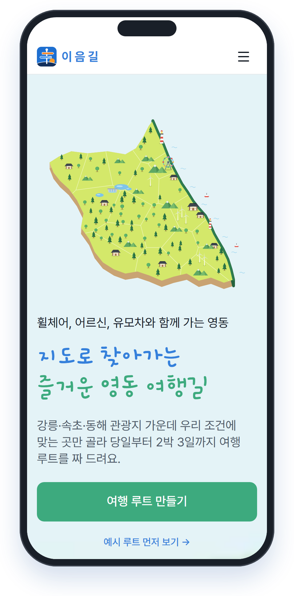

- **첫 화면**: 영동 관광지 사진과 함께 서비스 이름과 대상('휠체어, 어르신, 유모차와 함께 가는 영동')을 보여 줍니다. PC 화면은 [맨 위 그림](#이음길-ai)입니다.
- **바로가기 5칸**: 여행 루트 만들기 · 예시 루트 보기 · 관광지 둘러보기 · 서비스 소개 · 작동 원리
- **이렇게 골라요**: 단계 3개(조건에 안 맞는 곳은 빼요 → 왜 골랐는지와 출처 → 모르는 건 물어볼 것)를 고르면 휴대폰 속 화면이 그 단계의 실제 화면으로 바뀝니다.
- **누구와 함께 가세요?**: 휠체어·강릉 1박 2일 / 어르신·속초 당일 / 유모차·동해 당일. AI가 미리 만든 루트가 바로 열립니다.
- **영동 대표 관광지**: 대표 관광지 8곳. 누르면 관광지 둘러보기에서 자세한 정보가 열립니다.
- **머리줄**: 모든 화면에 메뉴와 오늘 영동 날씨(기상청)가 있습니다.

<br clear="right" />

### 조건 4단계

<table>
<tr><th width="34%">휴대폰</th><th>PC</th></tr>
<tr>
<td align="center" valign="top">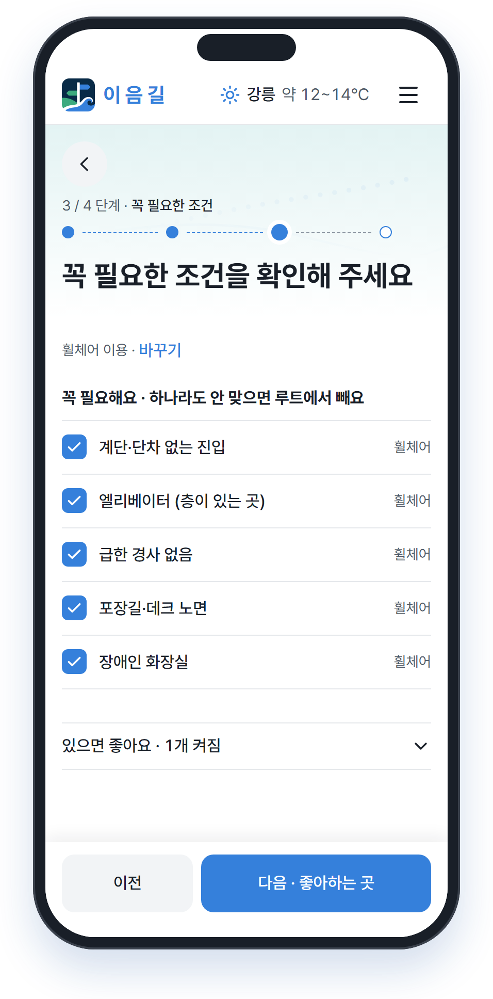</td>
<td align="center" valign="top">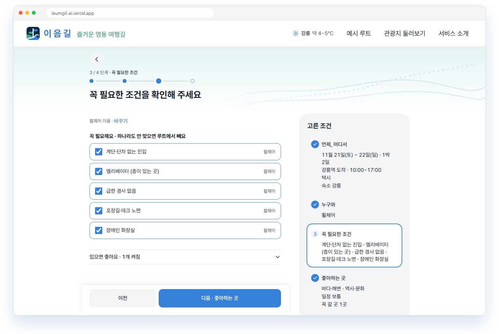</td>
</tr>
</table>

한 화면에 질문을 하나씩 묻고, 자유 입력 칸은 없습니다. 함께 가는 사람의 유형을 고르면 꼭 필요한 조건이 자동으로 켜집니다. PC에서는 오른쪽에 고른 조건이 쌓이고, 누르면 그 단계로 돌아갑니다.

| 1 언제·어디서 | 2 누구와 | 4 좋아하는 곳 |
| :---: | :---: | :---: |
| 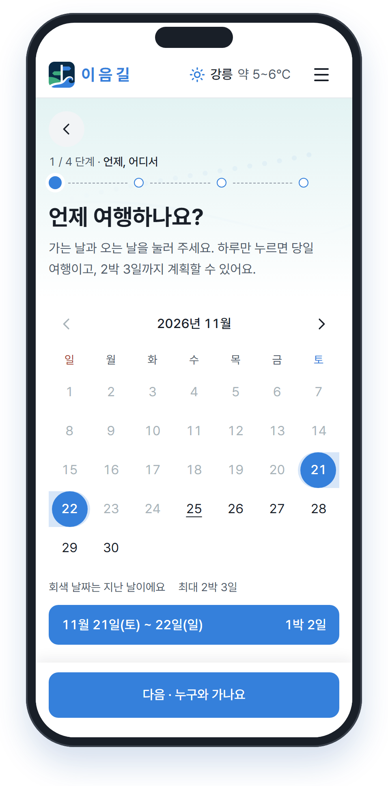 | 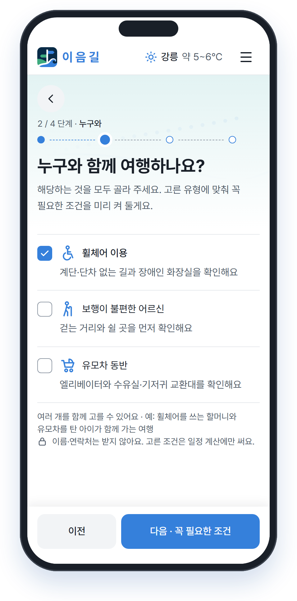 | 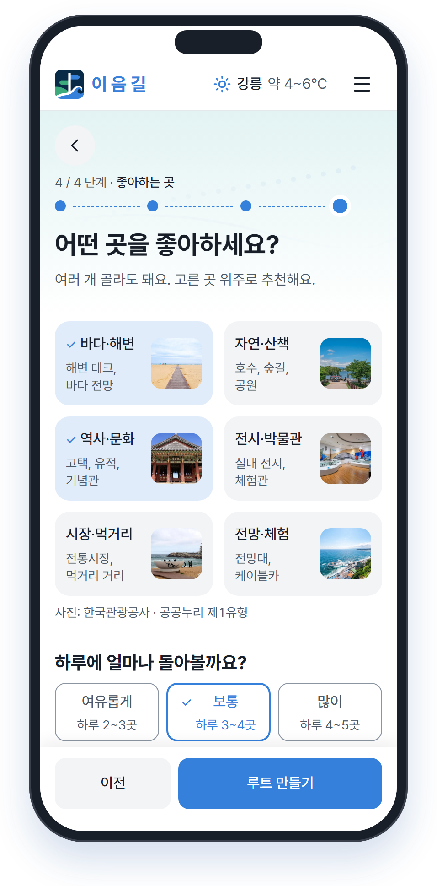 |

### 관광지 둘러보기

<table>
<tr><th width="34%">휴대폰</th><th>PC</th></tr>
<tr>
<td align="center" valign="top">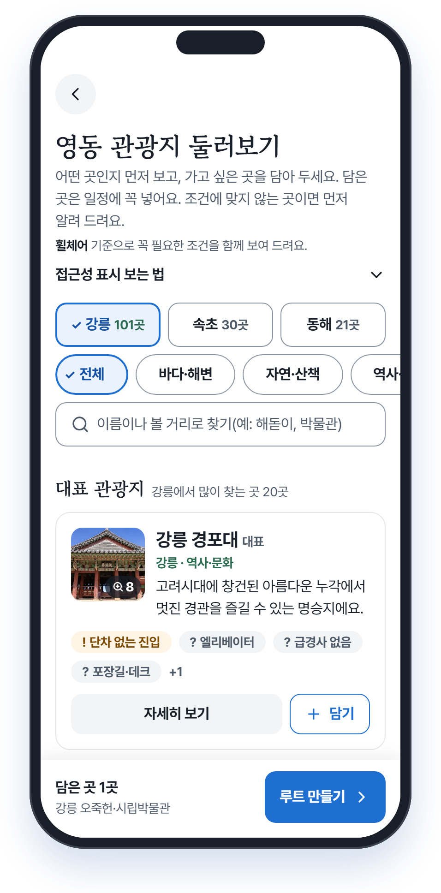</td>
<td align="center" valign="top">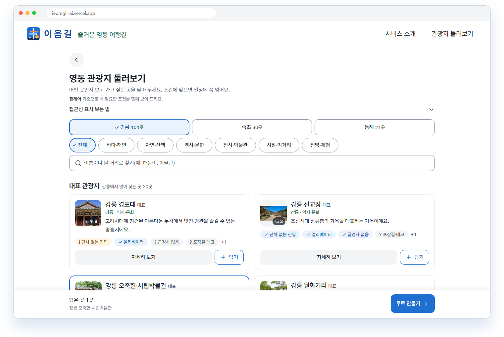</td>
</tr>
</table>

이름을 몰라도 강릉 · 속초 · 동해 → 분야 → 이름·볼 거리로 찾고, 마음에 드는 곳을 담아 일정에 넣습니다(`/places`). 대표 관광지(기획 조사표 32곳, 관광공사 장소로는 38곳)를 먼저 보여 줍니다.

- 카드: 큰 대표 사진 · 지역·분야 · 이름 · 우리 가족 기준 접근성 태그(✓ 가능 · ! 일부만 · ✕ 어려움 · ? 정보 없음). 글은 줄이고 사진으로 알아보게 했습니다
- 시설로 거르기: [휠체어 진입] [장애인 화장실] [장애인 주차] [엘리베이터] [수유실·기저귀] 가운데 고른 시설이 모두 가능·일부만인 곳만 남깁니다(공식 정보가 없는 곳은 빠진다고 함께 알림)
- 자세히: 어떤 곳인지 한 줄(AI 정리) · 볼 거리 · 관광공사 소개 원문, 운영시간, 전화, 접근성 10항목

### 고치기 · 확인하기(휴대폰)

| 만드는 중 | 장소 바꾸기 | 지도 번호 카드 |
| :---: | :---: | :---: |
| 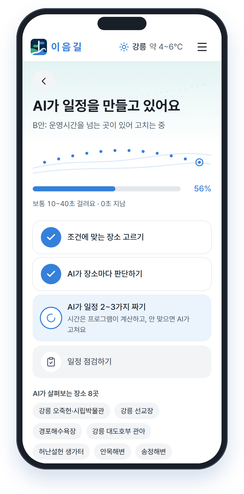 | 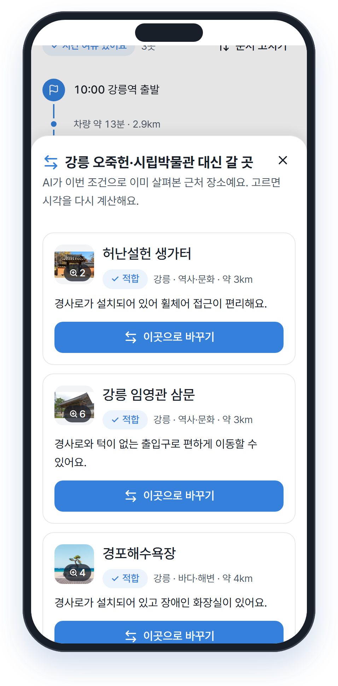 | 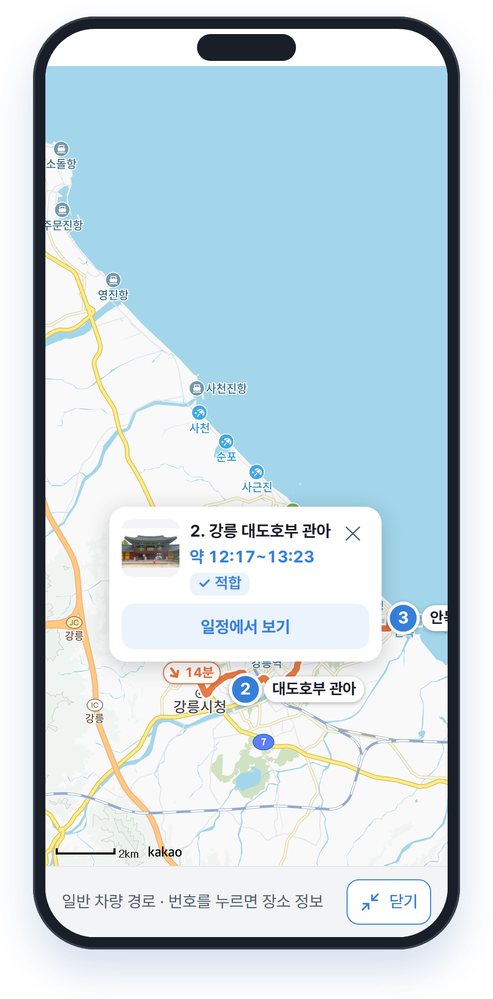 |
| **순서 고치기** | **가기 어려운 곳과 대안** | |
| 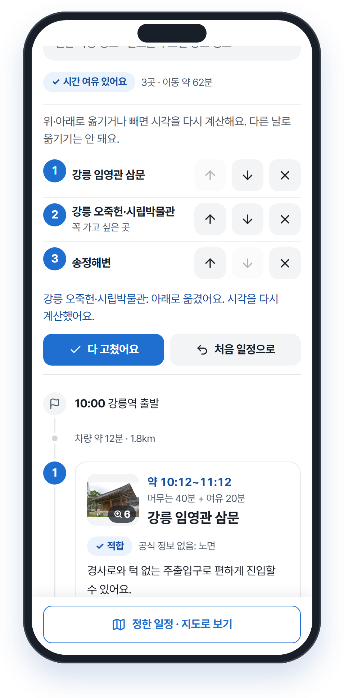 | 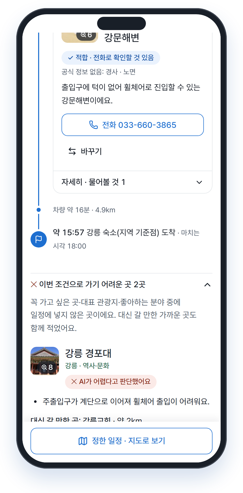 | |

<details>
<summary>화면마다 자세한 설명</summary>

1. **만드는 중**: 진행률과 단계, AI가 살펴보는 장소를 보여 줍니다. "장소 판단 3/3번째 끝", "B안: 운영시간을 넘는 곳이 있어 고치는 중" 같은 진행 기록은 서버에서 받은 그대로입니다.
2. **일정 비교**: 일정마다 제목, 장소 수, 이동 시간, 전화로 확인할 곳 수를 나란히 보여 줍니다. 제목은 AI가 실제로 넣은 장소가 드러나게 씁니다(예: '오죽헌과 솔숲 사이를 천천히 거니는 여행'). 이틀 이상 여행에는 제목에 '하루'를 쓰지 않습니다. 2박 3일은 일정 하나를 꼼꼼하게 짭니다.
3. **장소 카드**: 카드에는 사진·도착 시각·판단·한 줄 이유·전화만 먼저 보이고, 공식 정보가 없는 항목은 칩 옆에 '공식 정보 없음: 노면'처럼 표시합니다. [자세히]를 펼치면 도착한 뒤 동선(장애인 주차 → 출입구 → 화장실), 전화로 물어볼 것, 공공데이터로 확인한 시설, 출처가 나옵니다. 같은 말이 여러 번 나와 읽기 어렵다는 피드백으로 겹치는 글자를 정리했습니다. 판단과 '전화로 확인할 것 있음'은 접어도 보입니다. 시간표 왼쪽 세로선에는 스크롤을 따라 내려가는 진행 원이 있어 지금 어디쯤 보고 있는지 알려 줍니다.
4. **장소 바꾸기**: AI가 이미 판단해 둔 근처 장소 가운데 최대 3곳을 후보로 보여 줍니다. 코드가 시각과 운영시간을 다시 검사하고, 맞지 않으면 이유를 보여 주고 바꾸지 않습니다. 바꾼 뒤에도 되돌릴 수 있습니다.
5. **확정 일정**: 카카오 지도에 번호 + 장소 이름, 일반 차량 경로선과 구간마다 이동 시간을 그립니다. [전체 화면]으로 지도를 크게 볼 수 있습니다. 경로는 열 때마다 새로 받고 저장하지 않습니다. 날짜마다 그날 가는 시의 기상청 예보(하늘·강수확률·기온)를 보여 주고, 비·눈 예보 날에는 바깥 장소에 '데크·경사로가 미끄러울 수 있어요'를 붙입니다.
6. **출발 전 전화 확인**: 장소마다 물어볼 것과 공식 전화번호가 있습니다. [괜찮대요] / [어렵대요]를 누르면 진행률이 쌓이고, '어렵대요'를 누르면 다른 곳으로 바꾸기를 권합니다.
7. **지도 번호 카드**: 번호를 누르면 사진·시각·판단 카드가 뜨고 [일정에서 보기]로 그 장소로 내려갑니다.
8. **순서 고치기**: 같은 날 안에서 위·아래로 옮기거나 뺍니다. 운영시간·하루 범위를 넘으면 고치지 않고 이유를 보여 줍니다.
9. **가기 어려운 곳과 대안**: 꼭 가고 싶은 곳, 대표 관광지, 좋아하는 분야 가운데 이번 조건으로 빠진 곳을 이유와 함께 보여 주고, 같은 분야의 가까운 대안을 알려 줍니다.

</details>

### 디자인

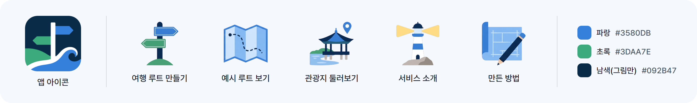

- '이음길'(잇는 길)이라는 이름처럼, 계단 없이 완만하게 이어지는 길을 앱 아이콘에 담았습니다.
- 시작 화면 시안의 색과 글꼴(여기어때 잘난체 고딕)은 히어로와 바로가기에만 쓰고, 나머지 화면은 파랑 #3580DB와 초록 #3DAA7E 두 가지 색만 씁니다.

### 누구나 쓰기 쉽게

- 본문 글자는 16px 이상, 버튼과 선택 칸은 44px 이상입니다. 글자 크기는 휴대폰·브라우저의 글자 크기 설정을 그대로 따릅니다.
- 글꼴은 두 가지만 씁니다: 본문·숫자 전부 Pretendard, 시작 화면 히어로 문구와 바로가기 이름만 여기어때 잘난체 고딕. 구분은 크기와 굵기로 합니다.
- 움직임은 스크롤한 만큼만 따라오거나 짧게(버튼·창 0.1\~0.2초, 소개 글의 구역·숫자·막대 등장 0.5\~1초) 끝나고, 기기의 '동작 줄이기' 설정을 켜면 멈춥니다. 시작 화면 사진 카드는 처음 한 번만 올라오고, 바로가기 그림은 마우스를 올리거나 키보드로 골랐을 때만 움직입니다. '동작 줄이기'를 켜면 처음부터 모두 제자리에 보입니다.
- 판단은 색만으로 나타내지 않고 ✓ 적합 · ! 주의 · ✕ 부적합처럼 기호와 글자를 함께 씁니다.
- 웹 접근성은 [axe-core](https://github.com/dequelabs/axe-core-npm) 자동 검사로 주요 화면을 휴대폰·PC에서 확인합니다([`axe.spec.ts`](tests/e2e/axe.spec.ts)). 색은 파랑 #3580db와 초록 #3daa7e 두 가지로 통일했고(시작 화면 히어로·바로가기는 시안 색), 이 색의 글자 대비는 기준(4.5:1)보다 낮지만 실제 화면에서 잘 보인다고 판단해 글자 대비 규칙만 검사에서 뺐습니다. 다른 규칙은 그대로 검사합니다.

## 기술 스택

[](https://ieumgil-ai.vercel.app)
[](https://github.com/ieumgil/ieumgil-ai/commits/main)

[](https://supabase.com/)
[](https://ieumgil-ai.vercel.app)


맨 위 데이터·AI 배지와 이 배지들이 쓰인 기술입니다.

<details>
<summary>기술별로 맡은 일과 지킨 원칙</summary>

| 기술 | 맡은 일 | 지킨 원칙 |
| --- | --- | --- |
| Gemini(`gemini-3.5-flash-lite`) | ① 읽기 · ② 판단(3회) · ③ 일정 2\~3안 · 평가 · 관광지 한 줄 소개 | JSON 스키마로만 받고 코드가 검사(Ajv). 근거가 원문 밖이면 버림. 시각은 쓰지 않음 |
| OpenAI(GPT-6 Luna, Responses API) | Gemini가 붐비거나 30초 넘게 늦으면 같은 요청을 보내 먼저 온 답을 씀 | 엄격 JSON 스키마, `store: false`. 둘 다 실패하면 규칙 일정 |
| 한국관광공사 무장애 여행정보 API | 152곳의 무장애 정보·운영시간·전화·사진의 1차 출처 | 수집 스크립트에서만 호출. 빈칸은 '모름'으로 두고 지어내지 않음 |
| 행정안전부 전국공중화장실표준데이터(CSV) | 장애인 화장실·기저귀 교환대 보충(31곳) | 스크립트에서만 읽고 원본은 커밋 안 함. 이름이 맞는 곳만, '있음'만 '가능'으로. 출처·기준일 표시 |
| 기상청 단기·중기예보 API(공공데이터포털) | 확정·공유 화면 날짜별 날씨, 비·눈 날 바깥 장소 주의 | 서버에서만 호출(키 서버 전용), 저장 안 함, 실패하면 날씨 칸만 숨김, 문구는 코드 고정 |
| 카카오맵 JS · 카카오모빌리티 길찾기 | 지도, 실제 차량 이동시간, 경로선 | 결과는 저장하지 않고 열 때마다 받음. "일반 차량 경로"로만 표시. REST 키는 서버에만 |
| Supabase(Postgres) | 공유 링크 저장 | 고른 일정만 저장, 서버가 스키마로 검사. RLS로 브라우저 키 차단, 기간이 지나면 자동 삭제 |
| Vercel | 배포(서버 함수에서 AI·카카오·기상청 호출, 진행 단계 스트리밍) | 키는 환경변수에만 |
| Next.js 16 · React 19 · TypeScript | 화면과 서버 API | TypeScript strict. AI·데이터 규칙은 `src/lib/`에 코드로 |
| Tailwind CSS v4 · shadcn/ui · Pretendard(SIL OFL 1.1) · 여기어때 잘난체 고딕(시작 화면 히어로 문구·바로가기 이름, GC COMPANY 무료 글꼴) · 자체 호스팅 | 모바일 우선 화면 | 디자인 값은 `globals.css` 한 곳에. 본문 16px · 터치 44px 이상 · 상태는 색 + 기호 + 글자 · rem 단위 |
| Vitest · Playwright · axe-core · GitHub Actions | 단위 · 화면 흐름 · 웹 접근성 테스트, 푸시마다 자동 검사 | 필수 조건 위반 0건, 근거 없는 판단을 버리는지, 접근성 위반 0건을 테스트로 고정 |

</details>

<details>
<summary>폴더 구조</summary>

```
src/app/            시작 · places/(관광지 둘러보기) · plan/(입력 4단계, making/ 만드는 중) · trip/[id]/(안 비교·상세·고치기)
                    · trip/[id]/final/(확정 일정 + 지도 + 인쇄) · s/[id]/(공유 링크, 읽기 전용)
                    · api/plan/(전체 흐름 + 스트리밍) · api/legs/·api/route-line/(카카오, 저장 안 함) · api/trips/(공유 저장) · api/weather/(기상청, 저장 안 함)
src/lib/ai/         judge.ts(② 판단) · plan.ts(③ 일정 2~3안) · review.ts(평가자) · trip.ts(전체 흐름) · guards.ts(안전 하한·근거 검사) · schemas.ts
src/lib/engine/     conditions.ts · filter.ts · timeline.ts(시각 계산) · check.ts(일정 검사) · repair.ts · fallback.ts(규칙 일정) · travel.ts
src/lib/trip/       view.ts(결과 화면 값) · edit.ts(바꾸기·순서·빼기) · alternatives.ts · hard.ts(어려운 곳) · questions.ts · real-travel.ts · store.ts(탭 보관)
src/lib/share/      doc.ts(공유할 값·검사) · supabase.ts(서버 전용) · view.ts(열 때 화면 값으로)   ·   supabase/migrations/(테이블·RLS·자동 삭제)
src/lib/public/     공중화장실 공공데이터 짝짓기·합치기·출처 표시
src/lib/weather/    kma.ts(기상청 호출, 서버 전용) · service.ts(15분 캐시) · kst·summary·mid(날짜·하루 값) · day-view·caution·labels(화면 값·주의·문구) · use-weather
src/lib/llm.ts      AI 호출을 한 곳에(Gemini → 늦으면 OpenAI, JSON 검사) · src/lib/kakao.ts(길찾기, 서버 전용)
src/components/     ui/(shadcn 기반, 44px·16px로 고침) · home/(시작 화면: 히어로·바로가기·단계 소개·대표 관광지) · plan/(입력 단계)
                    · trip/(장소 카드·안 고르기·바꾸기 창·체크리스트·날씨·타임라인 진행·공유·인쇄 일정표) · map/ · photos/ · SiteHeader(모든 화면 머리줄)
public/home/        시작 화면 사진 카드·점선 길(hero/) · 바로가기 그림(quick/) · src/app/fonts/(잘난체 고딕, 쓰는 글자만)
data/               places.json · evidence.json · photos.json · featured.json · ai/(읽기 결과·한 줄 소개) · docs/places/(근거 원문) · public/(공중화장실 짝) · eval/(평가)
scripts/            tour/(관광공사 API 수집·사진) · public/(공중화장실) · ai/(읽기·평가·예시) · readme/(캡처·구조도) · dev/(연결 확인·시험) — 순서는 scripts/README.md
tests/              단위 테스트(엔진·AI 가드는 가짜 LLM) · design/(디자인 규칙 감시) · e2e/(화면 흐름·접근성, Playwright)
docs/               기획 문서, AI 설계, 구현 계획, 디자인 시안, 공공데이터 조사
```

</details>

## 실행 방법

Node.js 22 이상에서 `npm install` 뒤 **`npm test`는 키 없이 바로 실행됩니다**(가짜 AI로 도는 단위 테스트 673개). 일정 만들기·지도·날씨를 직접 띄우려면 `.env.example`의 키가 필요합니다.

<details>
<summary>로컬에서 띄우기 · 환경변수 · 명령</summary>

```bash
git clone https://github.com/ieumgil/ieumgil-ai.git
cd ieumgil-ai
npm install
cp .env.example .env.local   # 키 넣기: 아래 표
npm run dev                  # http://localhost:3000
```

| 환경변수 | 쓰는 곳 |
| --- | --- |
| `GEMINI_API_KEY` 또는 `OPENAI_API_KEY` | 일정 만들기(둘 중 하나는 필요) |
| `NEXT_PUBLIC_KAKAO_JS_KEY` · `KAKAO_REST_API_KEY` | 지도 · 이동시간·경로선 |
| `SUPABASE_URL` · `SUPABASE_SERVICE_ROLE_KEY` | 공유 링크(선택) |
| `KMA_API_KEY` (선택 `KMA_GATEWAY`) | 날씨 예보(선택, 없으면 날씨 칸만 숨김). `KMA_GATEWAY`는 비워 두면 공공데이터포털 |

| 명령 | 하는 일 |
| --- | --- |
| `npm test` | 단위 테스트(가짜 LLM, 키 필요 없음) |
| `npm run test:e2e` | 화면 흐름·접근성 테스트(처음 한 번 `npx playwright install chromium`) |
| `npm run build` | 장소 데이터 검사 후 배포용 빌드 |
| `npm run readme:capture` | README 화면 캡처(개발 서버를 켠 뒤, AI 호출 없음) |
| `npm run data:public` → `data:build` → `data:read` → `data:merge` | 장소 데이터 다시 만들기(관광공사 API·AI 키 필요, [scripts/README.md](scripts/README.md)) |

AI 코딩 도구로 이 저장소를 고칠 때 지킬 원칙(키는 서버에만, 카카오 결과 저장 금지, '모름' 숨기지 않기 등)은 [CLAUDE.md](CLAUDE.md)에 있습니다.

</details>

## 이용 안내

- 접근성 정보는 공공데이터를 AI가 정리한 것이라 현장과 다를 수 있습니다. 출발 전에 일정에 붙은 질문으로 공식 전화에 확인해 주세요.
- 지도의 경로선은 일반 차량 경로입니다. 휠체어로 다닐 수 있는 안전한 길을 뜻하지 않습니다.
- 관광지·문화시설만 추천합니다. 음식점·카페·숙소는 추천하지 않고, 숙소는 지역만 받아 다음 날 출발점으로 씁니다.

## 팀 이음길

| 이름 | 맡은 일 |
| --- | --- |
| 공지혁<br /><sub>개발</sub> | **기획**: 누구를 위한 서비스인지, 입력 4단계, 유형별 꼭 필요한 조건표<br />**데이터**: 관광공사 API에서 영동 182곳을 받아 관광지 152곳으로 정리, 공중화장실 공공데이터 짝짓기, 사진 1,136장 분류<br />**AI**: 장소 문장 읽기 → 이 사람에게 맞는지 판단 → 일정 2\~3안 짜기 → 평가, AI가 틀리거나 멈출 때 막는 검사와 규칙 일정<br />**화면**: 시작·입력·결과 비교·확정 지도·둘러보기·공유·인쇄 화면, 휴대폰과 PC 디자인<br />**연결**: 카카오 지도·길찾기, 기상청 날씨, 공유 링크 저장(Supabase), 배포(Vercel)<br />**검사·문서**: 자동 테스트 1,000여 개, 웹 접근성 검사, README·기획 문서 |
| 강환일<br /><sub>조사 · 테스트 · 대외</sub> | **자료 조사**: 무장애 관광 현황과 쓸 수 있는 공공데이터·API 찾기, 기획 조사표 32곳의 무장애 정보 조사<br />**사용자 테스트**: 실제 이용자 입장에서 화면을 계속 써 보며 불편한 점과 버그를 찾아 알림<br />**보고**: 주간보고, 최종 보고서<br />**대외 활동**: 멘토링, 교수님·운영 기관 연락 등 바깥과 주고받는 일 전담 |

2026 My AI 랩(강릉과학산업진흥원) 과제입니다. 개발 과정은 [커밋 기록](https://github.com/ieumgil/ieumgil-ai/commits/main)과 [구현 계획](docs/impl-plan.md)에서 볼 수 있습니다.

## 라이선스

코드는 [MIT 라이선스](LICENSE)입니다. 데이터와 사진은 각 출처의 이용 조건을 따릅니다. 관광공사 사진은 사진마다 표시한 공공누리 유형, 고화질 관광지·대표 관광지 사진은 사진마다 적은 CC0 · CC BY · CC BY-SA · 공공누리 제1유형, 시작 화면 히어로 사진은 강릉시 자료([사진 출처](docs/data/photo-credits.md)), 공중화장실 표준데이터는 이용허락범위 제한 없음, 기상청 예보는 저작자표시입니다.

## 참고 자료

1. 문화체육관광부 보도자료, [첫 번째 '무장애 관광도시'로 강릉시 선정](https://www.mcst.go.kr/kor/s_notice/press/pressView.jsp?pSeq=19453) (2022.4.8.)
2. 공공데이터포털, [한국관광공사 무장애 여행정보 API](https://www.data.go.kr/data/15101897/openapi.do)
3. 공공데이터포털, [행정안전부 전국공중화장실표준데이터](https://www.data.go.kr/data/15012892/standard.do) (이용허락범위 제한 없음)
4. 공공데이터포털, [기상청 단기예보 조회서비스](https://www.data.go.kr/data/15084084/openapi.do) (이용허락범위 저작자표시)
5. 공공데이터포털, [기상청 중기예보 조회서비스](https://www.data.go.kr/data/15059468/openapi.do) (이용허락범위 저작자표시)
