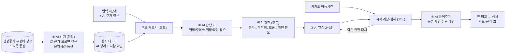

<div align="center">


# 이음길 AI

**휠체어, 어르신, 유모차와 함께 가는 영동 여행 루트 플래너**<br />
문장으로만 된 공공 무장애 정보를 AI가 읽고, 우리 가족 기준으로 판단해 일정 2~3안과 현장 안내로 바꿔 줍니다.

[서비스 바로가기](https://ieumgil-ai.vercel.app) · [기획 문서](docs/planning.md) · [디자인 시안](docs/design/README.md) · 시연 영상(준비 중)

[](https://github.com/ieumgil/ieumgil-ai/actions/workflows/ci.yml)
[](https://ieumgil-ai.vercel.app)
[](https://github.com/ieumgil/ieumgil-ai/commits/main)


</div>

> [!NOTE]
> **개발 중인 서비스입니다.** 시작 화면과 입력 4단계가 동작하고, 관광공사 무장애 정보 182곳을 받아 두었습니다. AI 읽기·판단·일정 설계와 결과 화면을 만들고 있습니다. 진행 상황은 [개발 현황](#개발-현황)에서 볼 수 있습니다.

## 왜 만들었나요

강릉은 2022년 문화체육관광부가 선정한 **국내 첫 무장애 관광도시**입니다.<sup>[1](#참고-자료)</sup> 그런데 관광약자와 함께 여행을 준비하는 사람은 지금도 관광지마다 계단, 장애인 화장실, 주차, 걷는 거리를 따로 찾아보고, 이동 시간을 계산해서 직접 일정으로 엮어야 합니다.

이음길은 이 과정을 **"우리 조건에 맞는 루트" 하나**로 줄입니다.

| 지금은 | 이음길에서는 |
| --- | --- |
| 관광지마다 접근성 정보를 따로 검색 | 유형을 고르면 꼭 필요한 조건이 자동으로 켜짐 |
| 무장애 정보가 "경사로 있음" 같은 문장뿐이라 직접 해석해야 함 | AI가 문장을 읽어 이 사람 기준으로 적합 / 주의 / 부적합 / 확인 필요를 판단 |
| 정보가 없으면 가 봐야 앎 | 모르는 항목은 숨기지 않고, 출발 전에 물어볼 질문과 공식 전화번호를 함께 보여줌 |
| 갈 수 있는 곳을 골라 직접 순서를 짬 | AI가 성격이 다른 일정 2~3안을 짜고, 코드가 이동 시간과 운영시간을 검사 |
| 어디서 본 정보인지 알기 어려움 | 판정마다 출처와 확인일을 함께 표시 |

## 이음길이 하는 일

- **조건을 어기는 곳은 빼요.** 휠체어·보행이 불편한 어르신·유모차 유형별로 필수 조건을 적용하고, 여러 유형을 고르면 항목마다 가장 엄격한 기준을 씁니다.
- **AI가 공공데이터를 읽어요.** 관광공사 무장애 정보 문장("출입구까지 경사로가 설치되어 있음(완만함)")을 판단할 수 있는 값과 근거로 정리합니다.
- **AI가 이 사람 기준으로 판단해요.** 장소마다 적합 / 주의 / 부적합 / 확인 필요와 이유를 내고, 근거가 된 원문 항목을 함께 보여줍니다.
- **AI가 일정을 2~3안 짜고 스스로 고쳐요.** 여유롭게 · 바다 중심 · 비 와도 괜찮게처럼 성격이 다른 안을 비교해 고릅니다. 코드가 운영시간·하루 범위를 검사해 걸린 안은 AI가 다시 고칩니다.
- **현장에서 쓸 말로 풀어줘요.** 도착 후 동선("장애인 주차 → 경사로 → 화장실은 주차장 쪽"), 출발 전 확인할 질문과 공식 전화번호.
- **애매한 것만 더 물어봐요.** 입력을 보고 AI가 필요한 질문만 0~3개 고릅니다(예: 수동·전동 휠체어).
- **조건 때문에 빠진 곳도 알려줘요.** 어려운 이유와 함께 대신 갈 만한 곳을 제안합니다.

## 어떻게 판단하나요

**LLM이 읽고·판단하고·계획하고·풀어주고, 코드는 계산과 검사를 강제합니다.** 관광공사 무장애 정보는 짧은 문장으로만 있어 코드로는 가능/불가를 가를 수 없습니다. 그래서 문장을 읽고 판단하는 일은 AI가 맡고, AI의 답은 전부 정해진 JSON 형식으로 받아 코드가 검사한 뒤 화면에 그립니다. 자세한 설계는 [AI 설계 문서](docs/ai-plan.md)에 있습니다.



- **근거 없는 말은 버립니다.** AI가 원문에 없는 시설·시간·거리를 쓰거나 근거 항목을 붙이지 않으면 그 답은 쓰지 않습니다. 시각은 AI가 아니라 코드가 계산합니다.
- **안전 하한은 코드가 지킵니다.** 꼭 필요한 조건이 '불가'면 부적합, '모름'이면 '확인 필요'로만 보여주고 '적합'이 될 수 없습니다.
- **AI가 실패해도 동작합니다.** AI 응답이 늦거나 형식이 틀리거나 한도를 넘으면 규칙만으로 만든 일정 1안을 보여줍니다.
## 유형별 조건

[기획 문서](docs/planning.md)의 조건표를 그대로 코드로 옮겼습니다([`src/lib/engine/conditions.ts`](src/lib/engine/conditions.ts)).

| 항목 | 휠체어 | 유모차 | 보행이 불편한 어르신 |
| --- | :---: | :---: | :---: |
| 계단·단차 없는 진입 | **필수** | 주의 | 주의 |
| 엘리베이터 (층이 있는 곳) | **필수** | **필수** | 선호 |
| 급한 경사 없음 | **필수** | 선호 | 주의 |
| 포장길·데크 노면 | **필수** | 선호 | 주의 |
| 장애인 화장실 | **필수** | — | 선호 |
| 수유실·기저귀 교환대 | — | 선호 | — |
| 장애인 전용 주차구역 | **필수**¹ | — | **필수**¹ |
| 주차장→입구, 관람 동선 거리 | — | — | **필수**² |
| 쉴 곳 (벤치·쉼터) | — | 선호 | 선호 |
| 휠체어·유모차 대여 | 선호 | 선호 | 선호 |

**필수**: 하나라도 어기면 루트에서 빼고 '어려운 곳 + 대안'으로 보여줍니다 · **선호**: 추천 순위에만 반영 · **주의**: 루트에 남기고 경고 문구를 붙입니다<br />
¹ 자가용이고 장애인 사용 자동차 표지가 있을 때만 · ² 사용자가 고른 거리(100m / 300m / 500m) 이하

## 화면

| 시작 | 1단계 언제·어디서 | 2단계 누구와 | 3단계 꼭 필요한 조건 | 4단계 좋아하는 곳 |
| :---: | :---: | :---: | :---: | :---: |
|  |  |  |  |  |

**누구나 쓸 수 있게**: 본문 16px 이상 · 터치 영역 44px 이상 · '가 글씨 크게' 버튼 · 상태를 색만이 아니라 기호(✓ ! ✕)와 글자로 함께 표시 · 모바일 우선, PC 반응형

## 데이터

1차 출처는 **한국관광공사 무장애 여행정보 API**<sup>[2](#참고-자료)</sup>입니다. 강릉·속초·동해의 관광지·문화시설 **182곳**을 받았고, 어떤 정보가 얼마나 있는지는 [공공데이터 조사](docs/data/tour-api-fields.md)에 정리했습니다.

| 지역 | API 장소 | 무장애 문장 예 |
| --- | :---: | --- |
| 강릉 | 120곳 | "출입구까지 경사로가 설치되어 있음(완만함)" |
| 속초 | 39곳 | "장애인 주차장 있음(6대)", "엘리베이터 있음" |
| 동해 | 23곳 | "주출입구는 턱이 없어 휠체어 접근 가능함" |

- **AI 정리 + 사람 확인**: AI가 문장을 읽어 접근성 10개 항목을 `가능 / 부분가능 / 불가 / 모름`으로 정리하고(등급 `AI 정리`), 사람이 40곳을 전화·현장으로 판정해(등급 `확인 완료`) AI와 얼마나 맞는지 잽니다.
- **모름은 숨기지 않아요**: '모름'에는 물어볼 질문이, 장소에는 공식 전화번호가 반드시 있어야 합니다. 빠지면 [검사 스크립트](scripts/validate-places.ts)가 빌드를 멈춥니다.
- **항목마다 근거**: 근거가 된 원문 항목, 출처, 확인일을 함께 기록합니다. 열린관광 누리집은 사람이 확인할 때 보는 출처로 씁니다.
- **사진**: 공공누리 제1유형을 우선 사용하고 출처를 표기합니다.
- 장소 데이터는 [`data/places.json`](data/places.json) 하나로 관리하고 [JSON 스키마](data/places.schema.json)로 형식을 고정합니다. 수집 스크립트는 [`scripts/tour/`](scripts/tour/)에 있습니다.

## 검증

| 항목 | 목표 | 현재 |
| --- | --- | --- |
| 자동 테스트 | 모두 통과 | [](https://github.com/ieumgil/ieumgil-ai/actions/workflows/ci.yml) 조건 계산 14개 · 날짜 계산 6개 · 장소 데이터 검사 10개 · 화면 흐름(E2E) 13개 × 모바일·PC |
| 엔진 시나리오 10개 | 필수 조건 위반 0건 | 조건 계산 부분 작성, 루트 엔진과 함께 완성 예정 |
| AI 가드 테스트 (가짜 LLM) | 근거 없는 판단 0건 · '모름'이 적합으로 나간 경우 0건 · 검사를 통과하지 못한 안 노출 0건 | AI 기능과 함께 진행 예정 |
| AI 읽기 정확도 (사람 판정 40곳) | 항목별 일치율 | 진행 예정 · 결과는 `docs/eval/` |
| AI 판단 시나리오 30개 (사람 정답) | 판단 일치율, 규칙 일정 대비 품질 | 진행 예정 · 결과는 `docs/eval/` |

모든 커밋마다 GitHub Actions가 장소 데이터 검사, 테스트, 린트, 빌드를 실행합니다.

## 개발 현황

- [x] 서비스 기획·디자인 시안, 장소 데이터 스키마
- [x] 장소 데이터 검사(빌드 전 자동 실행)와 테스트 환경
- [x] 시작 화면, 글씨 크게
- [x] 입력 4단계: 언제·어디서 / 누구와 / 꼭 필요한 조건 / 좋아하는 곳
- [x] 유형별 조건 계산 엔진
- [x] 관광공사 무장애 정보 수집: 영동 3개 시 관광지·문화시설 182곳
- [ ] 장소 데이터 형식 변경('모름' + 질문, 등급, 전화번호 필수)
- [ ] AI 기반: Gemini 호출(`llm.ts`), JSON 스키마, 출력 검증(`guards.ts`), 가짜 LLM 테스트
- [ ] ① AI 읽기 182곳 + 사람 판정 40곳
- [ ] 시각 계산·일정 검사·규칙 일정
- [ ] ② AI 판단 + 안전 하한
- [ ] ③ AI 일정 2~3안 + 검사·수정·평가
- [ ] ④ AI 풀어주기, AI 추가 질문
- [ ] 카카오맵·길찾기 연동
- [ ] 결과 화면: 안 비교 → 상세(모바일·PC), 어려운 곳과 대안
- [ ] 공유 링크·요약 이미지, 예시 루트
- [ ] 사용자 테스트

## 기술 스택

| 구분 | 사용 |
| --- | --- |
| 화면·서버 | Next.js 16 (App Router), React 19, TypeScript (strict) |
| 스타일 | Tailwind CSS v4, Pretendard |
| 지도·경로 | 카카오맵 JavaScript SDK, 카카오모빌리티 길찾기 |
| AI | Gemini Flash (읽기·판단·일정 2~3안·풀어주기, JSON 응답) |
| 데이터 | 한국관광공사 무장애 여행정보 API (수집 스크립트 전용) |
| 저장 | Supabase (공유 일정만, 개인정보 없음) |
| 검증 | Vitest, Playwright, JSON Schema (Ajv), GitHub Actions |
| 배포 | Vercel |

<details>
<summary>폴더 구조</summary>

```
src/app/            시작 화면 · plan/(입력 4단계) · trip/[id]/(결과)
src/components/     공통 화면 부품
src/lib/ai/         AI 판단·일정 2~3안·풀어주기·추가 질문, 출력 검증
src/lib/engine/     안전 하한·시간 계산·일정 검사·규칙 일정
src/lib/plan/       입력값, 날짜 계산
data/               장소 데이터와 스키마
scripts/            데이터 검사, 관광공사 API 수집(tour/)
tests/              엔진·데이터 테스트
e2e/                화면 흐름 테스트(Playwright)
docs/               기획 문서, 디자인 시안, 조사표
```

</details>

## 실행 방법

Node.js 22 이상이 필요합니다.

```bash
git clone https://github.com/ieumgil/ieumgil-ai.git
cd ieumgil-ai
npm install
cp .env.example .env.local   # 지도·AI 기능을 쓸 때 키 입력
npm run dev                  # http://localhost:3000
```

| 명령 | 하는 일 |
| --- | --- |
| `npm test` | 엔진·데이터 테스트 |
| `npm run test:e2e` | 화면 흐름 테스트 (Playwright, 처음 한 번 `npx playwright install chromium`) |
| `npm run validate:places` | 장소 데이터 검사 |
| `npm run build` | 데이터 검사 후 배포용 빌드 |

## 한계와 안내

- 지도 경로는 **일반 차량 경로**이며 휠체어 안전 경로를 보장하지 않습니다.
- 접근성 정보는 확인일 기준이며 현장 상황과 다를 수 있습니다. 출발 전 전화 확인을 권장합니다.
- 음식점·카페·숙소는 추천하지 않습니다. 숙소는 지역만 받아 둘째 날 출발점으로 씁니다.

## 팀 이음길

| 이름 | 역할 |
| --- | --- |
| 공지혁 | 기획, 개발 |
| 강환일 | 관광지 조사, 운영 |

2026 My AI 랩(강릉과학산업진흥원) 과제로 만들고 있습니다.

## 참고 자료

1. 문화체육관광부 보도자료, [첫 번째 '무장애 관광도시'로 강릉시 선정](https://www.mcst.go.kr/kor/s_notice/press/pressView.jsp?pSeq=19453) (2022.4.8.)
2. 공공데이터포털, [한국관광공사 무장애 여행정보 API](https://www.data.go.kr/data/15101897/openapi.do)
