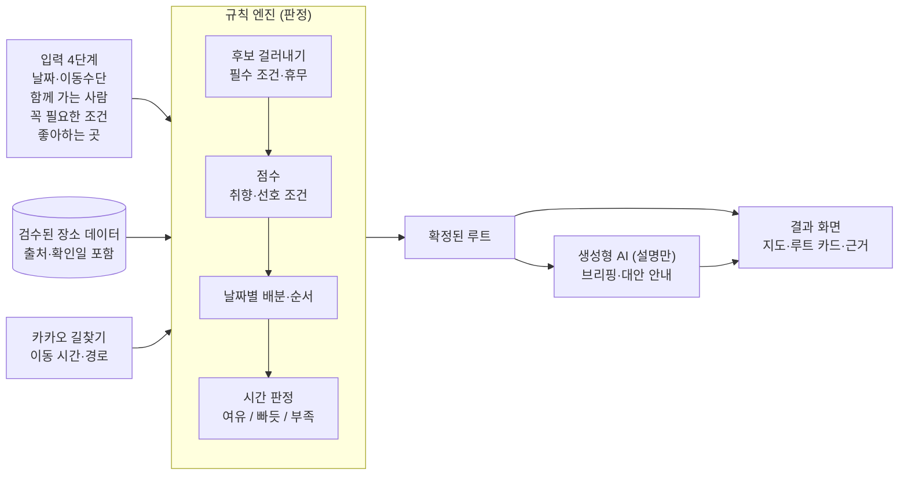

<div align="center">


# 이음길 AI

**휠체어, 어르신, 유모차와 함께 가는 영동 여행 루트 플래너**<br />
갈 수 있는지는 규칙으로 판정하고, AI가 쉬운 말로 설명합니다.

[서비스 바로가기](https://ieumgil-ai.vercel.app) · [기획 문서](docs/planning.md) · [디자인 시안](docs/design/README.md) · 시연 영상(준비 중)

[](https://github.com/ieumgil/ieumgil-ai/actions/workflows/ci.yml)
[](https://ieumgil-ai.vercel.app)
[](https://github.com/ieumgil/ieumgil-ai/commits/main)


</div>

> [!NOTE]
> **개발 중인 서비스입니다.** 시작 화면과 입력 4단계가 동작하고, 루트 엔진·결과 화면·AI 브리핑을 만들고 있습니다. 진행 상황은 [개발 현황](#개발-현황)에서 볼 수 있습니다.

## 왜 만들었나요

강릉은 2022년 문화체육관광부가 선정한 **국내 첫 무장애 관광도시**입니다.<sup>[1](#참고-자료)</sup> 그런데 관광약자와 함께 여행을 준비하는 사람은 지금도 관광지마다 계단, 장애인 화장실, 주차, 걷는 거리를 따로 찾아보고, 이동 시간을 계산해서 직접 일정으로 엮어야 합니다.

이음길은 이 과정을 **"우리 조건에 맞는 루트" 하나**로 줄입니다.

| 지금은 | 이음길에서는 |
| --- | --- |
| 관광지마다 접근성 정보를 따로 검색 | 유형을 고르면 꼭 필요한 조건이 자동으로 켜짐 |
| 정보가 없으면 가 봐야 앎 | 모든 항목을 가능 / 부분가능 / 불가로 확정한 데이터만 사용 |
| 갈 수 있는 곳을 골라 직접 순서를 짬 | 조건을 통과한 곳으로 날짜별 순서와 이동 시간을 계산 |
| 어디서 본 정보인지 알기 어려움 | 판정마다 출처와 확인일을 함께 표시 |

## 이음길이 하는 일

- **조건을 어기는 곳은 빼요.** 휠체어·보행이 불편한 어르신·유모차 유형별로 필수 조건을 적용하고, 여러 유형을 고르면 항목마다 가장 엄격한 기준을 씁니다.
- **판정마다 근거를 보여줘요.** 모든 접근성 항목에 출처 URL, 확인 방법, 확인일이 붙어 있습니다.
- **AI가 쉬운 말로 정리해요.** 확정된 루트를 바탕으로 여행 전체와 일차별 주의할 점, 챙길 것을 브리핑합니다.
- **조건 때문에 빠진 곳도 알려줘요.** 어려운 이유와 함께 대신 갈 만한 곳을 제안합니다.

## 어떻게 판정하나요

**판정은 규칙, 설명은 AI.** 갈 수 있는지는 코드로 된 규칙 엔진만 판단하고, 생성형 AI는 확정된 결과를 설명만 합니다. AI가 입력에 없는 시설, 시간, 거리를 만들어 내지 않도록 하기 위해서입니다.



- **AI가 실패해도 동작합니다.** AI 응답이 늦거나 한도를 넘으면 규칙으로 만든 기본 브리핑을 보여줍니다.
- **보내는 정보는 최소로.** AI에는 유형, 조건 값, 장소 정보만 보내고 이름·연락처는 받지도 보내지도 않습니다.

## 유형별 조건

[기획 문서](docs/planning.md)의 조건표를 그대로 코드로 옮겼습니다([`src/lib/engine/conditions.ts`](src/lib/engine/conditions.ts)).

| 항목 | 휠체어 | 유모차 | 보행이 불편한 어르신 |
| --- | :---: | :---: | :---: |
| 계단·단차 없는 진입 | **필수** | 주의 | 주의 |
| 엘리베이터 (층이 있는 곳) | **필수** | **필수** | 선호 |
| 급한 경사 없음 | **필수** | 선호 | 주의 |
| 포장길·데크 노면 | **필수** | 선호 | 주의 |
| 장애인 화장실 | **필수** | — | 선호 |
| 수유실·기저귀 교환대 | — | 선호 | — |
| 장애인 전용 주차구역 | **필수**¹ | — | **필수**¹ |
| 주차장→입구, 관람 동선 거리 | — | — | **필수**² |
| 쉴 곳 (벤치·쉼터) | — | 선호 | 선호 |
| 휠체어·유모차 대여 | 선호 | 선호 | 선호 |

**필수**: 하나라도 어기면 루트에서 빼고 '어려운 곳 + 대안'으로 보여줍니다 · **선호**: 추천 순위에만 반영 · **주의**: 루트에 남기고 경고 문구를 붙입니다<br />
¹ 자가용이고 장애인 사용 자동차 표지가 있을 때만 · ² 사용자가 고른 거리(100m / 300m / 500m) 이하

## 화면

| 시작 | 1단계 언제·어디서 | 2단계 누구와 | 3단계 꼭 필요한 조건 | 4단계 좋아하는 곳 |
| :---: | :---: | :---: | :---: | :---: |
|  |  |  |  |  |

**누구나 쓸 수 있게**: 본문 16px 이상 · 터치 영역 44px 이상 · '가 글씨 크게' 버튼 · 상태를 색만이 아니라 기호(✓ ! ✕)와 글자로 함께 표시 · 모바일 우선, PC 반응형

## 데이터

장소 데이터는 저장소 안 [`data/places.json`](data/places.json) 하나로 관리하고, [JSON 스키마](data/places.schema.json)로 형식을 고정합니다.

| 지역 | 조사 대상 | 검수 완료 |
| --- | :---: | :---: |
| 강릉 | 16곳 | 조사 중 |
| 속초 | 9곳 | 조사 중 |
| 동해 | 7곳 | 조사 중 |

- **'정보 없음' 금지**: 접근성 항목은 모두 `가능 / 부분가능 / 불가` 중 하나로 확정합니다. `미확인`이 하나라도 남아 있으면 [검사 스크립트](scripts/validate-places.ts)가 빌드를 멈춥니다.
- **항목마다 근거**: 출처 URL, 확인 방법(관광공사 API · 지자체 누리집 · 전화 확인 · 현장 확인), 확인일을 함께 기록합니다.
- **출처**: 한국관광공사 무장애 여행정보 API<sup>[2](#참고-자료)</sup>, 지자체 누리집, 전화 확인
- **사진**: 공공누리 제1유형을 우선 사용하고 출처를 표기합니다.

## 검증

| 항목 | 목표 | 현재 |
| --- | --- | --- |
| 자동 테스트 | 모두 통과 | [](https://github.com/ieumgil/ieumgil-ai/actions/workflows/ci.yml) 조건 계산 14개 · 날짜 계산 6개 · 장소 데이터 검사 10개 |
| 엔진 시나리오 10개 | 필수 조건 위반 0건 | 조건 계산 부분 작성, 루트 엔진과 함께 완성 예정 |
| AI 브리핑 시나리오 20개 | 입력에 없는 사실 0건 | 브리핑 기능과 함께 진행 예정 |

모든 커밋마다 GitHub Actions가 장소 데이터 검사, 테스트, 린트, 빌드를 실행합니다.

## 개발 현황

- [x] 서비스 기획·디자인 시안, 장소 데이터 스키마
- [x] 장소 데이터 검사(빌드 전 자동 실행)와 테스트 환경
- [x] 시작 화면, 글씨 크게
- [x] 입력 4단계: 언제·어디서 / 누구와 / 꼭 필요한 조건 / 좋아하는 곳
- [x] 유형별 조건 계산 엔진
- [ ] 영동권 관광지 32곳 조사·검수
- [ ] 루트 엔진: 후보 걸러내기 → 점수 → 날짜별 배분 → 순서 → 시간 판정
- [ ] 카카오맵·길찾기 연동
- [ ] 결과 화면(모바일·PC), 어려운 곳과 대안
- [ ] AI 브리핑(Gemini)과 기본 브리핑
- [ ] 공유 링크·요약 이미지, 예시 루트
- [ ] 사용자 테스트

## 기술 스택

| 구분 | 사용 |
| --- | --- |
| 화면·서버 | Next.js 16 (App Router), React 19, TypeScript (strict) |
| 스타일 | Tailwind CSS v4, Pretendard |
| 지도·경로 | 카카오맵 JavaScript SDK, 카카오모빌리티 길찾기 |
| AI | Gemini Flash (브리핑·대안 설명) |
| 저장 | Supabase (공유 일정만, 개인정보 없음) |
| 검증 | Vitest, JSON Schema (Ajv), GitHub Actions |
| 배포 | Vercel |

<details>
<summary>폴더 구조</summary>

```
src/app/            시작 화면 · plan/(입력 4단계) · trip/[id]/(결과)
src/components/     공통 화면 부품
src/lib/engine/     규칙 엔진 (판정)
src/lib/plan/       입력값, 날짜 계산
data/               장소 데이터와 스키마
scripts/            데이터 검사
tests/              엔진·데이터 테스트
docs/               기획 문서, 디자인 시안, 조사표
```

</details>

## 실행 방법

Node.js 22 이상이 필요합니다.

```bash
git clone https://github.com/ieumgil/ieumgil-ai.git
cd ieumgil-ai
npm install
cp .env.example .env.local   # 지도·AI 기능을 쓸 때 키 입력
npm run dev                  # http://localhost:3000
```

| 명령 | 하는 일 |
| --- | --- |
| `npm test` | 엔진·데이터 테스트 |
| `npm run validate:places` | 장소 데이터 검사 |
| `npm run build` | 데이터 검사 후 배포용 빌드 |

## 한계와 안내

- 지도 경로는 **일반 차량 경로**이며 휠체어 안전 경로를 보장하지 않습니다.
- 접근성 정보는 확인일 기준이며 현장 상황과 다를 수 있습니다. 출발 전 전화 확인을 권장합니다.
- 음식점·카페·숙소는 추천하지 않습니다. 숙소는 지역만 받아 둘째 날 출발점으로 씁니다.

## 팀 이음길

| 이름 | 역할 |
| --- | --- |
| 공지혁 | 기획, 개발 |
| 강환일 | 관광지 조사, 운영 |

2026 My AI 랩(강릉과학산업진흥원) 과제로 만들고 있습니다.

## 참고 자료

1. 문화체육관광부 보도자료, [첫 번째 '무장애 관광도시'로 강릉시 선정](https://www.mcst.go.kr/kor/s_notice/press/pressView.jsp?pSeq=19453) (2022.4.8.)
2. 공공데이터포털, [한국관광공사 무장애 여행정보 API](https://www.data.go.kr/data/15101897/openapi.do)
