<div align="center">

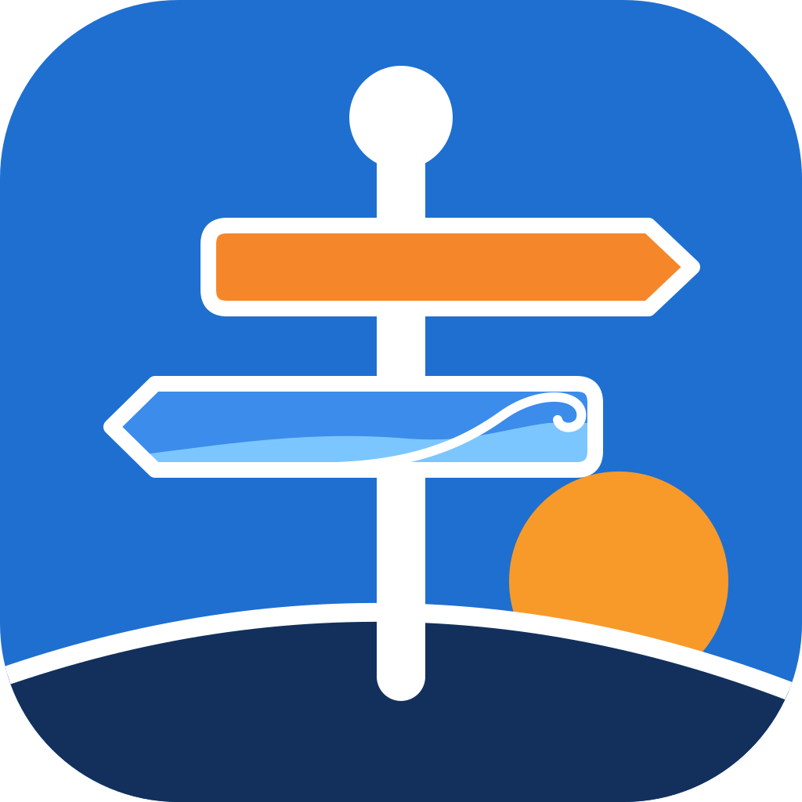

# 이음길 AI

**휠체어, 어르신, 유모차와 함께 가는 영동 여행 루트 플래너**<br />
문장으로만 된 공공 무장애 정보를 AI가 읽고, 우리 가족 기준으로 판단해 성격이 다른 일정 2\~3안으로 짜 줍니다.<br />
정한 일정은 **링크 하나로 함께 가는 사람과 나누고**, A4 한 장으로 뽑아 여행 당일까지 들고 갑니다.

[서비스 바로가기](https://ieumgil-ai.vercel.app) · [**예시 루트 바로 보기**](https://ieumgil-ai.vercel.app/trip/example) · [기획 문서](docs/planning.md) · [AI 설계](docs/ai-plan.md) · [디자인 시안](docs/design/README.md)

[](https://github.com/ieumgil/ieumgil-ai/actions/workflows/ci.yml)
[](https://ieumgil-ai.vercel.app)
[](https://github.com/ieumgil/ieumgil-ai/commits/main)


[](https://ai.google.dev/)
[](https://platform.openai.com/)
[](https://www.data.go.kr/data/15101897/openapi.do)
[](https://www.data.go.kr/data/15012892/standard.do)
[](https://apis.map.kakao.com/)
[](https://supabase.com/)
[](https://ieumgil-ai.vercel.app)
<br />


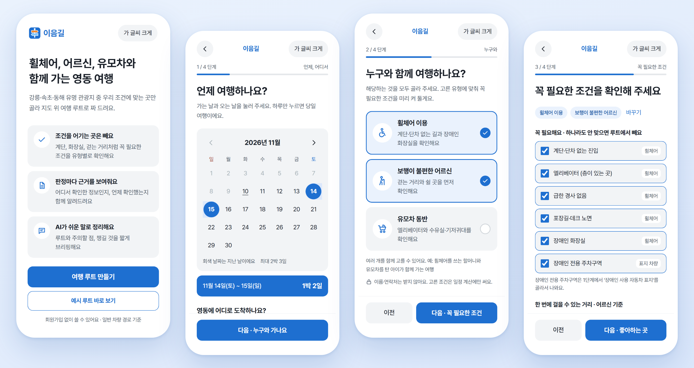

| 관광지 | 필수 조건 위반 | 근거 없이 채운 값 | AI 읽기 일관성 | 자동 테스트 |
| :---: | :---: | :---: | :---: | :---: |
| **152곳**<br /><sub>강릉·속초·동해</sub> | **0건**<br /><sub>시나리오 10 + 유형 조합 14</sub> | **0건**<br /><sub>1,520항목</sub> | **96.4%**<br /><sub>두 번 읽어 비교</sub> | **CI 통과**<br /><sub>단위 319 · 화면 흐름 124</sub> |

</div>

> [!TIP]
> **입력 없이 결과부터 보려면** [예시 루트](https://ieumgil-ai.vercel.app/trip/example)를 여세요. 실제 AI가 미리 만든 일정(휠체어 · 1박 2일 · 안 3개)이 바로 열리고, 장소 바꾸기 → 확정 → 지도 → 전화 확인 → 공유 링크 · 인쇄까지 눌러 볼 수 있습니다.<br />
> 직접 만들려면 [서비스](https://ieumgil-ai.vercel.app)에서 조건 4단계를 고르면 됩니다(AI 일정 만들기는 보통 10\~40초).

## 왜 만들었나요

강릉은 2022년 문화체육관광부가 선정한 **국내 첫 무장애 관광도시**입니다.<sup>[1](#참고-자료)</sup> 그런데 관광약자와 함께 여행을 준비하는 사람은 지금도 관광지마다 계단, 장애인 화장실, 주차, 걷는 거리를 따로 찾아보고, 이동 시간을 계산해서 직접 일정으로 엮어야 합니다. 공공 무장애 정보는 **"출입구까지 경사로가 설치되어 있음(완만함)" 같은 짧은 문장**으로만 있고, 기존 서비스는 이 문장을 그대로 보여주며 판단을 여행자에게 넘깁니다.

| 지금은 | 이음길에서는 |
| --- | --- |
| "경사로 있음" 같은 문장을 직접 해석 | AI가 문장을 읽고 **이 사람 기준으로** 적합 / 주의 / 확인 필요 / 부적합을 판단하고, 근거가 된 원문 항목을 표시 |
| 갈 수 있는 곳을 골라 직접 순서를 짬 | AI가 성격이 다른 일정 2\~3안을 짜고, 코드가 시각·운영시간을 계산·검사 |
| 정보가 없으면 가 봐야 앎 | 모르는 항목은 숨기지 않고 확인할 방법을 줌: 엘리베이터·장애인 화장실·주차·출입구는 **전화로 물어볼 질문 + 공식 전화**, 바닥·경사·쉴 곳은 **가서 보고 확인할 것** |
| 짠 일정을 캡처·메모로 따로 전달 | **공유 링크 하나**로 함께 가는 사람이 로그인 없이 보고, 여행 당일에도 휴대폰으로 다시 엶 · **A4 한 장** 일정표로 인쇄 |

## 여행 준비부터 당일까지

루트를 한 번 만들고 끝나는 서비스가 아닙니다. 어디가 있는지 찾아보는 단계부터, 함께 가는 사람과 나누고 여행 당일 다시 여는 단계까지 이어집니다.

| 단계 | 이음길이 돕는 것 |
| --- | --- |
| 1. 찾아보기 | [관광지 둘러보기](#사용-흐름): 지역·분야로 보고, AI 한 줄 소개와 우리 가족 기준 접근성 요약을 보고 담기 |
| 2. 조건 고르기 | 4단계 선택형(자유 입력 없음). 유형을 고르면 꼭 필요한 조건이 자동으로 켜짐 |
| 3. 일정 받기 | AI가 장소마다 판단하고 성격이 다른 2\~3안을 짬. 시각·운영시간은 코드가 계산·검사, 카카오 실제 이동시간 반영 |
| 4. 고치기 | 장소 [바꾸기] · [순서 고치기] · 빼기. AI를 다시 부르지 않고 그 자리에서 다시 계산 |
| 5. 확인하기 | 전화로 물어볼 것 + 공식 전화, [괜찮대요] / [어렵대요], 어려우면 바로 바꾸기 |
| 6. **함께 나누기** | **공유 링크**: 로그인 없이 읽기 전용으로 지도·일정·물어볼 것. 이동시간은 열 때마다 카카오에서 새로 받음 |
| 7. **들고 가기 · 당일** | **A4 한 장 일정표**(시간표 + 전화 체크 칸) · 당일에는 공유 링크를 휴대폰으로 열어 다음 장소·지도·전화를 바로 |

<table>
<tr>
<th>공유 링크 만들기</th>
<th>받은 사람 화면(읽기 전용)</th>
<th>인쇄·PDF(A4 한 장)</th>
</tr>
<tr>
<td align="center">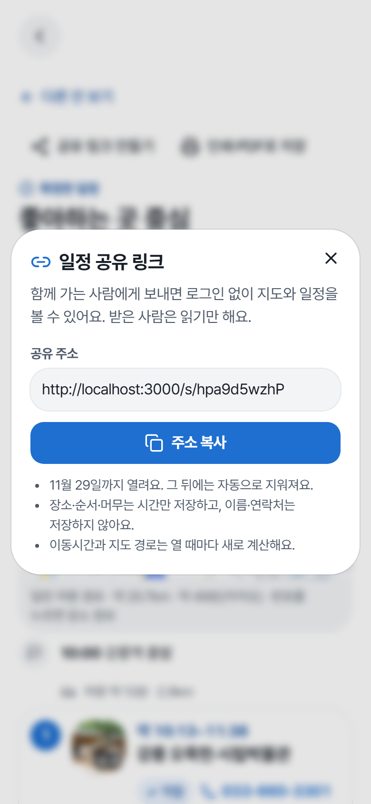</td>
<td align="center">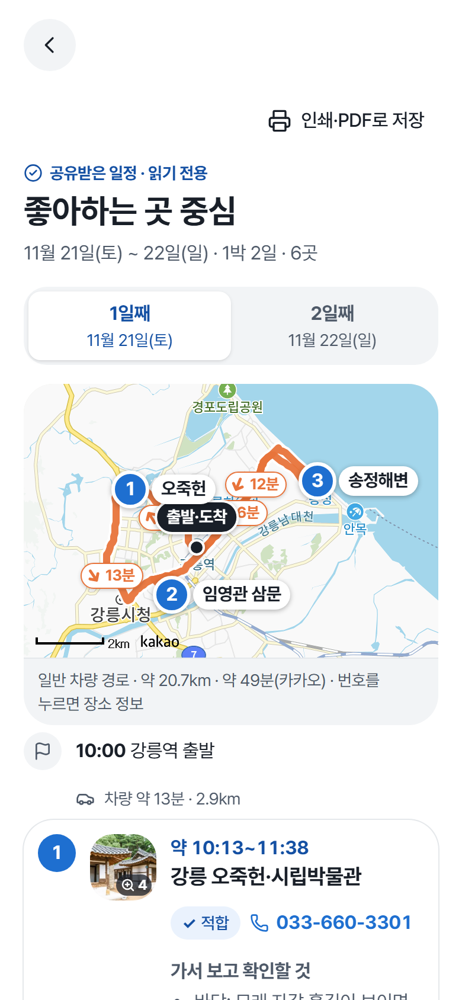</td>
<td align="center">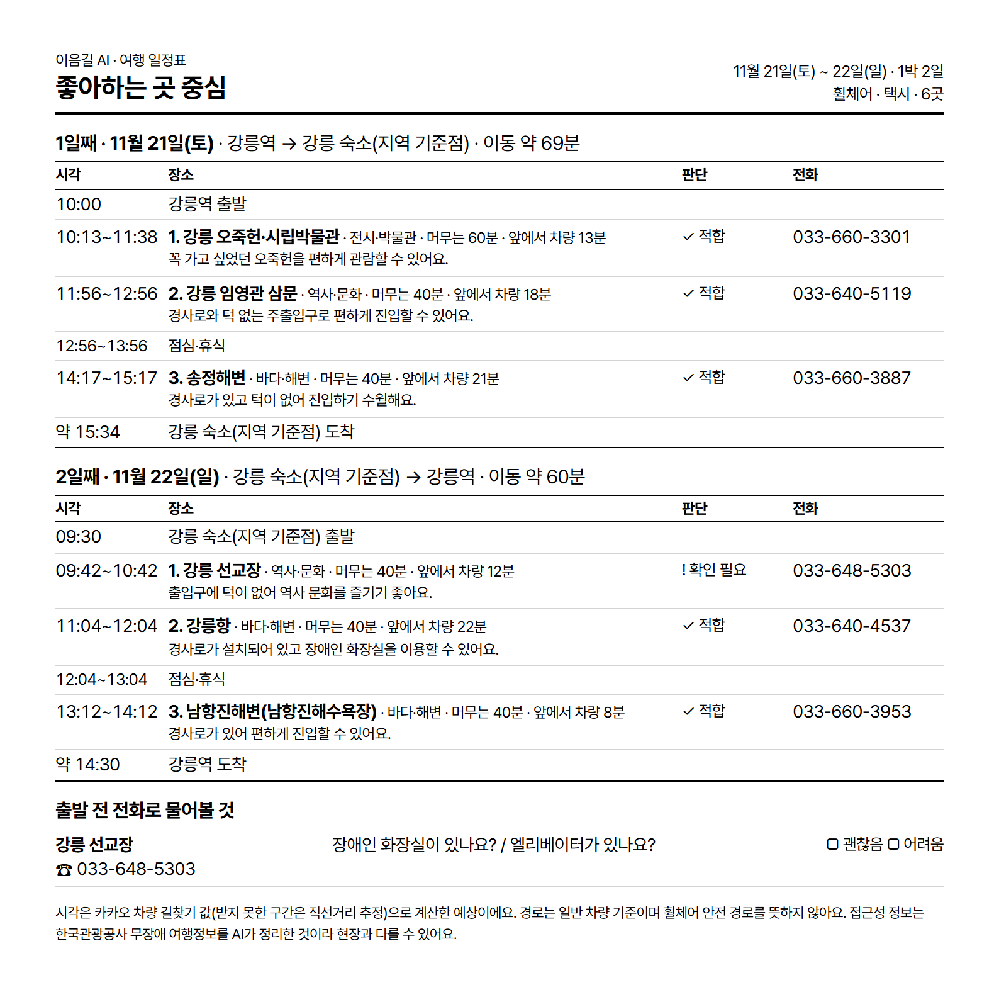</td>
</tr>
</table>

- **고른 일정만 저장합니다**: 장소·순서·머무는 시간·이유·물어볼 것. 이름·연락처·카카오 이동시간·경로는 저장하지 않고 열 때마다 다시 계산합니다(카카오 결과 저장 금지 정책).
- **알아서 사라집니다**: 여행 마지막 날 + 7일(최대 30일)이 지나면 자동으로 지워지고, 기간이 지난 링크는 그렇다고 안내합니다.
- **받은 사람은 읽기만**: 바꾸기·공유 버튼이 없고 검색 엔진에 올라가지 않습니다. 저장소는 브라우저 키로 접근할 수 없게 막았습니다(Supabase RLS).
- **종이로도**: 인쇄하면 사진·지도를 뺀 A4 일정표가 나옵니다(1박 2일 기준 1장).

## 계획서 대비 구현 현황

[기획 문서](docs/planning.md)의 계획은 **모두 동작합니다**. 공고 의무 결과물(핵심 기능 작동 · 실제 데이터로 시연 · 배포 URL과 GitHub 공개)도 모두 갖췄습니다. 아래는 계획 항목과 확인할 곳입니다.

| 계획 | 구현 · 확인할 곳 |
| --- | --- |
| ① AI 읽기: 관광공사 문장 → 접근성 10항목·운영시간·도착 후 동선 | 152곳 완료 · [`data/ai/read/`](data/ai/read/) · [`read-places.ts`](scripts/ai/read-places.ts) |
| ② AI 판단: 이 사람에게 적합 / 주의 / 확인 필요 / 부적합(3회) | [`judge.ts`](src/lib/ai/judge.ts) · 안전 하한 [`guards.ts`](src/lib/ai/guards.ts) |
| ③ AI 계획: 성격이 다른 일정 2\~3안 + 평가자 | [`plan.ts`](src/lib/ai/plan.ts) · [`review.ts`](src/lib/ai/review.ts) · 전체 흐름 [`trip.ts`](src/lib/ai/trip.ts) |
| ④ 풀어주기: 도착 후 동선·출발 전 확인할 것 | 방식 바꿈: ① 읽기 결과를 카드에, 확인할 것은 [체크리스트](src/components/trip/Checklist.tsx)로 |
| AI가 실패해도 시연이 멈추지 않음 | 규칙 일정 [`fallback.ts`](src/lib/engine/fallback.ts) · Gemini가 늦으면 OpenAI [`llm.ts`](src/lib/llm.ts) |
| LLM 답은 JSON 스키마로, 시각은 코드가 계산 | [`schemas.ts`](src/lib/ai/schemas.ts) · [`timeline.ts`](src/lib/engine/timeline.ts) · [`check.ts`](src/lib/engine/check.ts) |
| '모름'은 숨기지 않고 확인할 방법을 줌 | 빌드 검사 [`validate-places.ts`](scripts/validate-places.ts) · [`questions.ts`](src/lib/trip/questions.ts) |
| 카카오 결과 저장 안 함 · 키는 서버에만 · 개인정보 없음 | [`api/legs`](src/app/api/legs/route.ts) · [`api/route-line`](src/app/api/route-line/route.ts) · 자유 입력 칸 없음 |
| 시작 화면 + 예시 루트(심사용) | [`/trip/example`](https://ieumgil-ai.vercel.app/trip/example) |
| 입력 4단계 · 만드는 중(진행 기록 스트리밍) | [사용 흐름](#사용-흐름) · [`api/plan`](src/app/api/plan/route.ts) |
| 안 비교 → 날짜별 상세 · 여유/빠듯/부족 · 근거 표시 | [`src/components/trip/`](src/components/trip/) |
| 장소 바꾸기 · 순서 바꾸기·빼기(AI 없이 다시 계산) | [`edit.ts`](src/lib/trip/edit.ts) |
| 확정 일정 + 카카오 지도·경로선 · 실제 이동시간 | [`final/`](src/app/trip/%5Bid%5D/final/) · [`real-travel.ts`](src/lib/trip/real-travel.ts) |
| 출발 전 확인할 것(질문 + 전화) | 체크리스트(괜찮대요 / 어렵대요 → 바꾸기) |
| 어려운 곳 목록과 대안 | 결과 화면 아래 "이번 조건으로 가기 어려운 곳" · [`hard.ts`](src/lib/trip/hard.ts) |
| 공유 링크(읽기 전용, 기간 지나면 자동 폐기) | `/s/{id}` · [`lib/share/`](src/lib/share/) · [SQL](supabase/migrations/20261114000000_trips.sql) |
| 인쇄·PDF | A4 한 장 일정표 [`PrintSheet.tsx`](src/components/trip/PrintSheet.tsx) |
| 관광지 사진(공공누리, 출처 표시) · 모바일·PC 반응형 | [`photos.json`](data/photos.json) · 휴대폰 · 태블릿 · PC · 넓은 PC |
| 관광지 둘러보기 | [`/places`](src/app/places/PlacesBrowser.tsx) · AI 한 줄 소개 [`summary.json`](data/ai/summary.json) |
| 엔진 시나리오 10개 · AI 가드 · 화면 흐름 테스트 · AI 평가 | [검증](#검증) |

<details>
<summary><b>계획에서 바꾼 결정과 이유</b></summary>

| 처음 계획 | 바꾼 것 | 이유 |
| --- | --- | --- |
| 강릉만 | 영동권(강릉·속초·동해) | 관광공사 API로 장소를 충분히 모을 수 있어 범위를 넓힘(신청서의 '영동권 확대'와 같은 방향) |
| 사람이 장소를 조사·판정 | AI가 공공데이터 문장을 읽고, 모르는 항목은 확인할 방법을 안내 | 노면·걷는 거리는 공공데이터에 거의 없어 사람이 152곳을 다 확인할 수 없음. 사람이 확인한 값은 등급 `human`으로 덮어쓸 수 있게 둠 |
| '모름'은 모두 전화로 물어볼 질문 | 직원이 답할 수 있는 것만 전화, 바닥·경사·쉴 곳은 "가서 보고 확인할 것" | "노면 재질"은 직원도 답하기 어렵고 도착하면 보임. 질문이 쌓이면 아무도 전화하지 않음 |
| 이동시간 표를 카카오 다중 목적지로 미리 계산 | AI는 직선 추정으로 짜고, 다 짠 안만 카카오로 실제 시간을 받아 다시 검사 | 후보를 전부 짝지으면 호출이 너무 많음. 짠 안의 실제 동선만 재면 날짜마다 1회 |
| 조건 바꿔 다시 만들기 | 장소 [바꾸기] · [순서 고치기] | 다시 만들면 AI를 처음부터 다시 불러 느림. 고치기는 AI 없이 바로 |
| 모든 일정에 2\~3안 | 2박 3일은 1안 + 고치기 | 3일치를 나눠 짜면 안끼리 겹쳐 빠짐. 1안을 제대로 짜는 쪽을 택함 |
| AI 추가 질문 0\~3개 · ④ 풀어주기를 요청할 때 AI로 한 번 더 | 빼고, 미리 읽은 동선 + 체크리스트로 | 입력 4단계로 충분하고 단계가 늘면 어르신에게 부담. 다시 다듬는 호출은 시간만 늘어남 |
| 공유: 요약 이미지 저장 | 읽기 전용 공유 링크 + A4 인쇄 | 지도 이미지는 캡처가 막힐 수 있고, 이동시간을 이미지에 굳히면 카카오 저장 금지와 맞지 않음 |
| 어려운 곳의 대안 이유를 LLM이 붙임 | 대안은 코드가 고르고 이유는 ② 판단 이유를 그대로 | 요청할 때 AI 호출을 늘리지 않음. 대안도 이미 판단한 후보라 이유가 있음 |
| '가 글씨 크게' 버튼 | 휴대폰·브라우저 글자 크기 설정을 따름 | 버튼보다 기기 설정을 쓰는 사람이 많음. 모든 글자를 rem 단위로 |
| 역할: 강환일 = 백엔드(신청서) | 개발은 공지혁, 강환일은 관광지 조사·운영 | 실제 작업에 맞춤(주간보고에 기록) |

</details>

## 사용 흐름

**1. 조건 4단계**: 한 화면에 질문 하나. 유형을 고르면 꼭 필요한 조건이 자동으로 켜집니다.

| 시작 | 언제·어디서 | 누구와 | 꼭 필요한 조건 | 좋아하는 곳 |
| :---: | :---: | :---: | :---: | :---: |
| 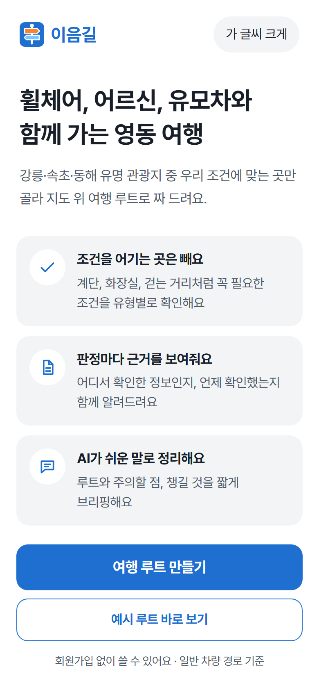 | 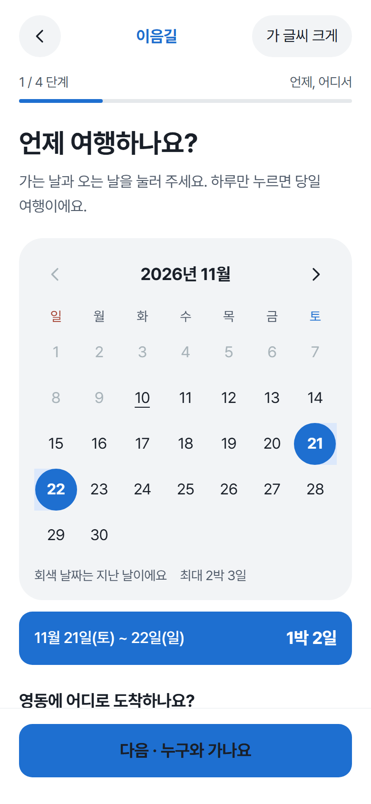 | 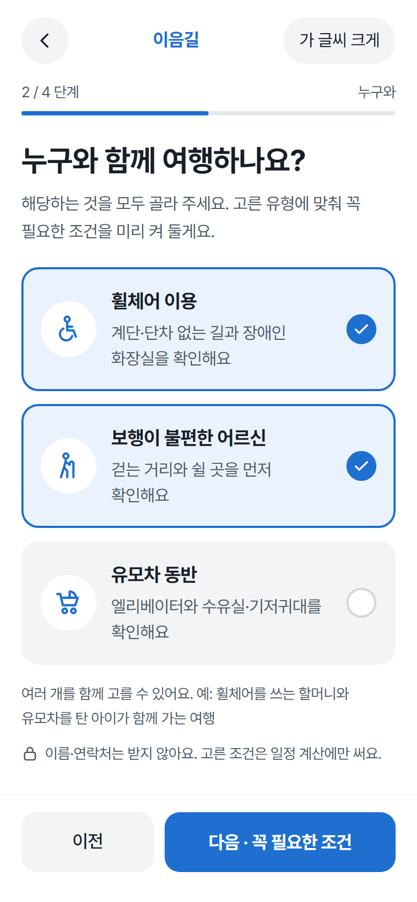 | 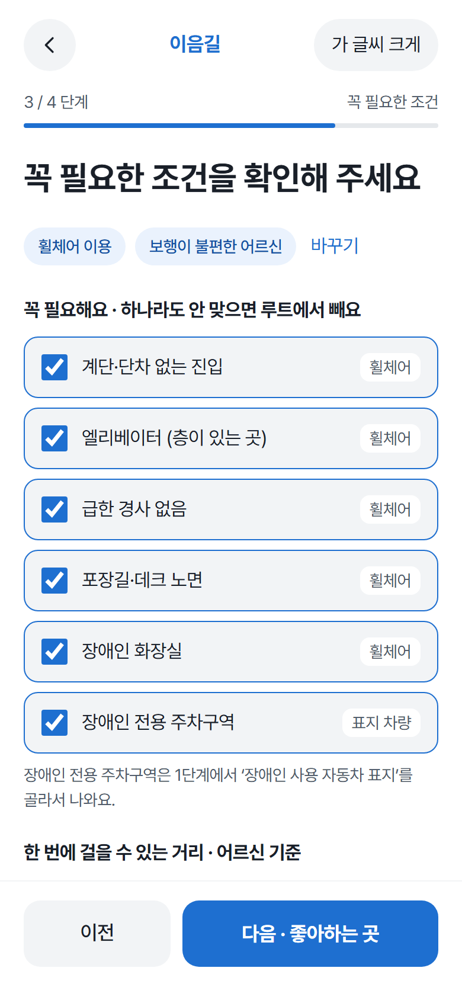 | 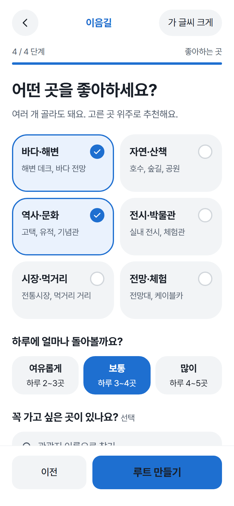 |

**2. AI가 일정을 만들고, 고치고, 확정합니다**: 조건은 휠체어 · 택시 · 1박 2일 · 강릉역 도착 · 바다·해변, 역사·문화 · 꼭 가고 싶은 곳 오죽헌입니다. AI 호출 5회 · 15초에 일정 2가지가 나왔습니다(세 번째 안은 다른 안과 장소가 많이 겹쳐 코드가 뺐습니다).

| ① 만드는 중 | ② 일정 비교 | ③ 장소 카드 [자세히] |
| :---: | :---: | :---: |
| 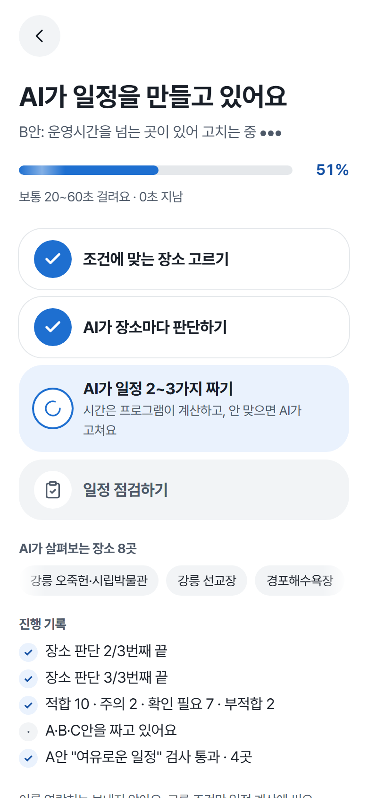 | 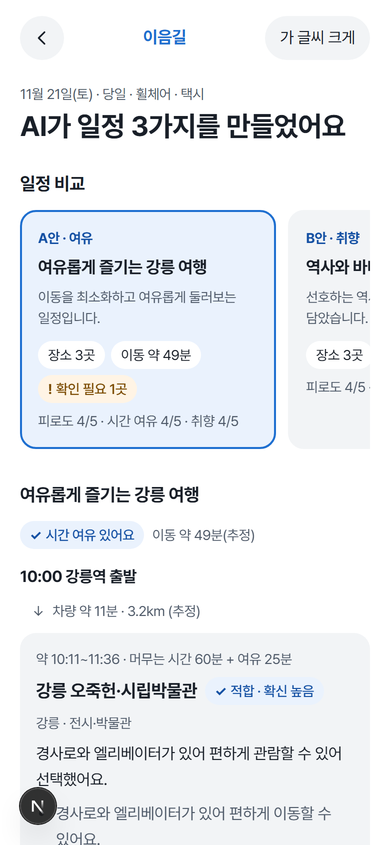 | 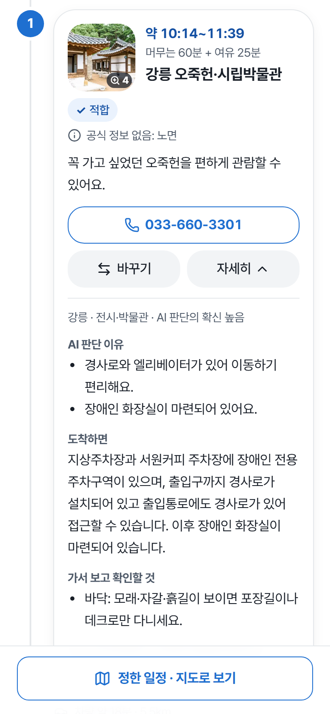 |
| **④ 장소 바꾸기** | **⑤ 확정 일정 + 지도** | **⑥ 출발 전 전화 확인** |
| 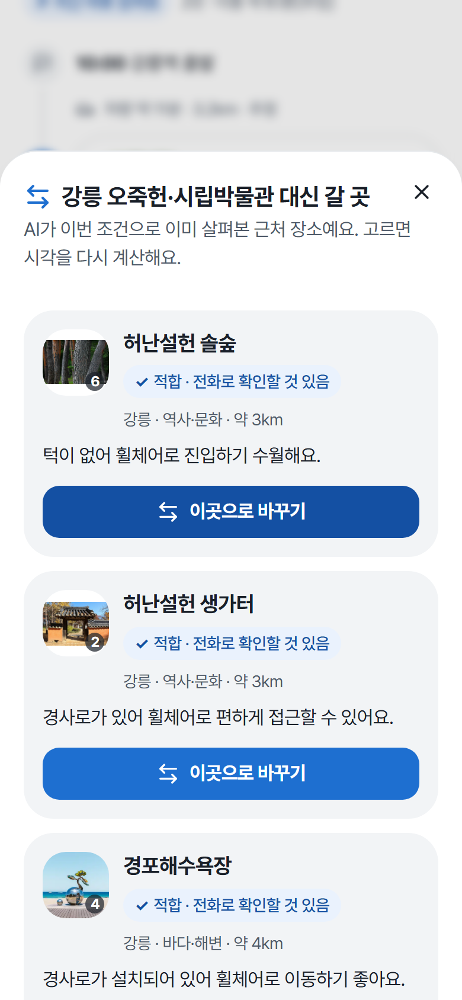 | 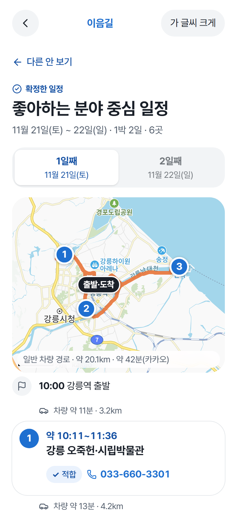 | 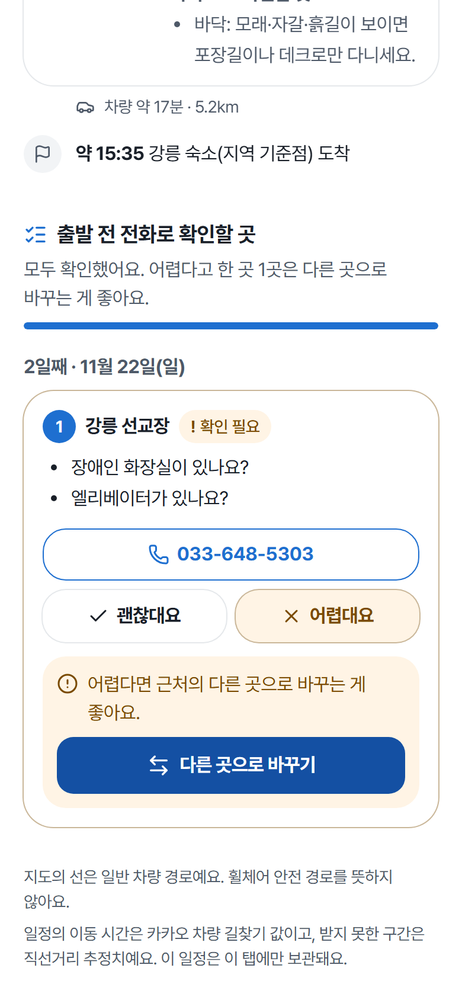 |
| **⑦ 지도 번호 카드** | **⑧ 순서 고치기** | **⑨ 가기 어려운 곳과 대안** |
| 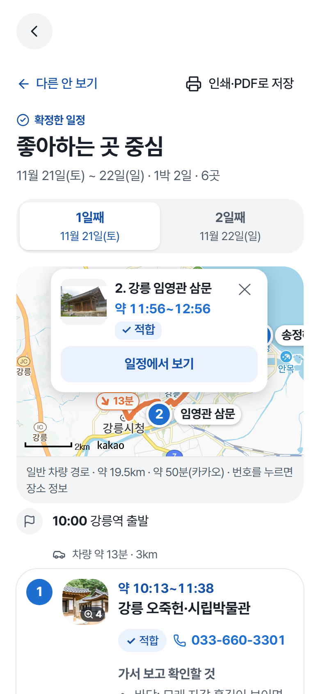 | 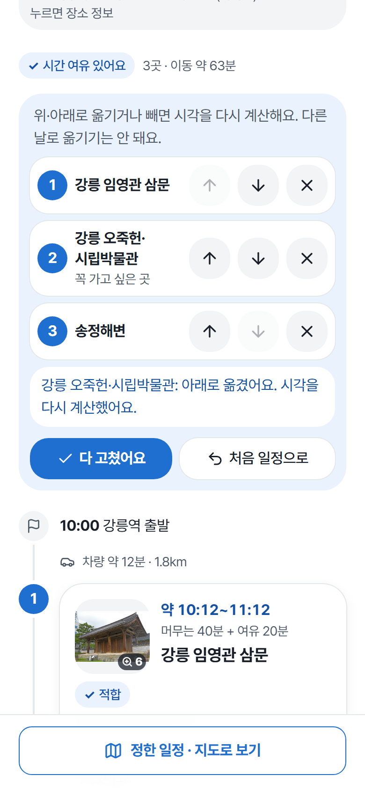 | 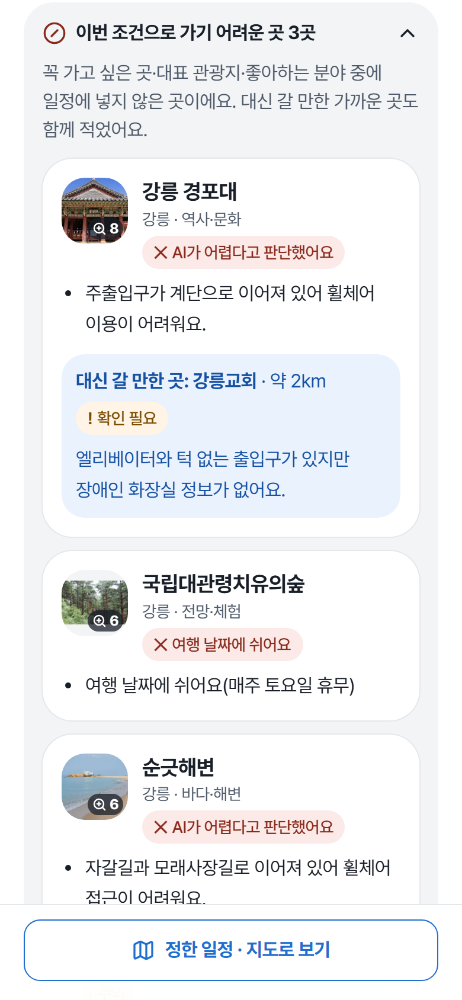 |

<details>
<summary>화면마다 자세한 설명</summary>

1. **만드는 중**: 진행률과 단계, AI가 살펴보는 장소, 진행 기록("장소 판단 3/3번째 끝", "B안: 운영시간을 넘는 곳이 있어 고치는 중")을 서버에서 받은 그대로 보여줍니다.
2. **일정 비교**: 성격이 다른 안을 갈 곳 한 줄 요약, 장소 수, 이동 시간, 전화로 확인할 곳 수로 비교합니다. 고른 안·날짜에 따라 지도도 바뀝니다. 2박 3일은 1안을 꼼꼼하게 짭니다.
3. **장소 카드**: 처음에는 사진, 도착 예상 시각, 판단, 공식 정보가 없는 항목, 한 줄 이유, 전화만. [자세히]에 AI 판단 이유, 도착하면(장애인 주차 → 출입구 → 화장실), 전화로 물어볼 것, 가서 볼 것, 근거(관광공사 원문 항목)가 있습니다.
4. **장소 바꾸기**: AI가 이미 판단해 둔 근처 장소(최대 3곳)로 바꿉니다. 코드가 시각·운영시간을 다시 검사하고, 걸리면 이유를 보여주고 바꾸지 않습니다. 되돌릴 수 있습니다.
5. **확정 일정**: 카카오 지도에 번호 + 장소 이름, 일반 차량 경로선, 구간마다 진행 방향과 이동시간을 그립니다. 경로는 열 때마다 새로 받고 저장하지 않습니다.
6. **출발 전 전화 확인**: 장소마다 물어볼 것과 공식 전화. [괜찮대요] / [어렵대요]로 진행률이 쌓이고, '어렵대요'면 바로 바꾸기를 권합니다.
7. **지도 번호 카드**: 번호를 누르면 사진·시각·판단 카드가 뜨고 [일정에서 보기]로 그 장소로 내려갑니다.
8. **순서 고치기**: 같은 날 안에서 위·아래로 옮기거나 뺍니다. 운영시간·하루 범위를 넘으면 고치지 않고 이유를 보여 줍니다.
9. **가기 어려운 곳과 대안**: 꼭 가고 싶은 곳·대표 관광지·좋아하는 분야 중 이번 조건으로 빠진 곳을 이유와 함께, 같은 분야의 가까운 대안을 알려 줍니다.

</details>

**3. PC에서도**: 창 너비에 따라 배치가 바뀝니다(휴대폰 한 칸 · 태블릿 넓은 한 칸 · PC 두 칸 · 넓은 PC 안 비교 3칸).

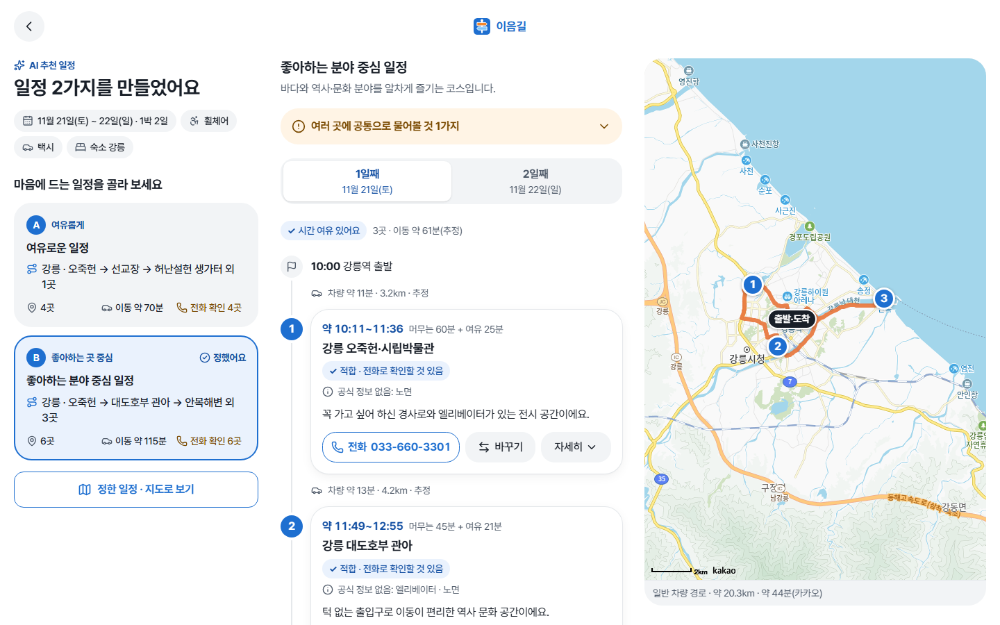

<details>
<summary>PC 시작 화면 · 확정 일정</summary>

| 시작(왼쪽 소개 + 실제 결과 화면 미리보기) | 확정 일정(왼쪽 지도 + 오른쪽 일정) |
| :---: | :---: |
| 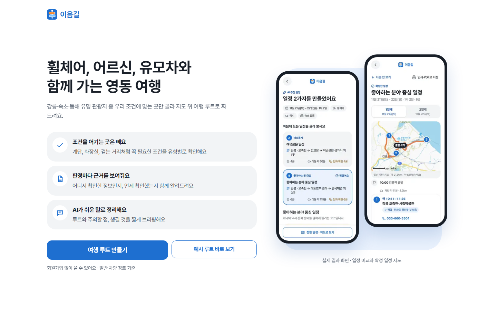 | 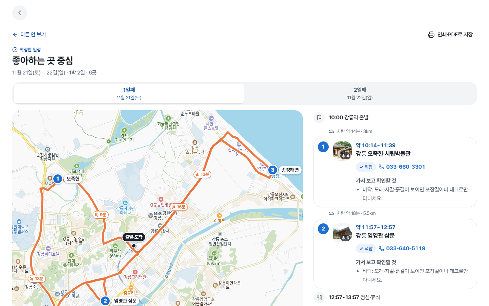 |

</details>

**4. 관광지 둘러보기**: 이름을 몰라도 지역과 분야로 찾아보고, 마음에 드는 곳을 담아 일정에 넣습니다(`/places`).

<table>
<tr>
<td width="250" valign="top">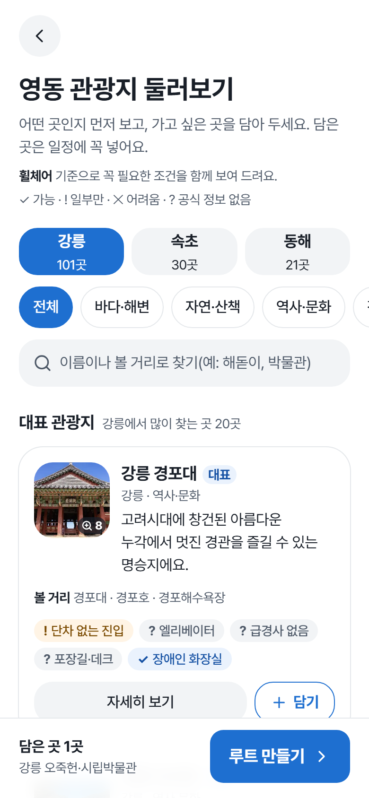</td>
<td valign="top">

**찾기**: 강릉 · 속초 · 동해 탭 → 분야 → 이름·볼 거리 검색

**카드에 보이는 것**
- 사진
- 어떤 곳인지 한 줄(AI 정리)
- 볼 거리
- 우리 가족 기준 접근성: ✓ 가능 · ! 일부만 · ✕ 어려움 · ? 정보 없음

**자세히 보기**: 관광공사 소개 원문, 운영시간, 전화, 접근성 10항목

**담기**: 꼭 가고 싶은 곳으로 일정에 넣기

대표 관광지(기획 조사표 38곳)를 먼저 보여 줍니다.

**누구나 쓸 수 있게**
- 본문 16px 이상, 터치 영역 44px 이상(자동 테스트로 검사)
- 글자 크기는 휴대폰·브라우저 설정을 그대로 따름
- 상태는 색만이 아니라 기호(✓ ! ✕)와 글자로 함께 표시

</td>
</tr>
</table>

## LLM이 어떻게 판단하고 추천하나요

**LLM이 읽고 · 판단하고 · 계획하고 · 평가하고, 코드는 계산과 검사를 강제합니다.** 공공데이터가 문장으로만 있어 코드로는 가능/불가를 가를 수 없기 때문에 판단은 LLM이 맡습니다. 대신 LLM의 답은 전부 **정해진 JSON 형식**으로 받고, 코드가 근거·안전 기준·시간을 검사한 뒤에만 화면에 나갑니다.

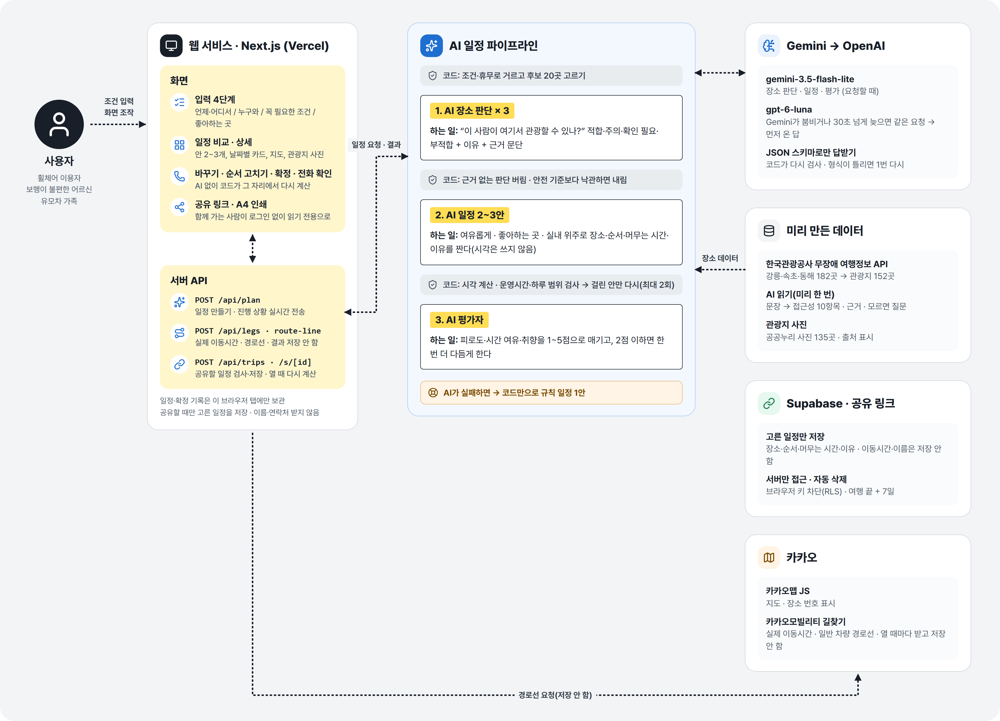

| 단계 | 누가 | 하는 일 | 코드가 지키는 것 |
| --- | --- | --- | --- |
| ① 읽기(미리) | LLM | 관광공사 문장 → 접근성 10개 항목 값, 운영시간, 도착 후 동선 | 근거 id가 원문 문단에 있어야 함 · 없으면 '모름' + 질문 |
| 후보 거르기 | 코드 | 갈 수 없는 곳 제외, 점수(취향·꼭 가고 싶은 곳·거리)로 20곳 | 필수 조건이 원문상 '불가'면 제외 · 휴무 제외 |
| ② 판단 | LLM × 3 | "이 사람이 관광할 수 있나"를 장소 전체 근거로 판단 | 근거 검사 · 안전 하한 · 3회 일치로 확신도 |
| ③ 계획 | LLM | 성격이 다른 2\~3안을 JSON으로 한 번에 | 시각은 코드가 계산 · 꼭 가고 싶은 곳이 빠지면 다시 요청 · 검사 통과한 안만 노출 |
| 평가자 | LLM | 안마다 피로도·여유·취향 점수와 한 줄 의견 | 2점 이하면 1회 다시 · 점수가 오를 때만 교체 |
| 대체 | 코드 | AI가 실패하면 규칙만으로 일정 1안 | 시연이 멈추지 않음 |

**안전 하한**: LLM은 더 보수적으로만 바꿀 수 있습니다([`guards.ts`](src/lib/ai/guards.ts)).
- 꼭 필요한 조건이 원문상 **불가** → 부적합 · **부분가능** → 최소 주의 · 걷는 거리가 알려져 있고 넘으면 부적합
- 휠체어는 **"들어갈 수 있다"는 원문**이 없으면 적합이 될 수 없음(확인 필요)
- 그 밖에 정보가 없는 항목은 판단을 막지 않고 확인할 것으로 붙임

**요청 한 번에** LLM 호출 5\~8회, 보통 10\~40초입니다. **Gemini Flash-Lite를 먼저** 쓰고, 붐비거나 30초 넘게 답이 없으면 같은 요청을 **OpenAI GPT-6 Luna**에도 보내 먼저 온 답을 씁니다. 둘 다 안 되면 규칙 일정 1안이 나옵니다. 이름·연락처는 받지도 보내지도 않습니다(자유 입력 칸 없음, OpenAI는 `store: false`).

<details>
<summary>실제 응답 예: ③ 계획이 낸 A안과 코드가 계산한 시각</summary>

[예시 루트](https://ieumgil-ai.vercel.app/trip/example)의 A안 첫날(휠체어 · 자가용 + 표지 · 1박 2일 · AI 호출 5회 · 14초)입니다. 이유·판단은 AI가, 시각은 코드가 계산했습니다.

```text
A안 "여유로운 강릉 여행" — 동선이 가깝고 편안하게 이동하며 여유롭게 둘러보는 일정입니다.
10:00 강릉역 출발 → 차량 약 11분
약 10:11~11:36 강릉 오죽헌·시립박물관 [적합 · 확신 높음]
    이유: 경사로와 엘리베이터가 있어 편리하게 관람할 수 있어 골랐어요.
    가서 볼 것: 바닥 — 모래·자갈·흙길이 보이면 포장길이나 데크로만 다니세요.
    근거: 관광공사 무장애 정보(접근로, 출입통로, 엘리베이터, 화장실, 주차)
→ 차량 약 5분
약 11:41~13:06 강릉자수박물관 [적합 · 확신 높음]
13:06~13:26 쉬는 시간 · 13:26~14:26 점심·휴식
→ 차량 약 11분
약 14:37~15:50 강릉시립미술관 교동 [적합 · 확신 높음]
    이유: 출입구에 경사로가 있어 진입하기 수월해요.
    전화로 물어볼 것: 엘리베이터가 있나요?  ☎ 공식 전화
AI 평가: 피로도 4 · 시간 여유 4 · 취향 4 — "이동 동선이 짧고 휠체어 이용에 편리한 박물관 중심이라 무리 없이 둘러보기 좋습니다."
```

</details>

<details>
<summary>자세한 흐름 보기(다시 짜기·실패 대비)</summary>

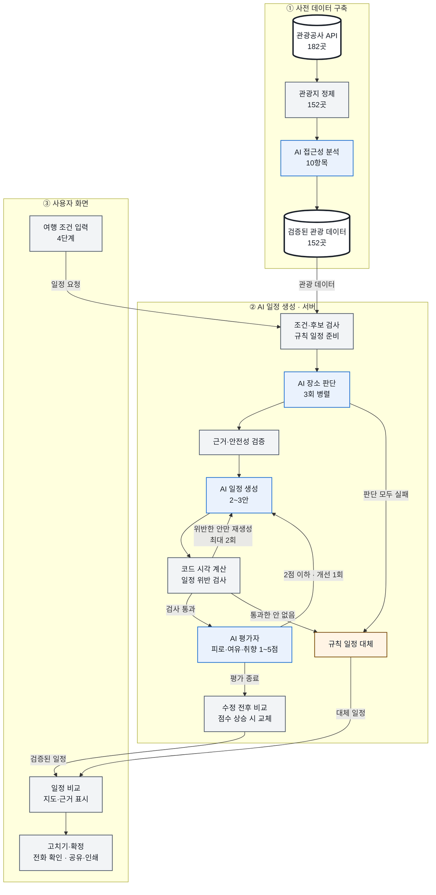

<sub>파란 칸 = AI(LLM)가 하는 일 · 회색 칸 = 코드가 하는 계산·검사 · 굵은 테두리 = 데이터 · 주황 칸 = AI가 실패했을 때 대비</sub>

</details>

## 유형별 조건

[기획 문서](docs/planning.md)의 조건표를 그대로 코드로 옮겼습니다([`conditions.ts`](src/lib/engine/conditions.ts)).

| 항목 | 휠체어 | 유모차 | 보행이 불편한 어르신 |
| --- | :---: | :---: | :---: |
| 계단·단차 없는 진입 | **필수** | 주의 | 주의 |
| 엘리베이터 (층이 있는 곳) | **필수** | **필수** | 선호 |
| 급한 경사 없음 | **필수** | 선호 | 주의 |
| 포장길·데크 노면 | **필수** | 선호 | 주의 |
| 장애인 화장실 | **필수** | — | 선호 |
| 수유실·기저귀 교환대 | — | 선호 | — |
| 장애인 전용 주차구역 | **필수**¹ | — | **필수**¹ |
| 주차장→입구, 관람 동선 거리 | — | — | **필수**² |
| 쉴 곳 (벤치·쉼터) | — | 선호 | 선호 |
| 휠체어·유모차 대여 | 선호 | 선호 | 선호 |

**필수**: 원문상 '불가'면 루트에서 뺍니다 · **선호**: 추천 순위에만 반영 · **주의**: 루트에 남기고 경고를 붙입니다<br />
¹ 자가용이고 장애인 사용 자동차 표지가 있을 때만 · ² 사용자가 고른 거리(100m / 300m / 500m) 이하

## 데이터

1차 출처는 **한국관광공사 무장애 여행정보 API**<sup>[2](#참고-자료)</sup>입니다. 강릉·속초·동해의 관광지·문화시설 182곳을 받아, 화장실·문화원처럼 관광지가 아닌 곳을 빼고 **152곳**(강릉 101 · 속초 30 · 동해 21)을 씁니다. 어떤 정보가 얼마나 있는지는 [공공데이터 조사](docs/data/tour-api-fields.md)에 정리했습니다. 장애인 화장실·기저귀 교환대는 행정안전부 공중화장실 공공데이터로 보충합니다.<sup>[3](#참고-자료)</sup>

- **AI가 모두 읽었어요**: 152곳 · 1,520항목. 근거 없이 채운 값은 코드가 '모름'으로 바꿉니다. 원문에 없는 항목은 '모름'으로 두고 확인할 방법을 붙였습니다(공공데이터로 보충한 뒤 1,520항목 중 851개, 56%).
- **공중화장실 공공데이터로 보충**: 행정안전부 「전국공중화장실표준데이터」([data.go.kr 15012892](https://www.data.go.kr/data/15012892/standard.do)) · 이용허락범위 제한 없음 · 받은 강원 파일의 데이터 기준일 2024-05\~2025-06 · 강릉·속초·동해 816건. 화장실 이름에 관광지 이름이 들어 있고 같은 시인 곳만 짝지어 **36곳**을 찾았습니다(주소만 같은 곳, 주유소 등은 제외). 장애인용 대변기가 있거나 기저귀 교환대가 있으면 그 항목을 '가능'으로 올리고, 31곳에 값을 채웠습니다(장애인 화장실 30 · 기저귀 교환대 23항목, 그중 '모름'·'불가'였다가 바뀐 것은 장애인 화장실 3 · 기저귀 교환대 18). 0칸이거나 목록에 없으면 AI 값을 그대로 둡니다(목록에 없다고 화장실이 없다는 뜻은 아니어서). 화면에는 '공공데이터(2024-12 기준)'처럼 표시합니다. 원본 CSV는 저장소에 두지 않고 짝지은 결과만 [`restrooms.json`](data/public/restrooms.json)과 [짝짓기 결과](docs/data/public-restrooms.md)에 둡니다. 수유실 정보는 이 데이터에 없습니다.
- **주차장 공공데이터는 쓰지 않았어요**: 전국주차장정보표준데이터([15012896](https://www.data.go.kr/data/15012896/standard.do))는 세 도시 218건 모두 '장애인전용주차구역보유여부'가 빈칸이라 쓰지 않았습니다.
- **공공데이터의 빈칸이 큽니다**: 휠체어에 중요한 노면은 152곳 중 134곳, 경사는 85곳이 '모름'입니다. 그래서 대부분 장소에 "가서 볼 것"이나 "전화로 물어볼 것"이 붙습니다. 숨기지 않고 화면에 그대로 보여 줍니다.
- **관광지 한 줄 소개**: 관광공사 소개를 AI가 "어떤 곳인지 한 문장 + 볼 거리"로 정리했습니다([`summary.json`](data/ai/summary.json)). 원문과 동떨어진 문장은 검사로 버립니다(처음 152곳 중 21곳을 버리고 다시 받음).
- **근거 원문을 함께 공개**: 장소마다 [근거 문서](data/docs/places/)(관광공사 원문 + 문단 id)와 [AI 읽기 결과](data/ai/read/)를 저장소에 둡니다. '모름'에 질문이, 장소에 공식 전화가 없으면 [검사 스크립트](scripts/validate-places.ts)가 빌드를 멈춥니다.
- **사진**: 관광공사 사진(공공누리) 1,136장을 풍경 / 편의시설 / 기타로 나눠, 대표 사진은 풍경만 씁니다(152곳 중 135곳에 사진). 제1유형은 작게 줄여 저장하고, 제3유형(변경 금지)은 원본을 통째로 보여 줍니다. 모든 사진에 출처를 표시합니다([`photos.json`](data/photos.json)).

## 검증

AI 지표는 정확도가 아니라 **일관성과 안전 규칙 준수**입니다. 모든 커밋마다 GitHub Actions가 장소 데이터 검사, 테스트, 린트, 빌드, 화면 흐름 테스트를 실행합니다.

| 항목 | 목표 | 현재 |
| --- | --- | --- |
| 자동 테스트 | 모두 통과 | [](https://github.com/ieumgil/ieumgil-ai/actions/workflows/ci.yml) 단위 319개 · 화면 흐름 124개(모바일·PC) |
| 엔진 시나리오 10개 + 유형 조합 14개 | 필수 조건 위반 0건 | **0건** |
| AI 가드(가짜 LLM 테스트 69개) | 근거 없는 판단 사용 0건 · 안전 하한보다 낙관 0건 · 검사 안 된 안 노출 0건 · 실패 시 규칙 일정 | **모두 통과** |
| AI 읽기 | 원문에 없는 근거로 채운 값 0건 · 두 번 읽었을 때 항목 일치율 | **0건** · **96.4%** ([`data/eval/`](data/eval/)) |
| AI 판단 | 같은 후보를 3회 판단했을 때 셋 다 같은 비율 · 두 모델의 정반대 판단 | **85.7%**(Gemini) · 78.3%(OpenAI) · 정반대 **0건** ([판단 평가](data/eval/judge-v1.md)) |
| 고치기(바꾸기·순서·빼기) | 부적합·중복으로 바꾸기 0건 · 검사에 걸리면 안 바꿈 · 시각은 코드 값 | **모두 통과** |
| 카카오 | 길찾기 결과 저장 0건 · 키는 서버에서만 · 영동권 밖 좌표 거부 | **모두 통과** |
| 공유 링크 | 저장 값에 이동시간·개인정보 0건 · 정해진 칸 밖 거절 · 받은 사람 화면이 만든 사람과 같은 장소·순서·시각 | **모두 통과** · 실제 Supabase로 확인 |

<details>
<summary>엔진 시나리오 10개 (<a href="tests/engine/scenarios.test.ts">tests/engine/scenarios.test.ts</a>)</summary>

| # | 유형 | 이동수단 | 기간·상황 | 확인하는 것 |
| --- | --- | --- | --- | --- |
| 1 | 휠체어 | 자가용 + 표지 차량 | 당일 | 장애인 주차가 필수 조건으로 반영 |
| 2 | 휠체어 | 택시 | 당일 | 장애인 주차 조건이 꺼짐 |
| 3 | 고령자(300m) | 자가용 | 당일 | 관람 동선이 300m를 넘는 곳은 빠짐 |
| 4 | 유모차 | 택시 | 1박 2일 | 수유실 선호 점수, 날짜 배분, 같은 장소 중복 없음 |
| 5 | 휠체어 + 고령자 | 자가용 + 표지 차량 | 2박 3일 | 조건 합집합, 둘째 날 숙소 출발 |
| 6 | 휠체어 | 택시 | 1박 2일, 숙소 미정 | 숙소 위치를 가정하고 표시 |
| 7 | 고령자 + 유모차 | 자가용 | 반나절(4시간) | 개수 하한, 빠듯·부족 판정 |
| 8 | 휠체어 | 자가용 | 동절기 날짜 | 동절기 운영시간·휴무 반영 |
| 9 | 휠체어 | 택시 | 꼭 가고 싶은 곳이 불가 | 경고 후 제외 |
| 10 | 휠체어 + 유모차 | 택시 | 후보가 적은 지역 | 하루 상한 자동 축소 |

여기에 세 유형의 모든 조합 7가지 × 이동수단 2가지 = 14가지를 2박 3일로 돌려 필수 조건 위반이 0건인지 함께 검사합니다.

</details>

## 기술 스택

맨 위 뱃지가 쓰인 기술입니다. 각 기술이 맡은 일과 지킨 원칙은 아래에 있습니다.

<details>
<summary>기술별로 맡은 일과 지킨 원칙</summary>

| 기술 | 맡은 일 | 지킨 원칙 |
| --- | --- | --- |
| Gemini(`gemini-3.5-flash-lite`) | ① 읽기 · ② 판단(3회) · ③ 일정 2\~3안 · 평가 · 관광지 한 줄 소개 | JSON 스키마로만 받고 코드가 검사(Ajv). 근거가 원문 밖이면 버림. 시각은 쓰지 않음 |
| OpenAI(GPT-6 Luna, Responses API) | Gemini가 붐비거나 30초 넘게 늦으면 같은 요청을 보내 먼저 온 답을 씀 | 엄격 JSON 스키마, `store: false`. 둘 다 실패하면 규칙 일정 |
| 한국관광공사 무장애 여행정보 API | 152곳의 무장애 정보·운영시간·전화·사진의 1차 출처 | 수집 스크립트에서만 호출. 빈칸은 '모름'으로 두고 지어내지 않음 |
| 행정안전부 전국공중화장실표준데이터(CSV) | 장애인 화장실·기저귀 교환대 보충(31곳) | 스크립트에서만 읽고 원본은 커밋 안 함. 이름이 맞는 곳만, '있음'만 '가능'으로(더 엄격하게 바꾸지 않음). 출처·기준일 표시 |
| 카카오맵 JS · 카카오모빌리티 길찾기 | 지도, 실제 차량 이동시간, 경로선 | 결과는 저장하지 않고 열 때마다 받음. "일반 차량 경로"로만 표시. REST 키는 서버에만 |
| Supabase(Postgres) | 공유 링크 저장 | 고른 일정만 저장, 서버가 스키마로 검사. RLS로 브라우저 키 차단, 기간이 지나면 자동 삭제 |
| Vercel | 배포(서버 함수에서 AI·카카오 호출, 진행 단계 스트리밍) | 키는 환경변수에만 |
| Next.js 16 · React 19 · TypeScript | 화면과 서버 API | TypeScript strict. AI·데이터 규칙은 `src/lib/`에 코드로 |
| Tailwind CSS v4 · shadcn/ui · Pretendard | 모바일 우선 화면 | 본문 16px · 터치 44px 이상 · 상태는 색 + 기호 + 글자 · rem 단위 |
| Vitest · Playwright · GitHub Actions | 단위 · 화면 흐름 테스트, 푸시마다 자동 검사 | 필수 조건 위반 0건, 근거 없는 판단을 버리는지 테스트로 고정 |

</details>

<details>
<summary>폴더 구조</summary>

```
src/app/            시작 · places/(관광지 둘러보기) · plan/(입력 4단계, making/ 만드는 중) · trip/[id]/(안 비교·상세·고치기)
                    · trip/[id]/final/(확정 일정 + 지도 + 인쇄) · s/[id]/(공유 링크, 읽기 전용)
                    · api/plan/(전체 흐름 + 스트리밍) · api/legs/·api/route-line/(카카오, 저장 안 함) · api/trips/(공유 저장)
src/lib/ai/         judge.ts(② 판단) · plan.ts(③ 일정 2~3안) · review.ts(평가자) · trip.ts(전체 흐름) · guards.ts(안전 하한·근거 검사) · schemas.ts
src/lib/engine/     conditions.ts · filter.ts · timeline.ts(시각 계산) · check.ts(일정 검사) · repair.ts · fallback.ts(규칙 일정) · travel.ts
src/lib/trip/       view.ts(결과 화면 값) · edit.ts(바꾸기·순서·빼기) · alternatives.ts · hard.ts(어려운 곳) · questions.ts · real-travel.ts · store.ts(탭 보관)
src/lib/share/      doc.ts(공유할 값·검사) · supabase.ts(서버 전용) · view.ts(열 때 화면 값으로)   ·   supabase/migrations/(테이블·RLS·자동 삭제)
src/lib/llm.ts      AI 호출을 한 곳에(Gemini → 늦으면 OpenAI, JSON 검사) · src/lib/kakao.ts(길찾기, 서버 전용)
src/components/     ui/(shadcn 기반) · plan/(입력 단계) · trip/(장소 카드·안 고르기·바꾸기 창·체크리스트·공유 버튼·인쇄 일정표) · map/ · photos/
data/               places.json · evidence.json · photos.json · featured.json · ai/(읽기 결과·한 줄 소개) · docs/places/(근거 원문) · eval/(평가)
scripts/            tour/(관광공사 API 수집·사진) · ai/(읽기·평가·예시) · readme/(캡처·구조도) · dev/(연결 확인·시험) — 순서는 scripts/README.md
tests/              단위 테스트(엔진·AI 가드는 가짜 LLM) · e2e/(화면 흐름, Playwright)
docs/               기획 문서, AI 설계, 구현 계획, 디자인 시안, 공공데이터 조사
```

</details>

## 실행 방법

Node.js 22 이상이 필요합니다.

```bash
git clone https://github.com/ieumgil/ieumgil-ai.git
cd ieumgil-ai
npm install
cp .env.example .env.local   # 키 넣기: 아래 표
npm run dev                  # http://localhost:3000
```

| 환경변수 | 쓰는 곳 |
| --- | --- |
| `GEMINI_API_KEY` 또는 `OPENAI_API_KEY` | 일정 만들기(둘 중 하나는 필요) |
| `NEXT_PUBLIC_KAKAO_JS_KEY` · `KAKAO_REST_API_KEY` | 지도 · 이동시간·경로선 |
| `SUPABASE_URL` · `SUPABASE_SERVICE_ROLE_KEY` | 공유 링크(선택) |

| 명령 | 하는 일 |
| --- | --- |
| `npm test` | 단위 테스트(가짜 LLM, 키 필요 없음) |
| `npm run test:e2e` | 화면 흐름 테스트(처음 한 번 `npx playwright install chromium`) |
| `npm run build` | 장소 데이터 검사 후 배포용 빌드 |
| `npm run readme:capture` | README 화면 캡처(개발 서버를 켠 뒤, AI 호출 없음) |
| `npm run data:public` → `data:build` → `data:read` → `data:merge` | 장소 데이터 다시 만들기(관광공사 API·AI 키 필요, [scripts/README.md](scripts/README.md)) |

## 한계와 안내

- 접근성 정보는 한국관광공사 자료를 AI가 정리하고 일부(장애인 화장실·기저귀 교환대)는 공중화장실 공공데이터(기준일 2024\~2025)로 보충한 것이라 현장과 다를 수 있습니다. 특히 노면·경사·걷는 거리는 공공데이터에 거의 없습니다. 출발 전 공식 전화로 확인해 주세요.
- AI 판단은 일관성과 안전 규칙으로 검사했고, 사람이 정답을 달아 비교한 정확도 평가는 하지 않았습니다.
- 이동 시간은 카카오 일반 차량 길찾기 값이고(받지 못한 구간만 '추정'), 지도 경로선은 휠체어 안전 경로를 뜻하지 않습니다.
- 장소 바꾸기 후보는 이번에 AI가 판단한 장소(최대 20곳) 안에서만 고릅니다.
- 공유 링크는 로그인 없이 열리므로 링크를 아는 사람은 누구나 볼 수 있습니다. 이름·연락처는 저장하지 않고 여행이 끝나고 7일 뒤 지워집니다.
- 음식점·카페·숙소는 추천하지 않습니다. 숙소는 지역만 받아 다음 날 출발점으로 씁니다.

## 팀 이음길

| 이름 | 역할 |
| --- | --- |
| 공지혁 | 기획, 화면·서버·데이터·AI 개발, 배포, 문서 |
| 강환일 | 관광지 조사(조사표 32곳), 주간보고 |

2026 My AI 랩(강릉과학산업진흥원) 과제입니다. 개발 과정은 [커밋 기록](https://github.com/ieumgil/ieumgil-ai/commits/main)과 [구현 계획](docs/impl-plan.md)에서 볼 수 있습니다.

## 참고 자료

1. 문화체육관광부 보도자료, [첫 번째 '무장애 관광도시'로 강릉시 선정](https://www.mcst.go.kr/kor/s_notice/press/pressView.jsp?pSeq=19453) (2022.4.8.)
2. 공공데이터포털, [한국관광공사 무장애 여행정보 API](https://www.data.go.kr/data/15101897/openapi.do)
3. 공공데이터포털, [행정안전부 전국공중화장실표준데이터](https://www.data.go.kr/data/15012892/standard.do) (이용허락범위 제한 없음)
