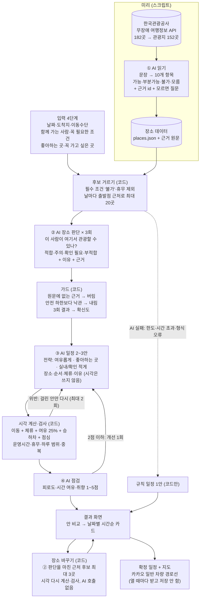

<div align="center">


# 이음길 AI

**휠체어, 어르신, 유모차와 함께 가는 영동 여행 루트 플래너**<br />
문장으로만 된 공공 무장애 정보를 AI가 읽고, 우리 가족 기준으로 판단해 성격이 다른 일정 2~3안으로 짜 줍니다.

[서비스 바로가기](https://ieumgil-ai.vercel.app) · [기획 문서](docs/planning.md) · [AI 설계](docs/ai-plan.md) · [디자인 시안](docs/design/README.md) · 시연 영상(준비 중)

[](https://github.com/ieumgil/ieumgil-ai/actions/workflows/ci.yml)
[](https://ieumgil-ai.vercel.app)
[](https://github.com/ieumgil/ieumgil-ai/commits/main)


</div>

> [!NOTE]
> **개발 중인 서비스입니다.** 입력 4단계 → AI 장소 판단 → AI 일정 2~3안 비교 → 장소 바꾸기 → 일정 확정 + 지도까지 실제로 동작합니다(관광공사 무장애 정보 152곳). [배포 사이트](https://ieumgil-ai.vercel.app)에서 바로 써 볼 수 있습니다. 일정의 이동 시간은 아직 직선거리 추정치이고(지도 경로선은 카카오), 입력 없이 보는 예시 루트를 준비하고 있습니다. 진행 상황은 [개발 현황](#개발-현황)에서 볼 수 있습니다.

## 왜 만들었나요

강릉은 2022년 문화체육관광부가 선정한 **국내 첫 무장애 관광도시**입니다.<sup>[1](#참고-자료)</sup> 그런데 관광약자와 함께 여행을 준비하는 사람은 지금도 관광지마다 계단, 장애인 화장실, 주차, 걷는 거리를 따로 찾아보고, 이동 시간을 계산해서 직접 일정으로 엮어야 합니다.

공공 무장애 정보가 있긴 하지만 **"출입구까지 경사로가 설치되어 있음(완만함)" 같은 짧은 문장**으로만 있습니다. 기존 서비스는 이 문장을 그대로 보여주고, 갈 수 있는지 판단은 여행자에게 넘깁니다.

| 지금은 | 이음길에서는 |
| --- | --- |
| 관광지마다 접근성 정보를 따로 검색 | 유형을 고르면 꼭 필요한 조건이 자동으로 켜짐 |
| "경사로 있음" 같은 문장을 직접 해석 | AI가 문장을 읽고 **이 사람 기준으로** 적합 / 주의 / 확인 필요 / 부적합을 판단 |
| 정보가 없으면 가 봐야 앎 | 모르는 항목은 숨기지 않고, 출발 전에 물어볼 질문과 공식 전화번호를 함께 보여줌 |
| 갈 수 있는 곳을 골라 직접 순서를 짬 | AI가 성격이 다른 일정 2~3안을 짜고, 코드가 시각·운영시간을 계산·검사 |
| 어디서 본 정보인지 알기 어려움 | 판단마다 근거가 된 관광공사 원문 항목을 표시 |

## 결과 화면

조건: 휠체어 · 택시 · 11월 21~22일(1박 2일) · 강릉역 도착 · 숙소 강릉 · 좋아하는 곳 바다·해변, 역사·문화 · 꼭 가고 싶은 곳 오죽헌<br />
→ **AI 호출 5회 · 약 26초 만에 일정 2가지** (세 번째 안은 다른 안과 장소가 많이 겹쳐서 코드가 뺐습니다)

| ① 만드는 중 | ② 일정 비교 | ③ 장소 카드 [자세히] |
| :---: | :---: | :---: |
|  |  |  |
| **④ 장소 바꾸기** | **⑤ 확정 일정 + 지도** | **⑥ 출발 전 전화 확인** |
|  |  |  |

1. **만드는 중**: 진행률과 단계, AI가 살펴보는 장소, 진행 기록("장소 판단 3/3번째 끝", "B안: 운영시간을 넘는 곳이 있어 고치는 중")을 서버에서 받은 그대로 보여줍니다.
2. **일정 비교**: 성격이 다른 2~3안(여유롭게 / 좋아하는 곳 중심 / 확인할 것 적게)을 같은 줄에 맞춰 비교합니다 — 갈 곳 한 줄 요약("강릉 · 오죽헌 → 선교장 → 허난설헌 생가터 외 1곳"), 장소 수, 이동 시간, **전화로 확인할 곳 수**. 안을 누르면 그 일정으로 바로 내려가고, 고른 안·날짜의 **지도(일반 차량 경로선)**가 함께 바뀝니다.
3. **장소 카드**: 처음에는 핵심만 — 도착 예상 시각, 판단(예: "✓ 적합 · 전화로 확인할 것 있음"), 공식 정보가 없는 항목("공식 정보 없음: 노면"), 한 줄 이유, 공식 전화. [자세히]를 누르면 AI 판단 이유, 도착하면(장애인 주차 → 출입구 → 화장실), 전화로 물어볼 것, 근거(관광공사 원문 항목)가 펼쳐집니다.
4. **장소 바꾸기**: AI가 이미 판단해 둔 근처 장소(최대 3곳)로 바꿉니다. AI를 다시 부르지 않고 코드가 그 자리에서 시각과 운영시간을 다시 계산·검사하고, 걸리면 이유를 보여주고 바꾸지 않습니다. 원래 장소로 되돌릴 수 있습니다.
5. **확정 일정**: 정한 안 하나만 남기고 카카오 지도에 장소 번호와 **일반 차량 경로선**을 그립니다. 경로는 열 때마다 새로 받고 저장하지 않습니다. 인쇄·PDF로 저장할 수 있습니다.
6. **출발 전 전화 확인**: 날짜별로 장소마다 물어볼 것(같은 주제의 질문은 하나로)과 공식 전화를 모았습니다. 통화 뒤 **[괜찮대요] / [어렵대요]**를 누르면 진행률이 쌓이고, '어렵대요'면 그 자리에서 다른 곳으로 바꾸기를 권합니다. 모두 괜찮으면 "출발 준비 끝!"을 보여줍니다.

**PC 화면** — 창 너비에 따라 배치가 바로 바뀝니다: 휴대폰(한 칸) · 태블릿(768px~, 넓은 한 칸) · PC(1024px~, 두 칸) · 넓은 PC(1280px~, 안 비교 3칸)


| 시작(왼쪽 소개 + 실제 결과 화면 미리보기) | 확정 일정(왼쪽 지도 + 오른쪽 일정) |
| :---: | :---: |
|  |  |

## LLM이 어떻게 판단하고 추천하나요

**LLM이 읽고 · 판단하고 · 계획하고 · 점검하고, 코드는 계산과 검사를 강제합니다.** 공공데이터가 문장으로만 있어 코드로는 가능/불가를 가를 수 없기 때문에, 판단은 LLM이 맡습니다. 대신 LLM의 답은 전부 **정해진 JSON 형식**으로 받고, 코드가 근거·안전 기준·시간을 검사한 뒤에만 화면에 나갑니다.



| 단계 | 누가 | 하는 일 | 코드가 지키는 것 |
| --- | --- | --- | --- |
| ① 읽기 (미리) | LLM | 관광공사 문장 → 접근성 10개 항목 값, 운영시간, 도착 후 동선 | 근거 id가 원문 문단에 있어야 함 · 없으면 '모름' + 질문 |
| 후보 거르기 | 코드 | 갈 수 없는 곳 제외, 점수(취향·꼭 가고 싶은 곳·거리)로 20곳 | 필수 조건이 원문상 '불가'면 제외 · 휴무 제외 |
| ② 판단 | LLM × 3 | "이 사람이 관광할 수 있나"를 장소 전체 근거로 판단 | 근거 검사 · 안전 하한 · 3회 일치로 확신도 |
| ③ 계획 | LLM | 성격이 다른 2~3안을 JSON으로 한 번에 | 체류 범위 맞춤 · 시각은 코드가 계산 · 검사 통과한 안만 노출 |
| ④ 점검 | LLM | 안마다 피로도·여유·취향 점수와 한 줄 의견 | 2점 이하면 개선 지시를 붙여 1회 다시 |
| 대체 | 코드 | AI가 실패하면 규칙만으로 일정 1안 | 시연이 멈추지 않음 |
| 장소 바꾸기 | 코드 | ② 판단을 마친 후보 중 그 안에 없는 근처 장소를 골라 두고, 바꾸면 시각을 다시 계산 | 부적합·그날 휴무·중복 제외 · 운영시간·하루 범위를 넘으면 바꾸지 않음 |

**안전 하한** — LLM은 더 보수적으로만 바꿀 수 있습니다 ([`src/lib/ai/guards.ts`](src/lib/ai/guards.ts))
- 꼭 필요한 조건이 원문상 **불가** → 부적합 · **부분가능** → 최소 주의 · 걷는 거리가 알려져 있고 넘으면 부적합
- 휠체어는 **"들어갈 수 있다"는 원문**(진입)이 없으면 적합이 될 수 없음(확인 필요)
- 그 밖에 정보가 없는 항목은 판단을 막지 않고 **출발 전 확인 질문**으로 붙임
- LLM이 실패해 규칙만으로 판단할 때는 엄격하게: 꼭 필요한 조건 중 하나라도 '모름'이면 확인 필요

**요청 한 번에** LLM 호출 5~8회(판단 3 · 계획 1~3 · 점검 1~2), 20~60초. 모델은 Gemini Flash-Lite(무료 등급)이고 환경변수로 바꿀 수 있습니다. 이름·연락처는 받지도 보내지도 않습니다(자유 입력 칸 없음).

<details>
<summary>실제 응답 예: ③ 계획이 낸 A안(검사 통과)과 코드가 계산한 시각</summary>

```text
A안 "여유롭게 즐기는 강릉 여행" — 이동을 최소화하고 여유롭게 둘러보는 일정입니다.
10:00 강릉역 출발 → 차량 약 11분(추정)
약 10:11~11:36 강릉 오죽헌·시립박물관 [적합 · 확신 높음]
    이유: 경사로와 엘리베이터가 있어 편하게 관람할 수 있어 선택했어요.
    출발 전 확인: 노면 포장 상태나 재질은 어떻게 되나요?  ☎ 033-660-3301
    근거: 관광공사 무장애 정보(접근로, 출입통로, 엘리베이터, 화장실)
약 11:44~12:50 강릉 선교장 [확인 필요 · 확신 보통]
12:50~13:50 점심·휴식
약 14:03~15:09 경포해수욕장 [적합 · 확신 높음]
약 15:26 강릉역 도착 (마치는 시각 17:00) · 시간 여유 있어요
AI 점검: 피로도 4 · 시간 여유 4 · 취향 4
```

</details>

## 유형별 조건

[기획 문서](docs/planning.md)의 조건표를 그대로 코드로 옮겼습니다([`src/lib/engine/conditions.ts`](src/lib/engine/conditions.ts)).

| 항목 | 휠체어 | 유모차 | 보행이 불편한 어르신 |
| --- | :---: | :---: | :---: |
| 계단·단차 없는 진입 | **필수** | 주의 | 주의 |
| 엘리베이터 (층이 있는 곳) | **필수** | **필수** | 선호 |
| 급한 경사 없음 | **필수** | 선호 | 주의 |
| 포장길·데크 노면 | **필수** | 선호 | 주의 |
| 장애인 화장실 | **필수** | — | 선호 |
| 수유실·기저귀 교환대 | — | 선호 | — |
| 장애인 전용 주차구역 | **필수**¹ | — | **필수**¹ |
| 주차장→입구, 관람 동선 거리 | — | — | **필수**² |
| 쉴 곳 (벤치·쉼터) | — | 선호 | 선호 |
| 휠체어·유모차 대여 | 선호 | 선호 | 선호 |

**필수**: 원문상 '불가'면 루트에서 뺍니다 · **선호**: 추천 순위에만 반영 · **주의**: 루트에 남기고 경고를 붙입니다<br />
¹ 자가용이고 장애인 사용 자동차 표지가 있을 때만 · ² 사용자가 고른 거리(100m / 300m / 500m) 이하

## 화면

| 시작 | 1단계 언제·어디서 | 2단계 누구와 | 3단계 꼭 필요한 조건 | 4단계 좋아하는 곳 |
| :---: | :---: | :---: | :---: | :---: |
|  |  |  |  |  |

**누구나 쓸 수 있게**: 본문 16px 이상 · 터치 영역 44px 이상(자동 검사) · 글자 크기는 rem이라 휴대폰·브라우저 설정을 그대로 따름 · 상태를 색만이 아니라 기호(✓ ! ✕)와 글자로 함께 표시 · 모바일 우선, 태블릿·PC는 창 너비에 따라 배치가 바로 바뀜(입력 단계는 PC에서 오른쪽에 '고른 조건' 요약)

## 데이터

1차 출처는 **한국관광공사 무장애 여행정보 API**<sup>[2](#참고-자료)</sup>입니다. 강릉·속초·동해의 관광지·문화시설 182곳을 받아, 화장실·문화원·숙박형 리조트처럼 관광지가 아닌 곳을 빼고 **152곳**을 씁니다. 어떤 정보가 얼마나 있는지는 [공공데이터 조사](docs/data/tour-api-fields.md)에 정리했습니다.

| 지역 | 장소 | 무장애 문장 예 |
| --- | :---: | --- |
| 강릉 | 101곳 | "출입구까지 경사로가 설치되어 있음(완만함)" |
| 속초 | 30곳 | "장애인 주차장 있음(6대)", "엘리베이터 있음" |
| 동해 | 21곳 | "주출입구는 턱이 없어 휠체어 접근 가능함" |

- **AI가 모두 읽었어요**: 152곳 · 1,520항목. 근거 없이 채운 값은 코드가 '모름'으로 바꿉니다. 원문에 없는 항목은 '모름'(57%)으로 두고 질문을 붙였습니다. 노면·걷는 거리는 공공데이터에 거의 없어서 카드에 '출발 전 확인'으로 나옵니다.
- **모름은 숨기지 않아요**: '모름'에는 물어볼 질문이, 장소에는 공식 전화번호가 반드시 있어야 합니다. 빠지면 [검사 스크립트](scripts/validate-places.ts)가 빌드를 멈춥니다.
- **근거 원문을 함께 공개**: 장소마다 [근거 문서](data/docs/places/)(관광공사 원문 + 문단 id)와 [AI 읽기 결과](data/ai/read/)를 저장소에 둡니다.
- **사진**: 공공누리 제1유형만 쓰고 출처를 표기합니다.

## 검증

사람이 정답을 다는 평가는 하지 않고, 자동으로 잴 수 있는 지표를 씁니다. AI 지표는 정확도가 아니라 **일관성과 안전 규칙 준수**입니다.

| 항목 | 목표 | 현재 |
| --- | --- | --- |
| 자동 테스트 | 모두 통과 | [](https://github.com/ieumgil/ieumgil-ai/actions/workflows/ci.yml) 단위 129개 · 화면 흐름(E2E) 34개 × 모바일·PC + 너비별 배치 6개 |
| 장소 바꾸기 | 부적합·이미 있는 곳으로 바꾸기 0건 · 검사에 걸리면 안 바꿈 · 시각은 코드 값 | **모두 통과** (단위 6개 + E2E) |
| 카카오 경로 | 길찾기 결과 저장 0건 · 키는 서버에서만 · 영동권 밖 좌표 거부 | **모두 통과** (단위 4개 + E2E) |
| 엔진 시나리오 10개 + 유형 조합 14개 | 필수 조건 위반 0건 | **0건** |
| AI 가드 (가짜 LLM 테스트 37개) | 근거 없는 판단 사용 0건 · 안전 하한보다 낙관 0건 · 검사를 통과하지 못한 안 노출 0건 · AI 실패 시 규칙 일정 | **모두 통과** |
| AI 읽기 근거 | 원문에 없는 근거로 채운 값 0건 | **0건** (152곳 · 1,520항목) |
| AI 읽기 일관성 | 같은 152곳을 두 번 읽었을 때 항목 일치율 | **96.4%** (프롬프트 예시 추가 전후 비교) |
| AI 판단 일관성 | 3회 판단 일치율(확신도 분포) | 진행 예정 · 결과는 `docs/eval/` |

모든 커밋마다 GitHub Actions가 장소 데이터 검사, 테스트, 린트, 빌드, 화면 흐름 테스트를 실행합니다.

## 개발 현황

- [x] 서비스 기획·디자인 시안, 장소 데이터 스키마와 검사
- [x] 시작 화면(첫 접속 인트로), 입력 4단계
- [x] 관광공사 무장애 정보 수집: 영동 3개 시 182곳 → 관광지 152곳
- [x] ① AI 읽기 152곳 (근거 id, '모름' + 질문, 운영시간, 도착 후 동선)
- [x] 코드 엔진: 후보 거르기 · 시각 계산 · 일정 검사 · 규칙 일정
- [x] ② AI 판단(3회, 근거 검사, 안전 하한) · ③ AI 일정 2~3안(검사·수정) · ④ AI 점검
- [x] 웹 연결: `/api/plan`(진행 기록 스트리밍) → 만드는 중(실제 진행 표시) → 안 비교 → 시간순 카드
- [x] 결과 화면 정리(핵심만 먼저, [자세히]), 움직임·글자 크기 단계
- [x] 장소 바꾸기(AI가 판단한 근처 후보, 코드가 다시 계산·검사)
- [x] 일정 확정 → 확정 일정 + 카카오 지도·일반 차량 경로선 · 인쇄·PDF
- [x] 출발 전 전화 확인 체크리스트(괜찮대요/어렵대요, 어려우면 바로 바꾸기)
- [x] 디자인 점검(닐슨 휴리스틱 평가 2회 + 자동 접근성 측정, 대비·포커스·용어·정보 위계 개선)
- [x] 실사용 피드백 반영: 첫 접속 인트로(1.2초, 탭마다 한 번, 누르면 건너뜀), 안 비교에 갈 곳 한 줄 요약, '가 글씨 크게' 버튼 제거(휴대폰·브라우저 글자 크기 설정을 따름), 상단 로고 정리
- [x] 배포(Vercel): 실제 AI 일정 만들기·카카오 지도·경로선 동작 확인
- [ ] 예시 루트(심사용, AI 호출 없이 열림)
- [x] PC·태블릿 배치(창 너비에 따라 전환) · 안 비교 화면에 지도(안·날짜를 바꾸면 함께 바뀜)
- [ ] 카카오 이동시간을 일정 시각에 반영(지금은 직선거리 추정)
- [ ] AI 추가 질문 · 도착 후 동선 다듬기
- [ ] **공유 링크**: 확정 일정 + 지도를 로그인 없이 읽기 전용으로 공유, 기간이 지나면 자동 폐기(Supabase, 카카오 경로·개인정보는 저장 안 함)
- [ ] **관광지 시각 자료**: 대표 사진(공공누리 1유형, 77곳 보유)·접근성 한눈 요약 등으로 어떤 곳인지 눈으로 보기(방식 검토 중)
- [ ] AI 판단 일관성 평가, 사용자 테스트
- [ ] (나중에) 요약 이미지

자세한 순서와 남은 일은 [구현 계획](docs/impl-plan.md)에 있습니다.

## 기술 스택

| 구분 | 사용 |
| --- | --- |
| 화면·서버 | Next.js 16 (App Router), React 19, TypeScript (strict) |
| 스타일 | Tailwind CSS v4, shadcn/ui(Radix), lucide 아이콘, Pretendard |
| AI | Gemini Flash-Lite (`@google/genai`, JSON 스키마 응답) |
| 데이터 | 한국관광공사 무장애 여행정보 API (수집 스크립트 전용) |
| 지도·경로 | 카카오맵 JavaScript SDK(확정 일정 지도), 카카오모빌리티 다중 경유지 길찾기(경로선, 저장 안 함) |
| 저장 | 없음 (일정·확정·바꾼 장소는 브라우저 탭에만 보관, 개인정보 없음) |
| 검증 | Vitest, Playwright, JSON Schema (Ajv), GitHub Actions |
| 배포 | Vercel |

<details>
<summary>폴더 구조</summary>

```
src/app/            시작 · plan/(입력 4단계, making/ 만드는 중) · trip/[id]/(안 비교·상세·바꾸기) · trip/[id]/final/(확정 일정 + 지도)
                    · api/plan/(전체 흐름 + 스트리밍) · api/route-line/(카카오 경로선, 저장 안 함)
src/lib/ai/         judge.ts(② 판단) · plan.ts(③ 일정 2~3안) · review.ts(④ 점검) · trip.ts(전체 흐름) · guards.ts(안전 하한·근거 검사) · schemas.ts
src/lib/engine/     conditions.ts · filter.ts · timeline.ts(시각 계산) · check.ts(일정 검사) · fallback.ts(규칙 일정) · travel.ts
src/lib/trip/       view.ts(결과 화면 값) · alternatives.ts(대체 후보) · edit.ts(바꾸기 후 다시 계산) · store.ts(탭 보관)
src/lib/llm.ts      Gemini 호출을 한 곳에(재시도·예비 모델·JSON 검사) · src/lib/kakao.ts(길찾기, 서버 전용)
src/components/     ui/(shadcn 기반 부품) · map/TripMap.tsx(카카오 지도) · plan/(입력 단계 부품)
data/               places.json · evidence.json · docs/places/(근거 원문) · ai/read/(AI 읽기 결과)
scripts/            tour/(관광공사 API 수집) · ai/(읽기·전체 흐름 시험) · engine/(규칙 일정 시험) · readme/(README 화면 캡처)
tests/ · e2e/       단위 테스트(엔진·AI 가드, 가짜 LLM) · 화면 흐름 테스트(Playwright)
docs/               기획 문서, AI 설계, 구현 계획, 디자인 시안, 공공데이터 조사
```

</details>

## 실행 방법

Node.js 22 이상이 필요합니다.

```bash
git clone https://github.com/ieumgil/ieumgil-ai.git
cd ieumgil-ai
npm install
cp .env.example .env.local   # GEMINI_API_KEY 입력(일정 만들기), 카카오 키는 지도·길찾기용
npm run dev                  # http://localhost:3000
```

| 명령 | 하는 일 |
| --- | --- |
| `npm test` | 엔진·AI 가드 테스트(가짜 LLM, 키 필요 없음) |
| `npm run test:e2e` | 화면 흐름 테스트 (처음 한 번 `npx playwright install chromium`) |
| `npm run validate:places` | 장소 데이터 검사 |
| `npx tsx scripts/ai/try-trip.ts wheelchair --cat "바다·해변"` | 실제 Gemini로 규칙 일정 vs AI 일정 비교 출력 |
| `npm run build` | 데이터 검사 후 배포용 빌드 |
| `npx tsx scripts/readme/capture.ts` | README 화면 캡처 다시 찍기(개발 서버 켠 뒤, AI 호출 없음) |

## 한계와 안내

- 일정의 이동 시간은 지금 **직선거리로 어림한 추정치**입니다(카카오 이동시간 반영 예정). 지도 경로선은 카카오 일반 차량 경로이며 휠체어 안전 경로를 보장하지 않습니다.
- 장소 바꾸기 후보는 이번에 AI가 판단한 장소(최대 20곳) 안에서만 고릅니다. 그래서 같은 후보가 여러 장소에 나올 수 있습니다.
- 접근성 정보는 한국관광공사 자료를 AI가 정리한 것으로 현장과 다를 수 있습니다. 출발 전 공식 전화로 확인해 주세요.
- 음식점·카페·숙소는 추천하지 않습니다. 숙소는 지역만 받아 둘째 날 출발점으로 씁니다.

## 팀 이음길

| 이름 | 역할 |
| --- | --- |
| 공지혁 | 기획, 개발 |
| 강환일 | 관광지 조사, 운영 |

2026 My AI 랩(강릉과학산업진흥원) 과제로 만들고 있습니다.

## 참고 자료

1. 문화체육관광부 보도자료, [첫 번째 '무장애 관광도시'로 강릉시 선정](https://www.mcst.go.kr/kor/s_notice/press/pressView.jsp?pSeq=19453) (2022.4.8.)
2. 공공데이터포털, [한국관광공사 무장애 여행정보 API](https://www.data.go.kr/data/15101897/openapi.do)
